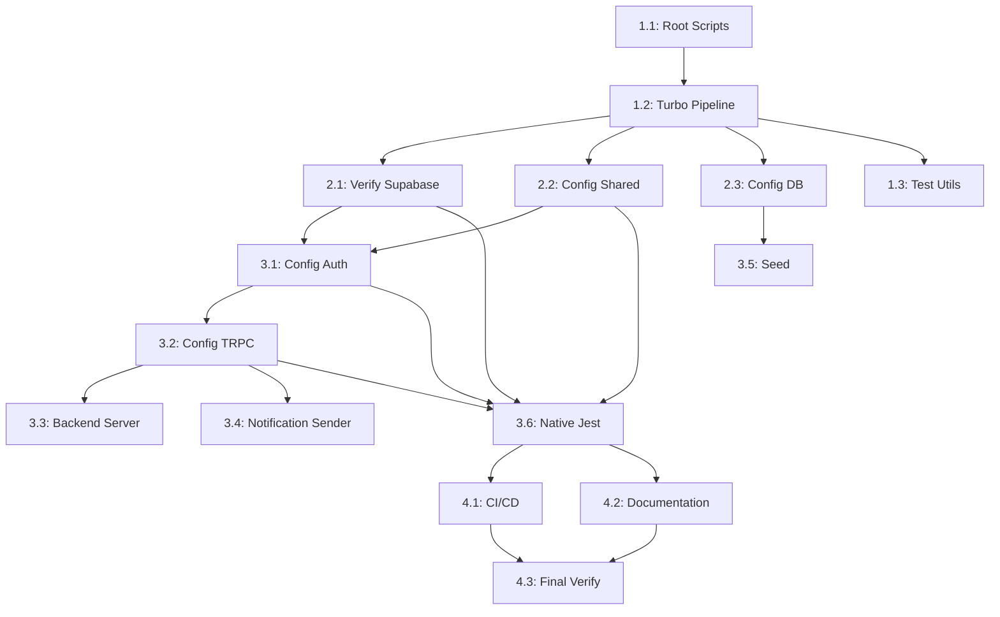

# Parallelization Analysis: Add Unit Tests to Monorepo

## Execution Waves

### Wave 1: Root Foundation
**Dependencies**: None

| Step | Task | Agent | Duration |
|------|------|-------|----------|
| 1.1 | Root Package.json Test Scripts | haiku | 5-15 min |

---

### Wave 2: Root Config + Package Foundation
**Dependencies**: Step 1.1 complete

| Step | Task | Agent | Duration | Parallel With |
|------|------|-------|----------|---------------|
| 1.2 | Turborepo Pipeline Configuration | haiku | 15-30 min | - |

---

### Wave 3: Independent Package Setup
**Dependencies**: Step 1.2 complete
**Parallelization**: All 4 steps can run concurrently

| Step | Task | Agent | Duration | Parallel With |
|------|------|-------|----------|---------------|
| 2.1 | Verify packages/supabase | haiku | 5-15 min | 2.2, 2.3, 1.3 |
| 2.2 | Configure packages/shared | sonnet | 15-30 min | 2.1, 2.3, 1.3 |
| 2.3 | Configure packages/db | haiku | 5-15 min | 2.1, 2.2, 1.3 |
| 1.3 | Shared Test Utilities (Optional) | sonnet | 15-30 min | 2.1, 2.2, 2.3 |

---

### Wave 4: Auth Package
**Dependencies**: Steps 2.1 AND 2.2 complete

| Step | Task | Agent | Duration | Parallel With |
|------|------|-------|----------|---------------|
| 3.1 | Configure packages/auth | sonnet | 30-60 min | - |

---

### Wave 5: TRPC Package
**Dependencies**: Step 3.1 complete

| Step | Task | Agent | Duration | Parallel With |
|------|------|-------|----------|---------------|
| 3.2 | Configure packages/trpc | sonnet | 30-60 min | - |

---

### Wave 6: Application Layer (3 Parallel Tracks)
**Dependencies**: Step 3.2 AND Step 2.3 complete
**Parallelization**: 3 tracks run concurrently

| Track | Step | Task | Agent | Duration | Dependencies |
|-------|------|------|-------|----------|--------------|
| A | 3.3 | Configure apps/backend-server | sonnet | 30-60 min | 3.2 |
| B | 3.4 | Configure apps/notification-sender | sonnet | 15-30 min | 3.2 |
| C | 3.5 | Configure apps/seed | sonnet | 15-30 min | 2.3 |

---

### Wave 7: Native App (Critical Path)
**Dependencies**: Steps 3.1, 3.2, 2.2, 2.1 ALL complete

| Step | Task | Agent | Duration | Parallel With |
|------|------|-------|----------|---------------|
| 3.6 | Configure apps/native (Jest) | opus | 60-120 min | - |

---

### Wave 8: CI/CD and Documentation
**Dependencies**: Step 3.6 complete
**Parallelization**: 4.1 and 4.2 run concurrently

| Step | Task | Agent | Duration | Parallel With |
|------|------|-------|----------|---------------|
| 4.1 | GitHub Actions CI/CD Integration | sonnet | 15-30 min | 4.2 |
| 4.2 | Documentation Updates | haiku | 15-30 min | 4.1 |

---

### Wave 9: Final Verification
**Dependencies**: Steps 4.1 AND 4.2 complete

| Step | Task | Agent | Duration | Parallel With |
|------|------|-------|----------|---------------|
| 4.3 | Final Verification & Integration | sonnet | 15-30 min | - |

---

## Parallelization Diagram

```
Wave 1:    [1.1]
           ↓
Wave 2:    [1.2]
           ↓
Wave 3:    [2.1]──────┬──────[2.2]──────┬──────[2.3]──────┬──────[1.3]
           (verify     │   (shared      │   (db decision  │   (optional
            supabase)  │    config)     │    & skip)     │    utils)
                       │                │                │
                       └────────────────┘                │
                                ↓                        │
Wave 4:                         [3.1]                    │
                       (auth config)                     │
                                ↓                        │
Wave 5:                         [3.2]                    │
                       (trpc config)                    │
                       ↓────────┬────────┐                │
                                │        │                │
Wave 6:                   [3.3]│   [3.4]│           [3.5]
                    (backend)│   (notify│           (seed)
                                │  sender)│
                                │        │
                       └────────┴────────┘
                                ↓
                       (wait for 3.1, 3.2,
                        2.1, 2.2)
                                ↓
Wave 7:                         [3.6]
                       (native Jest - opus)
                                ↓
Wave 8:                   [4.1]──────[4.2]
                       (CI/CD)      (docs)
                                ↓
Wave 9:                         [4.3]
                       (final verification)
```

---

## Critical Path Analysis

**Critical Path** (longest sequential chain):
```
1.1 → 1.2 → 2.2 → 3.1 → 3.2 → 3.6 → 4.1 → 4.3
```

**Critical Path Duration**: ~5.5 hours (sequential)
**Wall Clock Time with Parallelization**: ~2.5 hours

**Parallelization Savings**: ~3 hours (55% reduction)

---

## Agent Assignment Summary

| Agent Type | Steps Assigned | Total Est. Duration |
|------------|--------------|---------------------|
| **haiku** | 1.1, 1.2, 2.1, 2.3, 4.2 | ~75-135 min |
| **sonnet** | 1.3, 2.2, 3.1, 3.2, 3.3, 3.4, 3.5, 4.1, 4.3 | ~210-390 min |
| **opus** | 3.6 | ~60-120 min |

---

## Dependency Graph (Mermaid)



---

## Sub-Agent Execution Directive

### For Each Implementation Step:

1. **Pre-execution**: Verify all "Parallel with" steps are complete before starting
2. **Blockers**: Check all dependencies are satisfied
3. **Agent Selection**: Use assigned agent type (haiku/sonnet/opus)
4. **Quality Gates**: Each step must pass success criteria before marking complete
5. **Communication**: Update scratchpad with completion status

### Parallel Execution Rules:

- **Wave 3**: All 4 steps (2.1, 2.2, 2.3, 1.3) can dispatch simultaneously after 1.2
- **Wave 6**: Steps 3.3, 3.4, 3.5 dispatch together after 3.2 completes
- **Wave 8**: Steps 4.1 and 4.2 dispatch together after 3.6 completes
- **No cross-wave parallelization**: Never start a wave until ALL previous wave dependencies complete

### Synchronization Points:

1. **After Wave 2**: Wait for 1.2 before starting Wave 3
2. **After Wave 3**: Wait for BOTH 2.1 AND 2.2 before starting 3.1
3. **After Wave 5**: Wait for 3.2 AND 2.3 before starting Wave 6
4. **After Wave 7**: Wait for 3.6 before starting Wave 8
5. **After Wave 8**: Wait for BOTH 4.1 AND 4.2 before starting 4.3
