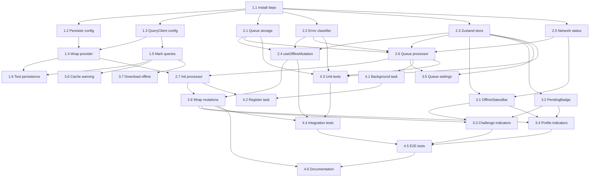

## Initial User Prompt

Implement local-first architecture using React Query Persistence + Offline Mutation Queue (Approach nr 1)

## Description

Event attendees frequently experience poor or no mobile connectivity during trips, causing the MIRAI native app to become unusable at the most critical time. Users cannot view trip data, challenge submissions fail without recovery, and profile updates are lost. This feature implements Phase 1 of a local-first architecture using React Query Persistence and an Offline Mutation Queue.

The solution provides offline read access to active trip data (trip details, groups, challenges, participants, resources) by persisting React Query cache to AsyncStorage. When users perform safe mutations while offline (profile updates, group joins, challenge submissions), the system queues these actions and automatically syncs them when connectivity returns. The UI clearly indicates offline status and pending sync states.

This is a 2-4 week implementation requiring no backend changes. It establishes the foundation for future Phase 2 enhancements (optimistic UI, background sync, delta sync).

**Scope**:
- Included:
  - React Query persistence configuration with AsyncStorage persister
  - networkMode: 'offlineFirst' for cached queries
  - Offline mutation queue storage and FIFO processing
  - Connectivity-aware queue processor with exponential backoff retry
  - UI indicators for offline status and pending/synced mutations
  - Queue management: max 100 entries, auto-discard oldest, max 3 retries
  - Selective sync for active trip data only
  - Schema versioning for queue entries
  - Error handling: validation errors, max retries, unsafe mutation blocking

- Excluded:
  - Backend API changes (delta endpoints, schema modifications)
  - Background sync via expo-task-manager
  - Optimistic UI updates with rollback
  - Full local-first for all 30+ tables
  - Real-time collaborative editing
  - Conflict resolution for concurrent edits
  - Activity feed, leaderboard, notifications offline support
  - Admin-only mutations offline (banUserUntil, deleteUser, forceEndJudgedStaffVoting)
  - Financial mutations offline (purchaseReward, addCoins)

**User Scenarios**:
1. **Primary Flow**: User views cached trip data offline, performs safe mutation that gets queued, and sees automatic sync when connectivity returns with clear UI indicators throughout.
2. **Alternative Flow**: User proactively downloads trip data before event via "Download for offline" button, ensuring full offline access even for screens not yet visited.
3. **Error Handling**: Queue reaches max size and auto-discards oldest entry; unsafe mutation attempted offline is blocked immediately with user notification; max retry exceeded shows error state requiring manual action.

---

## Architecture Overview

### Solution Strategy

This feature implements a **two-layer offline strategy**:

1. **Offline Read Layer**: Persist React Query cache to AsyncStorage using `@tanstack/react-query-persist-client`. Active trip data (trip details, groups, challenges, participants, resources) is cached with `networkMode: 'offlineFirst'`, allowing the UI to serve stale data immediately when the network is unavailable. Cache entries have a 7-day max age and are selectively persisted via query key markers (`{ persist: true }`).

2. **Offline Write Layer**: When a safe mutation fails due to a network error, it is captured as a `QueuedMutation` and stored in AsyncStorage. A connectivity-aware queue processor (powered by `@react-native-community/netinfo`) drains the queue FIFO when the device comes back online, with exponential backoff retry (1s, 2s, 4s) and a max of 3 attempts. Unsafe mutations (financial, admin, transactional) are blocked immediately when offline and never queued.

This approach requires **zero backend changes** and leverages the existing React Query + oRPC stack already in use across the native app.

### Key Architectural Decisions

| Decision | Choice | Reasoning |
|----------|--------|-----------|
| **Cache persistence backend** | AsyncStorage via `createAsyncStoragePersister` | Already used in the app for auth tokens; no new native modules. Phase 1 queue size (<100 items) and cache footprint (<1 MB estimated) fit comfortably within Android's 6 MB AsyncStorage limit. |
| **Queue storage backend** | AsyncStorage (JSON serialized) | Simpler than SQLite for Phase 1; no schema migrations or native rebuilds. If queue grows beyond 100 items or complex querying is needed, migrate to `expo-sqlite` in Phase 2. |
| **Queue ordering** | FIFO with retry count | Matches user mental model (first action, first sync). Priority queue was considered but deferred to Phase 2 to keep implementation scope within 2–4 weeks. |
| **Conflict resolution** | Last-Write-Wins (server authority) | Phase 1 explicitly does not support concurrent offline edits on the same data. Server state overwrites local on sync. User sees "pending" until confirmed. This avoids the need for CRDTs, vector clocks, or backend delta endpoints. |
| **Optimistic updates** | Immediate with React Query cache rollback | Better UX than waiting for sync. If the mutation ultimately fails (max retries exceeded or validation error), the cache is rolled back via `onError`. Risk: brief flash of incorrect data during rollback. |
| **Background sync** | NetInfo foreground listener + optional `expo-task-manager` | NetInfo provides immediate sync when the app returns to foreground. `expo-task-manager` is added for periodic background attempts, but iOS background fetch is **not guaranteed** (OS schedules based on battery/usage; ~15 min minimum in practice). Critical sync must not rely solely on background tasks. |
| **Schema versioning** | Queue buster string + app version check | Queue entries include a schema version. On app update with breaking schema changes, the queue is safely cleared and the user is notified to re-perform actions. |
| **Sensitive data exclusion** | `shouldDehydrateQuery` filter | AsyncStorage is unencrypted on both platforms. Auth tokens, passwords, and other sensitive queries are explicitly excluded from persistence. |

### Explicit Trade-offs

| Trade-off | What We Gained | What We Sacrificed |
|-----------|---------------|-------------------|
| **AsyncStorage over SQLite** | Faster implementation, no native module changes | 6 MB Android limit, unencrypted storage, no structured querying. Large relational datasets may require migration to SQLite in Phase 2. |
| **FIFO over priority queue** | Simpler code, predictable user experience | Critical actions (e.g., challenge submissions) may wait behind low-priority actions (e.g., profile updates). |
| **Last-Write-Wins over CRDTs** | No backend changes, 2–4 week timeline | Concurrent offline edits on the same resource result in data loss for one user. No real-time collaborative editing support. |
| **Immediate optimistic updates** | Responsive UI | Rollback may flash stale data briefly. Permanent failure requires user-facing error state. |
| **Selective sync (active trip only)** | Bounded cache size, faster hydration | Old trip data is not available offline. Users must re-fetch historical trips when online. |
| **No background sync guarantee** | Immediate foreground sync works reliably | iOS may delay background sync for hours. Users who kill the app before foreground sync may lose queued mutations until next open. |

### Reference Integration

Insights from the research skill and codebase analysis directly shaped the architecture:

- **From `.claude/skills/react-query-persistence/SKILL.md`**: The AsyncStorage persister configuration (`throttleTime: 1000`, `maxAge: 7 days`, `buster: app version`) and the `shouldDehydrateQuery` pattern for selective persistence are adopted verbatim. The skill's warning about iOS background fetch unreliability led to the decision that critical sync must happen on foreground NetInfo changes, not background tasks alone.

- **From `.specs/analysis/analysis-react-query-persistence.md`**: The analysis identified 8 mutations that **cannot** be offline (`banUserUntil`, `deleteUser`, `forceEndJudgedStaffVoting`, `purchaseReward`, `addCoins`, `submitVotes`, `respondToJoinRequest`, `updateWristNumber`) due to external API calls, atomic read-modify-write operations, or cascading transactions. These are blocked immediately when offline. The analysis also identified 10 mutations that **can** be queued (`updateMyProfile`, `updateAvatar`, `challengeSubmission.create`, `group.create`, etc.), with explicit risk levels and mitigations (e.g., handling "already submitted" for challenge submissions, server-side code allocation for groups in a future phase).

- **From `.specs/plans/conflict-scenarios-comprehensive.analysis.md`**: The conflict analysis revealed root cause patterns (read-modify-write without versioning, unique constraints on generated values, immutable-after-write rules, state machine transitions). These patterns informed the mutation classification and the decision to use Last-Write-Wins for Phase 1, avoiding the need for complex conflict resolution UI or backend schema changes.

- **From `.specs/plans/local-first-offline-lite.design.md`**: The design doc's component diagram (UI Layer → React Query Layer → Persistence Layer → Sync Layer) is the structural blueprint. The data classification table (offline-read, offline-write, server-only) defines which queries get `persist: true` and which mutations are wrapped.

### Expected File Changes

#### New Files (~445 lines)

| File | Purpose |
|------|---------|
| `packages/orpc/src/client/persister.ts` | AsyncStorage persister configuration (`createAsyncStoragePersister`, `throttleTime`, `maxAge`) |
| `apps/native/src/services/offline/storage.ts` | Queue AsyncStorage CRUD: `getQueue`, `addToQueue`, `updateMutation`, `removeFromQueue` with `MAX_QUEUE_SIZE = 100` |
| `apps/native/src/services/offline/queueProcessor.ts` | FIFO queue processor with exponential backoff retry, `isProcessing` flag, and NetInfo integration |
| `apps/native/src/services/offline/errorClassifier.ts` | Classify mutation errors into `NETWORK_ERROR`, `VALIDATION_ERROR`, `CONFLICT_ERROR`, `SERVER_ERROR` |
| `apps/native/src/stores/offlineQueueStore.ts` | Zustand store for queue state (pending count, failed mutations, sync status) |
| `apps/native/src/hooks/offline/useOfflineMutation.ts` | Wrapper around `useMutation` that queues on network error, supports optimistic update and rollback |
| `apps/native/src/hooks/offline/useOfflineQueue.ts` | Hook exposing queue status to UI components |
| `apps/native/src/hooks/offline/useNetworkStatus.ts` | NetInfo wrapper hook providing `isConnected`, `isInternetReachable` |
| `apps/native/src/components/offline/OfflineStatusBar.tsx` | Global offline status indicator bar |
| `apps/native/src/components/offline/PendingBadge.tsx` | Pending / synced / failed badge for mutation UI |
| `apps/native/src/services/background/offlineSyncTask.ts` | `expo-task-manager` background sync task definition |

#### Modified Files (~113 lines)

| File | Change Type | Risk |
|------|-------------|------|
| `packages/orpc/src/client/query-client-factory.ts` | Add `networkMode: 'offlineFirst'`, `gcTime: 24h`, `staleTime: 5min`, retry logic | Low |
| `packages/orpc/src/client/query-client.tsx` | Wrap app with `PersistQueryClientProvider` and `dehydrateOptions` | Low |
| `apps/native/src/app/_layout.tsx` | Initialize queue processor on app mount | Low |
| `apps/native/package.json` | Add `@tanstack/react-query-persist-client`, `@tanstack/query-async-storage-persister`, `@react-native-community/netinfo` | Low |
| `packages/orpc/package.json` | Add `@tanstack/react-query-persist-client` | Low |
| `apps/native/src/hooks/challenges/useChallengeCapture.ts` | Wrap `challengeSubmission.create` with `useOfflineMutation` | Medium |
| `apps/native/src/hooks/groups/useCreateGroup.ts` | Wrap `group.create` with `useOfflineMutation` | Medium |
| `apps/native/src/hooks/groups/useGroupEditor.ts` | Wrap `group.update`, `group.join`, `group.leave` with `useOfflineMutation` | Medium |
| `apps/native/src/hooks/trips/useTripDetails.ts` | Add `{ persist: true }` to query key | Low |
| `apps/native/src/hooks/trips/useTrips.ts` | Add `{ persist: true }` to active trip query key | Low |
| `apps/native/src/hooks/groups/useGroups.ts` | Add `{ persist: true }` to query key | Low |
| `apps/native/src/hooks/challenges/useChallenges.ts` | Add `{ persist: true }` to query key | Low |

---

## Parallelization Diagram

---

## Implementation Process

### Phase 1: Foundation — Persistence Layer (Week 1)

**Goal**: Enable offline read for active trip data via React Query persistence.

**Step 1.1**: Install dependencies
- **Agent**: `sonnet`
- **Depends on**: none (root step)
- Add `@tanstack/react-query-persist-client`, `@tanstack/query-async-storage-persister`, `@react-native-community/netinfo` to `apps/native/package.json`
- Add `@tanstack/react-query-persist-client` to `packages/orpc/package.json`
- Run `bun install`
- **Output**: Updated lockfile, node_modules
- **Success Criteria**: `bun install` completes without peer dependency conflicts
- **Risk**: Low

**Step 1.2**: Create AsyncStorage persister
- **Agent**: `sonnet`
- **Depends on**: Step 1.1
- Create `packages/orpc/src/client/persister.ts`
- Configure `createAsyncStoragePersister` with `throttleTime: 1000`, `maxAge: 7 * 24 * 60 * 60 * 1000`, `buster: app version`
- Implement `shouldDehydrateQuery` to exclude auth tokens, passwords, and queries without `{ persist: true }` in key
- **Output**: `persister.ts` file
- **Success Criteria**: Persister exports valid `AsyncStoragePersister` instance
- **Risk**: Low

**Step 1.3**: Configure QueryClient for offline-first
- **Agent**: `sonnet`
- **Depends on**: Step 1.1
- **Parallel with**: Step 1.2
- Modify `packages/orpc/src/client/query-client-factory.ts`
- Set `networkMode: 'offlineFirst'`, `gcTime: 24 * 60 * 60 * 1000`, `staleTime: 5 * 60 * 1000`
- Add retry logic: `retry: (failureCount, error) => failureCount < 3 && isNetworkError(error)`
- **Output**: Updated query client factory
- **Success Criteria**: QueryClient created with offline-first settings; existing queries still work
- **Risk**: Low

**Step 1.4**: Wrap app with PersistQueryClientProvider
- **Agent**: `sonnet`
- **Depends on**: Step 1.2, Step 1.3
- Modify `packages/orpc/src/client/query-client.tsx`
- Replace `QueryClientProvider` with `PersistQueryClientProvider`
- Pass `dehydrateOptions` with `shouldDehydrateQuery` filter
- **Output**: Updated provider component
- **Success Criteria**: App mounts without hydration errors; cache persists across restarts
- **Risk**: Low

**Step 1.5**: Mark active trip queries for persistence
- **Agent**: `haiku`
- **Depends on**: Step 1.3
- **Parallel with**: Step 1.4
- Add `{ persist: true }` to query keys in:
  - `apps/native/src/hooks/trips/useTripDetails.ts`
  - `apps/native/src/hooks/trips/useTrips.ts`
  - `apps/native/src/hooks/groups/useGroups.ts`
  - `apps/native/src/hooks/challenges/useChallenges.ts`
- **Output**: Updated hook files
- **Success Criteria**: Active trip queries include `persist: true` in key; cache is dehydrated on app background
- **Risk**: Low

**Step 1.6**: Test persistence across restarts
- **Agent**: `haiku`
- **Depends on**: Step 1.4, Step 1.5
- Manual test: load trip data online, kill app, restart offline, verify data visible
- **Output**: Test notes in scratchpad
- **Success Criteria**: Trip details, groups, challenges visible after offline restart
- **Risk**: Low

---

### Phase 2: Mutation Queue — Offline Write Layer (Week 2)

**Goal**: Queue safe mutations when offline and process them on reconnect.

**Step 2.1**: Create queue storage CRUD
- **Agent**: `sonnet`
- **Depends on**: Step 1.1
- **Parallel with**: Step 2.2, Step 2.3, Step 2.5
- Create `apps/native/src/services/offline/storage.ts`
- Implement `getQueue`, `addToQueue`, `updateMutation`, `removeFromQueue`
- Enforce `MAX_QUEUE_SIZE = 100` with FIFO discard of oldest
- Include schema version in each entry
- **Output**: `storage.ts` file
- **Success Criteria**: Queue CRUD operations work via AsyncStorage; max size enforced
- **Risk**: Low

**Step 2.2**: Create error classifier
- **Agent**: `sonnet`
- **Depends on**: Step 1.1
- **Parallel with**: Step 2.1, Step 2.3, Step 2.5
- Create `apps/native/src/services/offline/errorClassifier.ts`
- Classify errors: `NETWORK_ERROR`, `VALIDATION_ERROR`, `CONFLICT_ERROR`, `SERVER_ERROR`
- Network errors trigger queuing; validation errors reject immediately; server errors retry
- **Output**: `errorClassifier.ts` file
- **Success Criteria**: All oRPC/network error types map correctly to classification
- **Risk**: Low

**Step 2.3**: Create Zustand queue store
- **Agent**: `sonnet`
- **Depends on**: Step 1.1
- **Parallel with**: Step 2.1, Step 2.2, Step 2.5
- Create `apps/native/src/stores/offlineQueueStore.ts`
- Track: `pendingCount`, `failedMutations`, `syncStatus`, `isProcessing`
- Actions: `incrementPending`, `markFailed`, `markSynced`, `setProcessing`
- **Output**: `offlineQueueStore.ts` file
- **Success Criteria**: Store updates trigger UI re-renders; state persists in memory only (not AsyncStorage)
- **Risk**: Low

**Step 2.4**: Create useOfflineMutation hook
- **Agent**: `opus`
- **Depends on**: Step 2.1, Step 2.2, Step 2.3
- Create `apps/native/src/hooks/offline/useOfflineMutation.ts`
- Wrap `useMutation` from oRPC client
- On network error: serialize mutation, add to queue, show pending UI
- On success: invalidate relevant queries
- On validation error: do not queue, show error immediately
- Support optimistic updates with cache rollback via `onError`
- **Output**: `useOfflineMutation.ts` file
- **Success Criteria**: Offline mutation queues on network error; online mutation executes normally
- **Risk**: Medium

**Step 2.5**: Create useNetworkStatus hook
- **Agent**: `haiku`
- **Depends on**: Step 1.1
- **Parallel with**: Step 2.1, Step 2.2, Step 2.3
- Create `apps/native/src/hooks/offline/useNetworkStatus.ts`
- Wrap `@react-native-community/netinfo`
- Expose: `isConnected`, `isInternetReachable`, `connectionType`
- **Output**: `useNetworkStatus.ts` file
- **Success Criteria**: Hook reflects actual connectivity within 1 second of change
- **Risk**: Low

**Step 2.6**: Create queue processor
- **Agent**: `opus`
- **Depends on**: Step 2.1, Step 2.2, Step 2.3, Step 2.5
- Create `apps/native/src/services/offline/queueProcessor.ts`
- FIFO processing with `isProcessing` flag
- Exponential backoff: 1s, 2s, 4s between retries
- Max 3 retries per mutation
- On validation error: remove from queue, notify user
- On max retries exceeded: mark as failed, keep in queue for manual retry
- Integrate with NetInfo to trigger processing when online
- **Output**: `queueProcessor.ts` file
- **Success Criteria**: Queue drains FIFO when online; retries up to 3 times with backoff
- **Risk**: Medium

**Step 2.7**: Initialize queue processor on app mount
- **Agent**: `sonnet`
- **Depends on**: Step 2.6, Step 1.4
- Modify `apps/native/src/app/_layout.tsx`
- Import and initialize queue processor in `useEffect` on mount
- Reset any "retrying" mutations to "pending" on startup (handles app kill mid-processing)
- **Output**: Updated `_layout.tsx`
- **Success Criteria**: Queue processor starts on app launch; handles app kill gracefully
- **Risk**: Low

**Step 2.8**: Wrap safe mutations with useOfflineMutation
- **Agent**: `sonnet`
- **Depends on**: Step 2.4, Step 2.7
- Modify `apps/native/src/hooks/challenges/useChallengeCapture.ts` — wrap `challengeSubmission.create`
- Modify `apps/native/src/hooks/groups/useCreateGroup.ts` — wrap `group.create`
- Modify `apps/native/src/hooks/groups/useGroupEditor.ts` — wrap `group.update`, `group.join`, `group.leave`
- Block unsafe mutations (purchaseReward, addCoins, etc.) immediately when offline
- **Output**: Updated hook files
- **Success Criteria**: Safe mutations queue offline; unsafe mutations blocked with user notification
- **Risk**: Medium

---

### Phase 3: UI & Polish (Week 3)

**Goal**: Provide clear offline status and pending/synced indicators.

**Step 3.1**: Create OfflineStatusBar component
- **Agent**: `haiku`
- **Depends on**: Step 2.3, Step 2.5
- **Parallel with**: Step 3.2, Step 3.5, Step 3.6, Step 3.7
- Create `apps/native/src/components/offline/OfflineStatusBar.tsx`
- Global bar showing "Offline" / "Syncing..." / "Back online"
- Animate visibility on state change
- **Output**: `OfflineStatusBar.tsx` file
- **Success Criteria**: Bar visible within 1 second of connectivity change
- **Risk**: Low

**Step 3.2**: Create PendingBadge component
- **Agent**: `haiku`
- **Depends on**: Step 2.3
- **Parallel with**: Step 3.1, Step 3.5, Step 3.6, Step 3.7
- Create `apps/native/src/components/offline/PendingBadge.tsx`
- States: `pending` (yellow dot), `synced` (green check), `failed` (red X)
- Used on mutation-triggering buttons and cards
- **Output**: `PendingBadge.tsx` file
- **Success Criteria**: Badge renders all three states correctly
- **Risk**: Low

**Step 3.3**: Add pending indicators to challenge submission
- **Agent**: `sonnet`
- **Depends on**: Step 3.2, Step 2.8
- **Parallel with**: Step 3.4, Step 3.5, Step 3.6, Step 3.7
- Modify challenge submission screen
- Show `PendingBadge` next to submit button
- Show "Queued — will sync when online" message when offline
- **Output**: Updated screen component
- **Success Criteria**: User sees pending state for offline challenge submission
- **Risk**: Low

**Step 3.4**: Add pending indicators to profile update
- **Agent**: `sonnet`
- **Depends on**: Step 3.2, Step 2.8
- **Parallel with**: Step 3.3, Step 3.5, Step 3.6, Step 3.7
- Modify profile edit screen
- Show `PendingBadge` on save button
- Optimistic update: show updated profile immediately, rollback on permanent failure
- **Output**: Updated screen component
- **Success Criteria**: Profile updates immediately; rolls back on sync failure
- **Risk**: Medium

**Step 3.5**: Add queue status to settings
- **Agent**: `sonnet`
- **Depends on**: Step 2.3, Step 2.6
- **Parallel with**: Step 3.1, Step 3.2, Step 3.3, Step 3.4, Step 3.6, Step 3.7
- Create "Sync Issues" section in settings screen
- Show pending count, failed mutations with retry/clear buttons
- **Output**: Updated settings screen
- **Success Criteria**: User can view and manage queue from settings
- **Risk**: Low

**Step 3.6**: Implement cache age warning
- **Agent**: `haiku`
- **Depends on**: Step 1.5
- **Parallel with**: Step 3.1, Step 3.2, Step 3.3, Step 3.4, Step 3.5, Step 3.7
- Add "Data may be outdated" banner if cached data >7 days old
- Show only when offline or on stale cache hit
- **Output**: Updated trip/groups/challenges screens
- **Success Criteria**: Banner appears for stale cache; hidden after fresh fetch
- **Risk**: Low

**Step 3.7**: Add "Download for offline" button
- **Agent**: `sonnet`
- **Depends on**: Step 1.5
- **Parallel with**: Step 3.1, Step 3.2, Step 3.3, Step 3.4, Step 3.5, Step 3.6
- Add button to trip preparation / trip detail screen
- Pre-fetches all active trip data (details, groups, challenges, participants, resources)
- Stores in RQ cache with `persist: true`
- **Output**: Updated trip screen
- **Success Criteria**: All active trip data cached after button press; available offline
- **Risk**: Low

---

### Phase 4: Background Sync & Testing (Week 4)

**Goal**: Add background sync capability and comprehensive tests.

**Step 4.1**: Create background sync task
- **Agent**: `sonnet`
- **Depends on**: Step 2.6
- **Parallel with**: Step 4.3
- Create `apps/native/src/services/background/offlineSyncTask.ts`
- Define `expo-task-manager` task for queue processing
- Register with 1 hour minimum interval
- **Output**: `offlineSyncTask.ts` file
- **Success Criteria**: Task registered without crash; executes when OS allows
- **Risk**: Low

**Step 4.2**: Register background sync on app init
- **Agent**: `haiku`
- **Depends on**: Step 4.1, Step 2.7
- Modify `apps/native/src/app/_layout.tsx`
- Register background task on mount (if not already registered)
- **Output**: Updated `_layout.tsx`
- **Success Criteria**: Background task registered; no duplicate registrations
- **Risk**: Low

**Step 4.3**: Write unit tests for queue logic
- **Agent**: `sonnet`
- **Depends on**: Step 2.1, Step 2.2, Step 2.3, Step 2.6
- **Parallel with**: Step 4.1
- `apps/native/src/stores/offlineQueueStore.test.ts` — store state transitions
- `apps/native/src/services/offline/queueProcessor.test.ts` — FIFO, backoff, retry, max retries
- `apps/native/src/services/offline/errorClassifier.test.ts` — error type mapping
- `apps/native/src/services/offline/storage.test.ts` — CRUD, max size, schema version
- **Output**: Test files
- **Success Criteria**: All unit tests pass with >80% coverage for queue logic
- **Risk**: Low

**Step 4.4**: Write integration tests for offline-to-online
- **Agent**: `opus`
- **Depends on**: Step 2.4, Step 2.5, Step 2.6, Step 2.7, Step 2.8, Step 4.3
- Test: go offline, queue mutation, restore connectivity, verify sync
- Test: queue overflow (101 mutations -> oldest discarded)
- Test: validation error during sync -> removed from queue
- **Output**: Integration test files
- **Success Criteria**: Tests pass in CI with mocked NetInfo and AsyncStorage
- **Risk**: Medium

**Step 4.5**: Write E2E tests for complete offline flow
- **Agent**: `opus`
- **Depends on**: Step 3.3, Step 3.4, Step 3.5, Step 3.7, Step 4.4
- E2E: view trip offline -> submit challenge offline -> come online -> verify sync
- E2E: profile update offline -> online -> verify
- E2E: queue overflow -> verify oldest discarded
- **Output**: E2E test files
- **Success Criteria**: E2E tests pass on iOS and Android simulators
- **Risk**: High (E2E flakiness)

**Step 4.6**: Update documentation
- **Agent**: `haiku`
- **Depends on**: all previous steps
- Add offline behavior section to `docs/apps/native.md`
- Document mutation queue usage for developers
- Document which mutations are safe/unsafe offline
- **Output**: Updated docs
- **Success Criteria**: Docs accurately describe offline behavior and queue API
- **Risk**: Low

---

## Sub-Agent Execution Directive

**MUST** dispatch parallel steps simultaneously using the dependency graph above.

**MUST** wait for all dependencies of a step to complete before dispatching that step.

**MUST** use `opus` for complex architectural/hook work (Steps 2.4, 2.6, 4.4, 4.5), `sonnet` for standard implementation (Steps 1.1-1.4, 2.1-2.3, 2.7-2.8, 3.3-3.5, 3.7, 4.1, 4.3), and `haiku` for trivial/components/tests (Steps 1.5-1.6, 2.5, 3.1-3.2, 3.6, 4.2, 4.6).

**MUST** verify each step's success criteria before marking complete.

**MUST** halt execution and escalate if any medium- or high-risk step fails success criteria.

**MUST** run integration tests (Step 4.4) only after all implementation steps in Phases 1-3 are complete.

**MUST** run E2E tests (Step 4.5) only after integration tests pass.

---

## Acceptance Criteria

### Functional Requirements

- [ ] **Offline read for active trip data**: Given user previously loaded active trip while online, when they go offline and navigate to trip screen, then trip details, groups, and challenges display from cache without error.

- [ ] **React Query persistence across restarts**: Given app configured with persistQueryClient and AsyncStorage persister, when user restarts app while offline, then previously cached active trip data remains available.

- [ ] **Offline-first network mode**: Given QueryClient uses networkMode: 'offlineFirst', when user is offline and queries active trip data, then cache is served immediately without network timeout.

- [ ] **Safe mutation queuing**: Given user performs allowed mutation (profile update, simple submission) while offline, when mutation fails with network error, then mutation is stored in queue with pending status and UI shows pending indicator.

- [ ] **Queue processing on reconnect**: Given user has pending mutations in queue, when connectivity is restored, then queue processes FIFO, mutations execute in order, and UI updates to synced state.

- [ ] **Queue size limit**: Given queue has 100 entries, when user performs another offline mutation, then oldest entry is discarded, new entry is added, and user is notified if discarded entry was critical.

- [ ] **Retry with exponential backoff**: Given queued mutation fails with server error, when retry is triggered, then retry occurs after exponential backoff (1s, 2s, 4s) with maximum 3 attempts.

- [ ] **Validation error handling**: Given queued mutation has invalid data on sync, when queue processor attempts mutation, then mutation is removed from queue and user sees specific error message.

- [ ] **Unsafe mutation blocking**: Given user attempts prohibited offline mutation (purchaseReward, addCoins, banUserUntil), when action is triggered while offline, then action is blocked immediately, not queued, and user is informed it requires online connection.

- [ ] **Cache age limit**: Given cached data is older than 7 days, when user attempts to access offline, then cache is considered stale and shows "data may be outdated" or fetches if online.

- [ ] **Schema version handling**: Given app updates with breaking schema change, when queue has entries from previous version, then queue is cleared safely and user is notified to re-perform actions.

- [ ] **Offline status indicator**: Given connectivity state changes, when user is viewing any screen, then offline indicator is visible within 1 second of state change.

- [ ] **Selective sync for active trip**: Given user has multiple trips in history, when app syncs data, then only currently active trip data is persisted and old trip data is not cached.

- [ ] **No sensitive data persistence**: Given query cache is being persisted, when cache contains user data, then auth tokens, passwords, or other sensitive credentials are excluded from persistence.

### Non-Functional Requirements

- [ ] **Performance**: Cache read from AsyncStorage completes in under 100ms for typical queries; queue processing from online to empty completes in under 5 seconds median time.
- [ ] **Reliability**: 99% of queued offline mutations eventually sync successfully.
- [ ] **Usability**: Offline status indicator is visible within 1 second of connectivity state change; pending and synced states are clearly distinguishable in the UI.
- [ ] **Compatibility**: Implementation works with React Query v5, Expo SDK 50+, and existing oRPC client without backend changes.

### Definition of Done

- [ ] All acceptance criteria pass testing
- [ ] Unit tests written for queue CRUD, persistence config, and error handling logic
- [ ] Integration tests written for offline-to-online transition and queue processing
- [ ] E2E test written for complete offline flow (view trip -> submit challenge -> come online -> verify sync)
- [ ] Documentation updated to describe offline behavior and mutation queue usage
- [ ] Code reviewed and approved

---

## Scratchpad

Implementation scratchpad with decisions, file inventory, mutation classification, checklist, and risks:  
`.specs/scratchpad/react-query-persistence-scratchpad.md`

---

## Verification

### Verification Summary

| Step | Level | Threshold | Agent |
|------|-------|-----------|-------|
| 1.1 Install deps | Per-Item | 4.0/5.0 | sonnet |
| 1.2 Create persister | Single | 4.0/5.0 | sonnet |
| 1.3 Configure QueryClient | Single | 4.0/5.0 | sonnet |
| 1.4 Wrap provider | Single | 4.0/5.0 | sonnet |
| 1.5 Mark queries | Per-Item | 4.0/5.0 | haiku |
| 1.6 Test persistence | None | N/A | haiku |
| 2.1 Queue storage | Single | 4.0/5.0 | sonnet |
| 2.2 Error classifier | Single | 4.0/5.0 | sonnet |
| 2.3 Zustand store | Single | 4.0/5.0 | sonnet |
| 2.4 useOfflineMutation | Panel | 4.0/5.0 | opus |
| 2.5 Network status | Per-Item | 4.0/5.0 | haiku |
| 2.6 Queue processor | Panel | 4.0/5.0 | opus |
| 2.7 Init processor | Single | 4.0/5.0 | sonnet |
| 2.8 Wrap mutations | Panel | 4.0/5.0 | sonnet |
| 3.1 OfflineStatusBar | Per-Item | 4.0/5.0 | haiku |
| 3.2 PendingBadge | Per-Item | 4.0/5.0 | haiku |
| 3.3 Challenge indicators | Single | 4.0/5.0 | sonnet |
| 3.4 Profile indicators | Single | 4.0/5.0 | sonnet |
| 3.5 Queue settings | Single | 4.0/5.0 | sonnet |
| 3.6 Cache warning | Per-Item | 4.0/5.0 | haiku |
| 3.7 Download offline | Single | 4.0/5.0 | sonnet |
| 4.1 Background task | Single | 4.0/5.0 | sonnet |
| 4.2 Register task | Per-Item | 4.0/5.0 | haiku |
| 4.3 Unit tests | Panel | 4.0/5.0 | sonnet |
| 4.4 Integration tests | Panel | 4.0/5.0 | opus |
| 4.5 E2E tests | Panel | 4.0/5.0 | opus |
| 4.6 Documentation | Single | 4.0/5.0 | haiku |

---

### Step 1.1: Install Dependencies — Verification

**Level**: Per-Item
**Threshold**: 4.0/5.0

#### Rubric

1. Dependency Completeness (weight: 0.40)
   - All required packages added to correct package.json files?
   - Peer dependency conflicts resolved?
   - 1=Missing packages, 3=Adequate, 5=All present, no conflicts

2. Lockfile Integrity (weight: 0.30)
   - bun.lock updated correctly?
   - No duplicate or conflicting entries?
   - 1=Corrupt lockfile, 3=Acceptable, 5=Clean lockfile

3. Build Compatibility (weight: 0.30)
   - `bun install` completes successfully?
   - Existing builds still pass?
   - 1=Install fails, 3=Installs but warnings, 5=Clean install, builds pass

---

### Step 1.2: Create AsyncStorage Persister — Verification

**Level**: Single
**Threshold**: 4.0/5.0

#### Rubric

1. Configuration Accuracy (weight: 0.35)
   - `throttleTime`, `maxAge`, `buster` set correctly?
   - `shouldDehydrateQuery` excludes auth/sensitive queries?
   - 1=Missing config, 3=Basic config, 5=Complete with filters

2. Selective Persistence (weight: 0.35)
   - Only queries with `{ persist: true }` dehydrated?
   - Auth tokens, passwords explicitly excluded?
   - 1=No filtering, 3=Partial filter, 5=Precise selective sync

3. Export Quality (weight: 0.30)
   - Valid `AsyncStoragePersister` instance exported?
   - Type-safe, no `any` casts?
   - 1=Broken export, 3=Works but untyped, 5=Fully typed, clean

---

### Step 1.3: Configure QueryClient — Verification

**Level**: Single
**Threshold**: 4.0/5.0

#### Rubric

1. Offline-First Settings (weight: 0.40)
   - `networkMode: 'offlineFirst'` set globally?
   - `gcTime: 24h`, `staleTime: 5min` configured?
   - 1=Missing settings, 3=Partial, 5=All correct

2. Retry Logic (weight: 0.35)
   - Retry function checks `failureCount < 3`?
   - `isNetworkError` correctly identifies network failures?
   - 1=No retry logic, 3=Basic retry, 5=Smart retry with error classification

3. Backward Compatibility (weight: 0.25)
   - Existing queries unaffected by new defaults?
   - No breaking changes to query client factory API?
   - 1=Breaking changes, 3=Minor adjustments needed, 5=Fully backward compatible

---

### Step 1.4: Wrap Provider — Verification

**Level**: Single
**Threshold**: 4.0/5.0

#### Rubric

1. Provider Integration (weight: 0.40)
   - `PersistQueryClientProvider` replaces `QueryClientProvider`?
   - `dehydrateOptions` passed with `shouldDehydrateQuery`?
   - 1=Not wrapped, 3=Wrapped but missing options, 5=Complete integration

2. Hydration Safety (weight: 0.35)
   - App mounts without hydration errors?
   - Graceful handling of corrupted cache?
   - 1=Hydration crashes, 3=Basic error handling, 5=Robust recovery

3. Cache Persistence (weight: 0.25)
   - Cache survives app restart?
   - Selective sync respected across restarts?
   - 1=Cache lost, 3=Partial persistence, 5=Full selective persistence

---

### Step 1.5: Mark Queries for Persistence — Verification

**Level**: Per-Item
**Threshold**: 4.0/5.0

#### Rubric (per file)

1. Query Key Marker (weight: 0.50)
   - `{ persist: true }` added to query key?
   - Marker position consistent across all files?
   - 1=Missing marker, 3=Some files marked, 5=All active trip queries marked

2. Scope Accuracy (weight: 0.30)
   - Only active trip queries marked (not historical)?
   - No over-persistence of transient data?
   - 1=Over-persistent, 3=Mostly correct, 5=Precise scope

3. Key Stability (weight: 0.20)
   - Query keys remain stable for cache hits?
   - No dynamic values that break cache lookup?
   - 1=Unstable keys, 3=Mostly stable, 5=Fully stable

---

### Step 2.1: Queue Storage CRUD — Verification

**Level**: Single
**Threshold**: 4.0/5.0

#### Rubric

1. CRUD Completeness (weight: 0.35)
   - `getQueue`, `addToQueue`, `updateMutation`, `removeFromQueue` implemented?
   - All operations handle AsyncStorage errors?
   - 1=Missing operations, 3=Basic CRUD, 5=Complete with error handling

2. Queue Limits (weight: 0.35)
   - `MAX_QUEUE_SIZE = 100` enforced?
   - FIFO discard of oldest on overflow?
   - 1=No limits, 3=Limit exists but edge cases, 5=Strict enforcement

3. Schema Versioning (weight: 0.30)
   - Schema version included in each entry?
   - Version mismatch handled (clear queue, notify user)?
   - 1=No versioning, 3=Version stored, 5=Full version lifecycle

---

### Step 2.2: Error Classifier — Verification

**Level**: Single
**Threshold**: 4.0/5.0

#### Rubric

1. Classification Coverage (weight: 0.40)
   - All 4 error types classified: `NETWORK_ERROR`, `VALIDATION_ERROR`, `CONFLICT_ERROR`, `SERVER_ERROR`?
   - oRPC-specific error shapes handled?
   - 1=Missing types, 3=Basic coverage, 5=Complete oRPC coverage

2. Trigger Accuracy (weight: 0.35)
   - Network errors trigger queuing?
   - Validation errors reject immediately?
   - Server errors trigger retry?
   - 1=Wrong triggers, 3=Mostly correct, 5=Precise triggers

3. Edge Cases (weight: 0.25)
   - Timeout errors classified as network?
   - GraphQL-style errors handled?
   - 1=No edge handling, 3=Some edges, 5=Comprehensive

---

### Step 2.3: Zustand Queue Store — Verification

**Level**: Single
**Threshold**: 4.0/5.0

#### Rubric

1. State Shape (weight: 0.35)
   - `pendingCount`, `failedMutations`, `syncStatus`, `isProcessing` tracked?
   - State updates immutable?
   - 1=Missing fields, 3=Basic shape, 5=Complete, immutable

2. Action Completeness (weight: 0.35)
   - `incrementPending`, `markFailed`, `markSynced`, `setProcessing` implemented?
   - Actions update derived state correctly?
   - 1=Missing actions, 3=Basic actions, 5=Complete with derived updates

3. UI Reactivity (weight: 0.30)
   - Store updates trigger re-renders in components?
   - No excessive re-renders?
   - 1=No reactivity, 3=Works but inefficient, 5=Efficient reactivity

---

### Step 2.4: useOfflineMutation Hook — Verification

**Level**: Panel
**Threshold**: 4.0/5.0

#### Rubric

1. Network Error Handling (weight: 0.30)
   - Mutation serializes and queues on network error?
   - Pending UI shown immediately?
   - 1=No queuing, 3=Basic queuing, 5=Robust with rollback

2. Validation Error Handling (weight: 0.25)
   - Validation errors do NOT queue?
   - Error shown immediately to user?
   - 1=Queues validation errors, 3=Rejects but unclear, 5=Clear immediate rejection

3. Optimistic Updates (weight: 0.25)
   - Cache updated optimistically on mutation start?
   - `onError` rolls back cache on failure?
   - 1=No optimism, 3=Optimism without rollback, 5=Full optimism + rollback

4. Online Mutation Passthrough (weight: 0.20)
   - Online mutations execute normally without queue?
   - No regression in online mutation behavior?
   - 1=Breaks online, 3=Works but different, 5=Transparent passthrough

---

### Step 2.5: useNetworkStatus Hook — Verification

**Level**: Per-Item
**Threshold**: 4.0/5.0

#### Rubric

1. NetInfo Integration (weight: 0.40)
   - `@react-native-community/netinfo` wrapped correctly?
   - Event listeners added and cleaned up?
   - 1=Not integrated, 3=Basic wrap, 5=Complete with cleanup

2. State Accuracy (weight: 0.35)
   - `isConnected`, `isInternetReachable`, `connectionType` exposed?
   - Values reflect actual connectivity within 1 second?
   - 1=Stale values, 3=Mostly accurate, 5=Real-time accuracy

3. Hook API (weight: 0.25)
   - Returns stable references (no unnecessary re-renders)?
   - Type-safe, documented interface?
   - 1=Unstable API, 3=Works, 5=Stable, typed, documented

---

### Step 2.6: Queue Processor — Verification

**Level**: Panel
**Threshold**: 4.0/5.0

#### Rubric

1. FIFO Processing (weight: 0.25)
   - Queue drains in FIFO order?
   - `isProcessing` flag prevents concurrent runs?
   - 1=No FIFO, 3=Mostly FIFO, 5=Strict FIFO with concurrency guard

2. Exponential Backoff (weight: 0.25)
   - Retry delays: 1s, 2s, 4s?
   - Max 3 retries enforced?
   - 1=No backoff, 3=Fixed retry, 5=Exponential with max limit

3. Error Handling (weight: 0.25)
   - Validation error: remove from queue, notify user?
   - Max retries exceeded: mark failed, keep for manual retry?
   - 1=No error handling, 3=Basic handling, 5=Complete lifecycle

4. NetInfo Integration (weight: 0.25)
   - Processing triggered on online event?
   - No processing while offline?
   - 1=No integration, 3=Basic trigger, 5=Smart online detection

---

### Step 2.7: Init Processor on Mount — Verification

**Level**: Single
**Threshold**: 4.0/5.0

#### Rubric

1. Initialization Timing (weight: 0.40)
   - Queue processor initialized in `useEffect` on mount?
   - No duplicate initializations?
   - 1=Not initialized, 3=Initialized but duplicates, 5=Single, correct timing

2. App Kill Recovery (weight: 0.35)
   - "Retrying" mutations reset to "pending" on startup?
   - No stuck "retrying" states?
   - 1=No recovery, 3=Partial reset, 5=Complete recovery

3. Layout Integration (weight: 0.25)
   - `_layout.tsx` modified without breaking app structure?
   - Processor init does not block render?
   - 1=Breaks layout, 3=Works but blocking, 5=Non-blocking, clean

---

### Step 2.8: Wrap Safe Mutations — Verification

**Level**: Panel
**Threshold**: 4.0/5.0

#### Rubric

1. Safe Mutation Wrapping (weight: 0.35)
   - `challengeSubmission.create`, `group.create`, `group.update`, `group.join`, `group.leave` wrapped?
   - Wrapping consistent across all files?
   - 1=Missing wraps, 3=Some wrapped, 5=All safe mutations wrapped

2. Unsafe Mutation Blocking (weight: 0.35)
   - `purchaseReward`, `addCoins`, `banUserUntil` blocked when offline?
   - Block happens immediately (not queued)?
   - 1=Not blocked, 3=Blocked but delayed, 5=Immediate block with notification

3. User Notification (weight: 0.30)
   - User informed when mutation is blocked?
   - Clear message explaining online requirement?
   - 1=Silent block, 3=Generic message, 5=Clear, actionable message

---

### Step 3.1: OfflineStatusBar — Verification

**Level**: Per-Item
**Threshold**: 4.0/5.0

#### Rubric

1. State Display (weight: 0.40)
   - Shows "Offline" / "Syncing..." / "Back online" correctly?
   - State transitions accurate?
   - 1=Missing states, 3=Some states, 5=All states, accurate

2. Visibility Timing (weight: 0.35)
   - Bar visible within 1 second of connectivity change?
   - No flicker or delayed updates?
   - 1=>5s delay, 3=~2s delay, 5=<1s, smooth

3. Animation (weight: 0.25)
   - Animate visibility on state change?
   - Animation smooth, not jarring?
   - 1=No animation, 3=Basic animation, 5=Polished, smooth

---

### Step 3.2: PendingBadge — Verification

**Level**: Per-Item
**Threshold**: 4.0/5.0

#### Rubric

1. State Rendering (weight: 0.40)
   - `pending` (yellow dot), `synced` (green check), `failed` (red X) render correctly?
   - Visual distinction clear?
   - 1=Missing states, 3=Some states, 5=All states, clear

2. Component Reusability (weight: 0.30)
   - Used on buttons and cards as specified?
   - Props API flexible for different contexts?
   - 1=Hardcoded, 3=Limited reuse, 5=Flexible, reusable

3. Accessibility (weight: 0.30)
   - Screen reader labels for each state?
   - Color not sole indicator (icons + text)?
   - 1=No a11y, 3=Basic labels, 5=Full a11y support

---

### Step 3.3: Challenge Submission Indicators — Verification

**Level**: Single
**Threshold**: 4.0/5.0

#### Rubric

1. Badge Integration (weight: 0.40)
   - `PendingBadge` shown next to submit button?
   - Badge state reflects actual queue status?
   - 1=Missing badge, 3=Badge present but stale, 5=Live, accurate badge

2. Offline Messaging (weight: 0.35)
   - "Queued — will sync when online" shown when offline?
   - Message hidden when online?
   - 1=No message, 3=Message but wrong timing, 5=Precise conditional

3. UX Clarity (weight: 0.25)
   - User understands submission is queued, not lost?
   - No duplicate submission risk?
   - 1=Confusing UX, 3=Acceptable, 5=Clear, reassuring

---

### Step 3.4: Profile Update Indicators — Verification

**Level**: Single
**Threshold**: 4.0/5.0

#### Rubric

1. Optimistic Update (weight: 0.35)
   - Profile shows updated data immediately?
   - No loading spinner during optimistic phase?
   - 1=No optimism, 3=Delayed optimism, 5=Immediate, seamless

2. Rollback Behavior (weight: 0.35)
   - Cache rolls back on permanent failure?
   - Rollback visible to user (not silent)?
   - 1=No rollback, 3=Rollback but silent, 5=Clear rollback with notification

3. Badge Integration (weight: 0.30)
   - `PendingBadge` on save button?
   - State transitions: pending -> synced / failed?
   - 1=Missing badge, 3=Badge but wrong states, 5=Complete state flow

---

### Step 3.5: Queue Settings — Verification

**Level**: Single
**Threshold**: 4.0/5.0

#### Rubric

1. Section Creation (weight: 0.35)
   - "Sync Issues" section added to settings?
   - Section discoverable, not buried?
   - 1=Missing section, 3=Section exists but hidden, 5=Prominent, clear

2. Queue Management (weight: 0.35)
   - Pending count displayed accurately?
   - Retry and clear buttons functional?
   - 1=No management, 3=View only, 5=Full CRUD

3. Failed Mutation Display (weight: 0.30)
   - Failed mutations listed with details?
   - User can retry individual or all failed?
   - 1=No display, 3=List but no actions, 5=Detailed list with actions

---

### Step 3.6: Cache Age Warning — Verification

**Level**: Per-Item
**Threshold**: 4.0/5.0

#### Rubric

1. Age Detection (weight: 0.40)
   - Banner shows when cached data >7 days old?
   - Age calculated from cache timestamp?
   - 1=No detection, 3=Approximate age, 5=Precise age check

2. Conditional Display (weight: 0.35)
   - Shows only when offline or stale cache hit?
   - Hidden after fresh fetch?
   - 1=Always shown, 3=Mostly conditional, 5=Precise conditional

3. Screen Coverage (weight: 0.25)
   - Banner on trip, groups, challenges screens?
   - Consistent styling across screens?
   - 1=One screen, 3=Some screens, 5=All relevant screens

---

### Step 3.7: Download for Offline — Verification

**Level**: Single
**Threshold**: 4.0/5.0

#### Rubric

1. Button Placement (weight: 0.30)
   - Button on trip preparation / detail screen?
   - Visible but not intrusive?
   - 1=Missing button, 3=Hidden placement, 5=Clear, accessible

2. Pre-fetch Completeness (weight: 0.40)
   - Fetches trip details, groups, challenges, participants, resources?
   - All data stored with `persist: true`?
   - 1=Partial fetch, 3=Most data, 5=Complete active trip data

3. Offline Availability (weight: 0.30)
   - Data available offline after button press?
   - Survives app restart?
   - 1=Not available, 3=Available but partial, 5=Full offline access

---

### Step 4.1: Background Sync Task — Verification

**Level**: Single
**Threshold**: 4.0/5.0

#### Rubric

1. Task Definition (weight: 0.40)
   - `expo-task-manager` task defined correctly?
   - Task calls queue processor?
   - 1=Missing task, 3=Task defined but empty, 5=Complete task

2. Interval Configuration (weight: 0.30)
   - 1 hour minimum interval set?
   - Configuration respects OS constraints?
   - 1=No interval, 3=Interval set but wrong, 5=Correct, OS-aware

3. Crash Safety (weight: 0.30)
   - Task handles errors without crashing?
   - Graceful degradation if queue processor fails?
   - 1=Crashes app, 3=Basic catch, 5=Robust error handling

---

### Step 4.2: Register Background Task — Verification

**Level**: Per-Item
**Threshold**: 4.0/5.0

#### Rubric

1. Registration Logic (weight: 0.40)
   - Task registered on mount?
   - Duplicate registration prevented?
   - 1=Not registered, 3=Registered but duplicates, 5=Single, idempotent

2. Layout Integration (weight: 0.30)
   - `_layout.tsx` modified without breaking structure?
   - Registration non-blocking?
   - 1=Breaks layout, 3=Works but blocking, 5=Non-blocking, clean

3. Conditional Registration (weight: 0.30)
   - Registration skipped if already registered?
   - Platform-specific handling (iOS vs Android)?
   - 1=Always registers, 3=Basic conditional, 5=Smart, platform-aware

---

### Step 4.3: Unit Tests — Verification

**Level**: Panel
**Threshold**: 4.0/5.0

#### Rubric

1. Store Tests (weight: 0.25)
   - `offlineQueueStore.test.ts` covers state transitions?
   - All actions tested with setup/assert?
   - 1=Missing tests, 3=Some coverage, 5=Complete state coverage

2. Processor Tests (weight: 0.25)
   - `queueProcessor.test.ts` covers FIFO, backoff, retry?
   - Max retries and error cases tested?
   - 1=Missing tests, 3=Basic coverage, 5=Complete edge cases

3. Classifier Tests (weight: 0.25)
   - `errorClassifier.test.ts` maps all error types?
   - oRPC-specific errors tested?
   - 1=Missing tests, 3=Some types, 5=All error types

4. Storage Tests (weight: 0.25)
   - `storage.test.ts` covers CRUD, max size, schema version?
   - AsyncStorage mocked correctly?
   - 1=Missing tests, 3=Basic CRUD, 5=Complete with edge cases

---

### Step 4.4: Integration Tests — Verification

**Level**: Panel
**Threshold**: 4.0/5.0

#### Rubric

1. Offline-to-Online Sync (weight: 0.35)
   - Test: offline -> queue mutation -> online -> verify sync?
   - NetInfo and AsyncStorage mocked?
   - 1=Missing test, 3=Basic test, 5=Complete sync verification

2. Queue Overflow (weight: 0.30)
   - Test: 101 mutations -> oldest discarded?
   - Overflow notification verified?
   - 1=Missing test, 3=Basic overflow, 5=Complete with notification

3. Validation Error Sync (weight: 0.35)
   - Test: validation error during sync -> removed from queue?
   - User notification verified?
   - 1=Missing test, 3=Basic removal, 5=Complete with notification

---

### Step 4.5: E2E Tests — Verification

**Level**: Panel
**Threshold**: 4.0/5.0

#### Rubric

1. Complete Offline Flow (weight: 0.35)
   - E2E: view trip offline -> submit challenge offline -> online -> verify sync?
   - Test runs on iOS and Android simulators?
   - 1=Missing test, 3=One platform, 5=Both platforms, full flow

2. Profile Update Flow (weight: 0.30)
   - E2E: profile update offline -> online -> verify?
   - Optimistic update and rollback verified?
   - 1=Missing test, 3=Basic test, 5=Complete with rollback

3. Queue Overflow Flow (weight: 0.20)
   - E2E: queue overflow -> verify oldest discarded?
   - UI notification verified?
   - 1=Missing test, 3=Basic test, 5=Complete with UI check

4. Test Stability (weight: 0.15)
   - Tests pass consistently (not flaky)?
   - Retries and stable selectors used?
   - 1=Flaky, 3=Mostly stable, 5=Rock solid

---

### Step 4.6: Documentation — Verification

**Level**: Single
**Threshold**: 4.0/5.0

#### Rubric

1. Offline Behavior Docs (weight: 0.35)
   - `docs/apps/native.md` updated with offline section?
   - Behavior described for end users?
   - 1=Missing docs, 3=Basic description, 5=Complete user guide

2. Developer API Docs (weight: 0.35)
   - Mutation queue usage documented for developers?
   - Hook API documented with examples?
   - 1=No API docs, 3=Basic API, 5=Complete with examples

3. Mutation Classification (weight: 0.30)
   - Safe vs unsafe mutations clearly listed?
   - Rationale for each classification provided?
   - 1=No classification, 3=Partial list, 5=Complete with rationale

---

## Sub-Agent Execution Directive (Verification)

**MUST** run verification for each step after implementation completes.
**MUST** use the agent specified in the Verification Summary table.
**MUST** apply the rubric and threshold for that step's verification level.
**MUST** retry implementation if verification score < threshold (up to max iterations).
**MUST** escalate medium- and high-risk step failures regardless of score.
**MUST** run Panel-level verifications with multiple checks (code review + functional test + edge case).
**MUST** run Per-Item verifications for each file/item in the step.
**MUST** skip None-level verifications (manual tests only).
