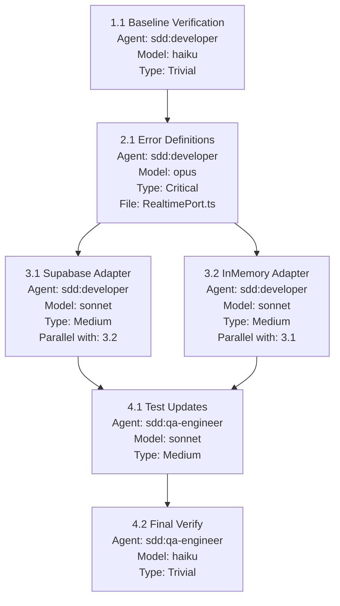

## Description

**Research Findings (2026-04-14):**

The RealtimePort interface and its implementations (SupabaseRealtimeAdapter, InMemoryRealtimeAdapter) are **already migrated to Effect pattern**. However, the error classes used by these interfaces **still use the old manual `_tag` pattern** instead of Effect's idiomatic `Data.TaggedError`.

### Current State

**✅ Already Complete (Interface & Adapter Methods):**

- `RealtimePort.subscribe` returns `Effect.Effect<RealtimeSubscription, RealtimeError | SubscriptionError, never>`
- `RealtimePort.broadcast` returns `Effect.Effect<void, RealtimeError, never>`
- `RealtimePort.trackPresence` returns `Effect.Effect<void, RealtimeError, never>`
- `RealtimeSubscription.unsubscribe` returns `Effect.Effect<void, RealtimeError, never>`
- Both adapters (SupabaseRealtimeAdapter, InMemoryRealtimeAdapter) use Effect.tryPromise and Effect.try

**❌ Needs Migration (Error Classes):**

- `RealtimeError` uses manual `extends Error` with `readonly _tag = "RealtimeError"`
- `ConnectionError` uses manual `extends Error` with `readonly _tag = "ConnectionError"`
- `SubscriptionError` uses manual `extends Error` with `readonly _tag = "SubscriptionError"`

### What This Task Actually Is

This task focuses on **migrating error class definitions** from manual `_tag` pattern to Effect's `Data.TaggedError` pattern. This aligns with Effect ecosystem best practices and enables better pattern matching with `Effect.catchTag`.

### Why This Matters

1. **Effect Idiomatic** - `Data.TaggedError` is the standard way to define errors in Effect
2. **Pattern Matching** - `Effect.catchTag` works optimally with Data.TaggedError
3. **Immutability** - Tagged errors are immutable, not mutable class instances
4. **Consistency** - Aligns with other Effect-based code in the codebase
5. **Better Type Safety** - Full type inference for error properties

## Architecture Overview

### Solution Strategy

This is a **focused error class migration**, not a full interface migration. The RealtimePort interface and its adapters are already Effect-based. The work is converting three error classes from manual `_tag` pattern to Effect's idiomatic `Data.TaggedError`.

**Phase 1: Error Definition Migration**

- Convert `RealtimeError`, `ConnectionError`, and `SubscriptionError` to `Data.TaggedError`
- Update `packages/use-cases/src/ports/RealtimePort.ts` (source file)

**Phase 2: Adapter Alignment**

- Update `SupabaseRealtimeAdapter` and `InMemoryRealtimeAdapter` error instantiation
- Constructor calls remain compatible (object argument pattern preserved)

**Phase 3: Test Updates**

- Update assertions from `instanceof` checks to `_tag` pattern matching
- Verify `Effect.catchTag` works correctly with new errors

### Key Decisions

| Decision                  | Choice                   | Reasoning                                                                          |
| ------------------------- | ------------------------ | ---------------------------------------------------------------------------------- |
| Scope Refinement          | Error-only migration     | Research revealed interfaces are already Effect-based (no changes needed)          |
| Error Pattern             | `Data.TaggedError`       | Idiomatic Effect pattern; enables `catchTag` pattern matching; immutable by design |
| Constructor Compatibility | Preserve object argument | Minimizes adapter code changes; current `new Error({...})` syntax stays valid      |
| Test Pattern              | `_tag` checking          | `Data.TaggedError` doesn't extend `Error`; use `_tag` property for assertions      |

### Expected Changes

**Primary (Definition):**
| File | Change |
|------|--------|
| `packages/use-cases/src/ports/RealtimePort.ts` | Convert 3 error classes to `Data.TaggedError` |

**Secondary (Instantiation):**
| File | Change |
|------|--------|
| `packages/adapters/src/gateways/realtime/SupabaseRealtimeAdapter.ts` | Verify/update error creation in `mapSupabaseErrorToRealtimeError` |
| `packages/adapters/src/gateways/realtime/InMemoryRealtimeAdapter.ts` | Verify/update error creation in `subscribe`, `broadcast`, `trackPresence` |
| `packages/adapters/src/services/ConnectionManager.ts` | Update error handling if creating errors directly |

**Verification (Tests):**
| File | Change |
|------|--------|
| `packages/adapters/src/services/__tests__/ConnectionManager.test.ts` | Update `instanceof` assertions to `_tag` checking |
| `packages/adapters/src/gateways/__tests__/InMemoryAdapters.contract.test.ts` | Verify error type checking works |
| `packages/adapters/src/gateways/__tests__/PortImplementations.contract.test.ts` | Verify error type checking works |

### References

- **Skill:** `.specs/archive/skills/port-interface-effect-migration/SKILL.md` — Pattern 2: Error Definition Migration
- **Analysis:** `.specs/analysis/realtime-port-effect-migration-analysis.md` — Full codebase analysis with 17 affected files

## Scope

### In Scope

- [ ] Convert `RealtimeError` to use `Data.TaggedError("RealtimeError")`
- [ ] Convert `ConnectionError` to use `Data.TaggedError("ConnectionError")`
- [ ] Convert `SubscriptionError` to use `Data.TaggedError("SubscriptionError")`
- [ ] Update SupabaseRealtimeAdapter error creation in `mapSupabaseErrorToRealtimeError`
- [ ] Update InMemoryRealtimeAdapter error instantiation sites
- [ ] Update ConnectionManager or other services that catch these errors
- [ ] Update all tests to work with new error types
- [ ] Verify `Effect.catchTag` pattern matching works correctly

### Out of Scope

- [ ] Interface method signatures (already Effect-based - no changes needed)
- [ ] Adapter Effect implementations (already using Effect.tryPromise/try)
- [ ] Changes to other ports (TelemetryPort, AuthPort, etc.) - separate tasks
- [ ] New features or functionality
- [ ] Major breaking changes to consumers beyond error type structure

## Dependencies

- `migrate-supabase-realtime-adapter-to-effect.refactor.md` - SupabaseRealtimeAdapter was migrated (already complete, not a blocker)

## Affected Files

| File                                                                 | Changes                                      |
| -------------------------------------------------------------------- | -------------------------------------------- |
| `packages/use-cases/src/ports/RealtimePort.ts`                       | Convert error classes to Data.TaggedError    |
| `packages/adapters/src/gateways/realtime/SupabaseRealtimeAdapter.ts` | Update error instantiation                   |
| `packages/adapters/src/gateways/realtime/InMemoryRealtimeAdapter.ts` | Update error instantiation                   |
| `packages/adapters/src/services/ConnectionManager.ts`                | Update error handling if needed              |
| Test files                                                           | Update assertions to work with tagged errors |

## Acceptance Criteria

### AC-001: RealtimeError Uses Data.TaggedError

**GIVEN** the RealtimeError class definition  
**WHEN** examined  
**THEN** it extends `Data.TaggedError("RealtimeError")<{ readonly message: string }>`

### AC-002: ConnectionError Uses Data.TaggedError

**GIVEN** the ConnectionError class definition  
**WHEN** examined  
**THEN** it extends `Data.TaggedError("ConnectionError")<{ readonly message: string; readonly channel?: string }>`

### AC-003: SubscriptionError Uses Data.TaggedError

**GIVEN** the SubscriptionError class definition  
**WHEN** examined  
**THEN** it extends `Data.TaggedError("SubscriptionError")<{ readonly message: string; readonly channel: string }>`

### AC-004: Supabase Adapter Creates Tagged Errors

**GIVEN** the SupabaseRealtimeAdapter error mapping  
**WHEN** errors are created  
**THEN** they use `new RealtimeError({ message: ... })` format with Data.TaggedError constructors

### AC-005: InMemory Adapter Creates Tagged Errors

**GIVEN** the InMemoryRealtimeAdapter  
**WHEN** errors are created in subscribe, broadcast, or trackPresence  
**THEN** they use Data.TaggedError constructors

### AC-006: Error Pattern Matching Works

**GIVEN** code using `Effect.catchTag`  
**WHEN** catching RealtimeError, ConnectionError, or SubscriptionError  
**THEN** pattern matching correctly identifies error by `_tag` property

### AC-007: Tests Pass with New Errors

**GIVEN** the complete test suite  
**WHEN** running `bun test`  
**THEN** all RealtimePort-related tests pass

### AC-008: TypeScript Compilation Succeeds

**GIVEN** the codebase  
**WHEN** running `bunx tsc --noEmit`  
**THEN** no type errors related to error classes

## User Scenarios

### Scenario 1: Error Creation in Adapter (Primary Flow)

**Actor:** Adapter developer  
**Trigger:** Mapping external error to domain error

**Current Code (to change):**

```typescript
return new RealtimeError({
  message: `Broadcast failed: ${error instanceof Error ? error.message : "Unknown error"}`,
});
```

**Target Code:**

```typescript
return new RealtimeError({
  message: `Broadcast failed: ${error instanceof Error ? error.message : "Unknown error"}`,
});
// Note: Constructor call stays similar, but class is now Data.TaggedError
```

**Changes Required:**

- Error class definition changes from `extends Error` to `extends Data.TaggedError("...")`
- Properties become readonly and immutable
- `_tag` is automatically managed by Data.TaggedError

### Scenario 2: Error Pattern Matching in Use Case (Consumer Flow)

**Actor:** Use case developer  
**Trigger:** Handling real-time operation failure

**Flow:**

1. Use case composes effect with real-time operation
2. Operation fails with ConnectionError
3. Use case handles with catchTag:
   ```typescript
   Effect.gen(function* () {
     const result = yield* realtimePort.subscribe(channel, config);
     return result;
   }).pipe(
     Effect.catchTag("ConnectionError", (error) =>
       Effect.fail(
         new DomainError({ message: `Failed to connect: ${error.message}` }),
       ),
     ),
     Effect.catchTag(
       "SubscriptionError",
       (error) => Effect.succeed(null), // Graceful fallback
     ),
   );
   ```
4. Pattern matching works because `_tag` is "ConnectionError" via Data.TaggedError

**Success Criteria:**

- `catchTag("ConnectionError")` matches ConnectionError
- Error properties accessible in handler
- Tag values are type-safe

### Scenario 3: Test Error Assertion (Verification Flow)

**Actor:** Test developer  
**Trigger:** Verifying error behavior in tests

**Current Test Pattern:**

```typescript
const either = await Effect.runPromise(Effect.either(program));
expect(either._tag).toBe("Left");
// May need instanceof check or _tag access
```

**Target Test Pattern:**

```typescript
const either = await Effect.runPromise(Effect.either(program));
expect(either._tag).toBe("Left");
if (either._tag === "Left") {
  expect(either.left._tag).toBe("RealtimeError"); // Works with Data.TaggedError
  expect(either.left.message).toBe("Expected error message");
}
```

**Changes Required:**

- Tests that use `instanceof` may need to check `_tag` instead
- Error property access remains similar

### Scenario 4: Error with Channel Context

**Actor:** Adapter developer  
**Trigger:** Connection fails for specific channel

**Flow:**

1. Supabase connection fails for channel "challenge-123"
2. Adapter creates ConnectionError:
   ```typescript
   new ConnectionError({
     message: `Connection failed during subscribe: ${error.message}`,
     channel: "challenge-123",
   });
   ```
3. Use case catches and accesses channel:
   ```typescript
   Effect.catchTag("ConnectionError", (error) => {
     logger.error(`Channel ${error.channel} connection failed`);
     return Effect.succeed(null);
   });
   ```

**Success Criteria:**

- Optional channel property preserved
- Message property accessible
- Error is immutable

## Technical Details

### Error Class Migration Examples

**Before:**

```typescript
export class RealtimeError extends Error {
  readonly _tag = "RealtimeError" as const;
  readonly code = "REALTIME_ERROR" as const;
  override readonly message: string;

  constructor(props: { message: string }) {
    super(props.message);
    this.message = props.message;
  }
}
```

**After:**

```typescript
import { Data } from "effect";

export class RealtimeError extends Data.TaggedError("RealtimeError")<{
  readonly message: string;
}> {}
```

**ConnectionError Before:**

```typescript
export class ConnectionError extends Error {
  readonly _tag = "ConnectionError" as const;
  readonly code = "CONNECTION_ERROR" as const;
  readonly channel?: string;
  override readonly message: string;

  constructor(props: { message: string; channel?: string }) {
    super(props.message);
    this.message = props.message;
    this.channel = props.channel;
  }
}
```

**ConnectionError After:**

```typescript
export class ConnectionError extends Data.TaggedError("ConnectionError")<{
  readonly message: string;
  readonly channel?: string;
}> {}
```

## Implementation Process

### Phase Overview

| Phase | Name         | Steps | Goal                                | Parallel Opportunities         |
| ----- | ------------ | ----- | ----------------------------------- | ------------------------------ |
| 1     | Setup        | 1     | Establish baseline                  | None (entry point)             |
| 2     | Foundational | 1     | Migrate 3 error class definitions   | None (foundation)              |
| 3     | Adapters     | 2     | Update adapter error instantiation  | Step 3.1 ⟷ Step 3.2 (parallel) |
| 4     | Verification | 2     | Update tests and final verification | None (depends on Phase 3)      |

**Total Steps:** 6 | **Max Parallelization Depth:** 2 | **Critical Path Length:** 5

### Agent Distribution

| Agent Model | Steps | Tasks                                  |
| ----------- | ----- | -------------------------------------- |
| opus        | 1     | Step 2.1 (Critical foundation)         |
| sonnet      | 3     | Steps 3.1, 3.2 (Adapters), 4.1 (Tests) |
| haiku       | 2     | Steps 1.1, 4.2 (Verification)          |

---

### Parallelization Diagram



---

### Phase 1: Setup

#### Step 1.1: Baseline Verification

**Agent Assignment:** sdd:developer (haiku)
**Type:** Trivial verification
**Dependencies:** None (entry point)
**Parallel with:** Nothing

**Goal:** Establish test baseline before migration

**Subtasks:**

1. Run full test suite: `bun test`
2. Record any existing test failures (should be none)
3. Run TypeScript check: `bunx tsc --noEmit`

**Output:**

- Baseline test results documented
- Confirmed no pre-existing failures

**Success Criteria:**

- `bun test` passes with 0 failures
- `bunx tsc --noEmit` shows 0 errors

**Blockers:** None

**Verification:**

| Aspect        | Value                                                                          |
| ------------- | ------------------------------------------------------------------------------ |
| **Level**     | None                                                                           |
| **Rationale** | This step is a verification step itself (binary pass/fail from test execution) |

---

### Phase 2: Foundational

#### Step 2.1: Migrate Error Classes to Data.TaggedError

**Agent Assignment:** sdd:developer (opus)
**Type:** Critical foundation
**Dependencies:** Step 1.1
**Parallel with:** Nothing (blocks all Phase 3 work)

**Goal:** Convert RealtimeError, ConnectionError, SubscriptionError to Data.TaggedError

**Subtasks:**

1. **Update RealtimeError** in `packages/use-cases/src/ports/RealtimePort.ts`
   - Replace manual class with Data.TaggedError
   - Preserve `code` property for backward compatibility

2. **Update ConnectionError** in `packages/use-cases/src/ports/RealtimePort.ts`
   - Replace manual class with Data.TaggedError
   - Preserve optional `channel` property
   - Preserve `code` property

3. **Update SubscriptionError** in `packages/use-cases/src/ports/RealtimePort.ts`
   - Replace manual class with Data.TaggedError
   - Preserve required `channel` property
   - Preserve `code` property

**Target Code Pattern:**

```typescript
import { Data } from "effect";

export class RealtimeError extends Data.TaggedError("RealtimeError")<{
  readonly message: string;
  readonly code: "REALTIME_ERROR";
}> {}

export class ConnectionError extends Data.TaggedError("ConnectionError")<{
  readonly message: string;
  readonly channel?: string;
  readonly code: "CONNECTION_ERROR";
}> {}

export class SubscriptionError extends Data.TaggedError("SubscriptionError")<{
  readonly message: string;
  readonly channel: string;
  readonly code: "SUBSCRIPTION_ERROR";
}> {}
```

**Output:**

- Updated error class definitions using Data.TaggedError
- All properties preserved (message, channel, code)

**Success Criteria:**

- TypeScript compilation: `bunx tsc --noEmit` passes
- Error constructors still accept `{ message, ... }` pattern
- `_tag` property is automatically provided by Data.TaggedError

**Blockers:**
| Blocker | Resolution |
|---------|------------|
| Tests fail with `instanceof` checks | Update tests to use `_tag` checking (Phase 4) |
| `code` property missing | Include in TaggedError payload type |

**Risks:**
| Risk | Impact | Mitigation |
|------|--------|------------|
| `instanceof` checks fail in tests | High | Update to `_tag` property checking |
| `code` property not accessible | Medium | Include in Data.TaggedError payload |
| Constructor signature changes | Low | Keep object argument pattern |

**Verification:**

| Aspect        | Value                                                                                                                 |
| ------------- | --------------------------------------------------------------------------------------------------------------------- |
| **Level**     | Panel (2 judges)                                                                                                      |
| **Threshold** | 4.0/5.0                                                                                                               |
| **Rationale** | Critical foundation - errors made here cascade to all adapters and tests. High blast radius requires panel consensus. |

**Rubric:**

| Criterion                 | Weight | Description                                                                                                                        |
| ------------------------- | ------ | ---------------------------------------------------------------------------------------------------------------------------------- |
| Error Class Definitions   | 0.35   | All 3 error classes (RealtimeError, ConnectionError, SubscriptionError) correctly converted to Data.TaggedError with proper syntax |
| TaggedError Pattern       | 0.25   | Proper use of `Data.TaggedError("Name")<{}>` pattern with auto-generated `_tag` property                                           |
| Property Preservation     | 0.20   | All original properties preserved: `message`, `channel` (optional/required per class), `code`                                      |
| TypeScript Compilation    | 0.15   | `bunx tsc --noEmit` passes with 0 errors related to error class definitions                                                        |
| Constructor Compatibility | 0.05   | Constructor maintains compatibility with `{ message, ... }` object argument pattern                                                |

**Evaluation Instructions:**

1. Verify all 3 error classes use `Data.TaggedError("ErrorName")<{...}>` syntax
2. Check that `_tag` property is NOT manually defined (should be auto-generated)
3. Confirm `code` property is included in the payload type for each error
4. Verify `ConnectionError` has optional `channel?: string`, `SubscriptionError` has required `channel: string`
5. Run `bunx tsc --noEmit` and verify no type errors
6. Test that `new ErrorClass({ message, code, channel? })` still works

---

### Phase 3: Adapters (Parallelizable)

#### Step 3.1: Update SupabaseRealtimeAdapter

**Agent Assignment:** sdd:developer (sonnet)
**Type:** Medium complexity
**Dependencies:** Step 2.1
**Parallel with:** Step 3.2 (InMemoryRealtimeAdapter)

**Goal:** Verify and update error instantiation in SupabaseRealtimeAdapter

**Subtasks:**

1. **Verify error creation in `mapSupabaseErrorToRealtimeError`**
   - File: `packages/adapters/src/gateways/realtime/SupabaseRealtimeAdapter.ts`
   - Lines: 41-84
   - Current: `new ConnectionError({ message, channel })`
   - Should work with Data.TaggedError (same constructor pattern)
   - **Action:** Add `code` property to error creation:
     ```typescript
     return new ConnectionError({
       message: `Connection failed during ${operation}: ${error.message}`,
       channel,
       code: "CONNECTION_ERROR",
     });
     ```

2. **Verify error creation in `SupabaseRealtimeSubscription.unsubscribe`**
   - Lines: 135-146
   - Current: `new RealtimeError({ message })`
   - **Action:** Add `code` property:
     ```typescript
     new RealtimeError({
       message: `Failed to unsubscribe...`,
       code: "REALTIME_ERROR",
     });
     ```

3. **Verify error creation in `broadcast` method**
   - Lines: 282-293
   - Current: `throw new RealtimeError({ message })`
   - **Action:** Add `code` property

4. **Verify error creation in `trackPresence` method**
   - Lines: 336-347
   - Current: `throw new RealtimeError({ message })`
   - **Action:** Add `code` property

**Output:**

- All error instantiations include `code` property
- TypeScript compilation passes

**Success Criteria:**

- `bunx tsc --noEmit` shows 0 errors
- Adapter can create all three error types

**Blockers:**
| Blocker | Resolution |
|---------|------------|
| Type mismatch on error creation | Ensure `code` property is included in constructor call |

**Risks:**
| Risk | Impact | Mitigation |
|------|--------|------------|
| Forgetting to add `code` property | Medium | Search for all `new RealtimeError`, `new ConnectionError`, `new SubscriptionError` calls |

**Verification:**

| Aspect        | Value                                                                                          |
| ------------- | ---------------------------------------------------------------------------------------------- |
| **Level**     | Single                                                                                         |
| **Threshold** | 4.0/5.0                                                                                        |
| **Rationale** | Medium complexity but isolated mechanical changes (adding code property to error constructors) |

**Rubric:**

| Criterion                   | Weight | Description                                                                                                                     |
| --------------------------- | ------ | ------------------------------------------------------------------------------------------------------------------------------- |
| Error Instantiation Updates | 0.40   | All 4 error instantiation sites include `code` property: mapSupabaseErrorToRealtimeError, unsubscribe, broadcast, trackPresence |
| Channel Property Handling   | 0.25   | ConnectionError includes `channel` property when channel context is available                                                   |
| TypeScript Compilation      | 0.20   | `bunx tsc --noEmit` passes with 0 errors in SupabaseRealtimeAdapter.ts                                                          |
| Logic Preservation          | 0.15   | No unintended changes to adapter behavior beyond error property addition                                                        |

**Evaluation Instructions:**

1. Verify all `new RealtimeError({...})`, `new ConnectionError({...})`, `new SubscriptionError({...})` calls include `code` property
2. Check that ConnectionError instantiation includes `channel` when applicable
3. Confirm no other adapter logic was modified
4. Run TypeScript check: `bunx tsc --noEmit`

---

#### Step 3.2: Update InMemoryRealtimeAdapter

**Agent Assignment:** sdd:developer (sonnet)
**Type:** Medium complexity
**Dependencies:** Step 2.1
**Parallel with:** Step 3.1 (SupabaseRealtimeAdapter)

**Goal:** Verify and update error instantiation in InMemoryRealtimeAdapter

**Subtasks:**

1. **Update error creation in `subscribe` method**
   - File: `packages/adapters/src/gateways/realtime/InMemoryRealtimeAdapter.ts`
   - Lines: 134-137
   - Current: `throw new SubscriptionError({ message, channel })`
   - **Action:** Add `code` property:
     ```typescript
     throw new SubscriptionError({
       message: "Cannot subscribe: adapter is closed",
       channel,
       code: "SUBSCRIPTION_ERROR",
     });
     ```

2. **Update error creation in `catchAllDefect` handler**
   - Lines: 170-179
   - Current: `new SubscriptionError({ message, channel })`
   - **Action:** Add `code` property

3. **Update error creation in `broadcast` method**
   - Lines: 235-238
   - Current: `new RealtimeError({ message })`
   - **Action:** Add `code` property

4. **Update error creation in `trackPresence` method**
   - Lines: 263-266
   - Current: `new RealtimeError({ message })`
   - **Action:** Add `code` property

5. **Update error creation in `InMemoryRealtimeSubscription.unsubscribe`**
   - Lines: 64-67
   - Current: `new RealtimeError({ message })`
   - **Action:** Add `code` property

**Output:**

- All error instantiations include `code` property
- TypeScript compilation passes

**Success Criteria:**

- `bunx tsc --noEmit` shows 0 errors
- Adapter can create all three error types

**Blockers:** None (depends on Step 2.1)

**Risks:**
| Risk | Impact | Mitigation |
|------|--------|------------|
| Missing error instantiation site | Medium | Grep for all error constructor calls |

**Verification:**

| Aspect        | Value                                                                  |
| ------------- | ---------------------------------------------------------------------- |
| **Level**     | Single                                                                 |
| **Threshold** | 4.0/5.0                                                                |
| **Rationale** | Medium complexity but isolated mechanical changes parallel to Step 3.1 |

**Rubric:**

| Criterion                   | Weight | Description                                                                                                                                            |
| --------------------------- | ------ | ------------------------------------------------------------------------------------------------------------------------------------------------------ |
| Error Instantiation Updates | 0.40   | All 5 error instantiation sites include `code` property: subscribe, catchAllDefect, broadcast, trackPresence, InMemoryRealtimeSubscription.unsubscribe |
| Required Channel Property   | 0.25   | SubscriptionError always includes required `channel` property in constructor calls                                                                     |
| TypeScript Compilation      | 0.20   | `bunx tsc --noEmit` passes with 0 errors in InMemoryRealtimeAdapter.ts                                                                                 |
| Logic Preservation          | 0.15   | No unintended changes to adapter behavior beyond error property addition                                                                               |

**Evaluation Instructions:**

1. Verify all 5 error instantiation sites include `code` property in constructor calls
2. Check that SubscriptionError always includes required `channel` property
3. Confirm no other adapter logic was modified
4. Run TypeScript check: `bunx tsc --noEmit`

---

### Phase 4: Verification

#### Step 4.1: Update Test Assertions

**Agent Assignment:** sdd:qa-engineer (sonnet)
**Type:** Medium complexity test updates
**Dependencies:** Step 3.1 AND Step 3.2 (both adapters must complete)
**Parallel with:** Nothing (requires both adapters)

**Goal:** Update tests to work with Data.TaggedError (remove `instanceof`, verify `_tag`)

**Subtasks:**

1. **Update InMemoryAdapters.contract.test.ts**
   - File: `packages/adapters/src/gateways/__tests__/InMemoryAdapters.contract.test.ts`
   - Line 274: `expect(either.left).toBeInstanceOf(SubscriptionError);`
     - Change to: `expect(either.left._tag).toBe("SubscriptionError");`
   - Line 275: `expect(either.left._tag).toBe("SubscriptionError");` - Keep as-is (works)
   - Line 276: `expect(either.left.code).toBe("SUBSCRIPTION_ERROR");` - Keep (now works with `code` in payload)
   - Line 277-279: Narrowing with `either.left._tag === "SubscriptionError"` - Keep as-is

2. **Verify ConnectionManager.test.ts**
   - File: `packages/adapters/src/services/__tests__/ConnectionManager.test.ts`
   - Only imports `RealtimeError` for type setup
   - No error type assertions to update
   - Verify tests still pass

3. **Verify PortImplementations.contract.test.ts**
   - File: `packages/adapters/src/gateways/__tests__/PortImplementations.contract.test.ts`
   - Line 256: `expect(either.left._tag).toBe("SubscriptionError");` - Keep as-is (works)
   - No changes needed

4. **Add catchTag verification test**
   - Create test to verify `Effect.catchTag` works with new errors:
     ```typescript
     it("should support Effect.catchTag pattern matching", async () => {
       const effect = adapter.subscribe("channel", { onMessage: () => {} });
       const caught = effect.pipe(
         Effect.catchTag("SubscriptionError", (error) =>
           Effect.succeed({ recovered: true, message: error.message }),
         ),
       );
       const result = await Effect.runPromise(caught);
       expect(result).toBeDefined();
     });
     ```

**Output:**

- Updated test assertions using `_tag` instead of `instanceof`
- catchTag pattern matching verified

**Success Criteria:**

- All tests in `InMemoryAdapters.contract.test.ts` pass
- All tests in `ConnectionManager.test.ts` pass
- All tests in `PortImplementations.contract.test.ts` pass
- New catchTag test passes

**Blockers:**
| Blocker | Resolution |
|---------|------------|
| Data.TaggedError doesn't have `code` property | Must have included `code` in payload in Step 2.1 |

**Risks:**
| Risk | Impact | Mitigation |
|------|--------|------------|
| Other tests use `instanceof` | Medium | Global search for `instanceof RealtimeError` etc. |
| catchTag type inference issues | Low | Add explicit type test |

**Verification:**

| Aspect        | Value                                                                                                             |
| ------------- | ----------------------------------------------------------------------------------------------------------------- |
| **Level**     | Single                                                                                                            |
| **Threshold** | 4.0/5.0                                                                                                           |
| **Rationale** | Test updates with clear, verifiable acceptance criteria; single judge sufficient for mechanical assertion changes |

**Rubric:**

| Criterion             | Weight | Description                                                                                                                         |
| --------------------- | ------ | ----------------------------------------------------------------------------------------------------------------------------------- |
| Assertion Conversion  | 0.35   | All `instanceof` assertions converted to `_tag` property checking                                                                   |
| Test File Coverage    | 0.25   | All affected test files updated: InMemoryAdapters.contract.test.ts, ConnectionManager.test.ts, PortImplementations.contract.test.ts |
| catchTag Verification | 0.25   | New test added demonstrating `Effect.catchTag` works correctly with migrated errors                                                 |
| Test Pass Rate        | 0.15   | All tests pass after assertion updates                                                                                              |

**Evaluation Instructions:**

1. Search for remaining `instanceof RealtimeError`, `instanceof ConnectionError`, `instanceof SubscriptionError` in tests - should be 0
2. Verify `_tag` property checks exist: `expect(error._tag).toBe("ErrorName")`
3. Confirm new catchTag test exists and passes
4. Run full test suite: `bun test`

---

#### Step 4.2: Final Verification

**Agent Assignment:** sdd:qa-engineer (haiku)
**Type:** Trivial verification
**Dependencies:** Step 4.1
**Parallel with:** Nothing (final step)

**Goal:** Complete verification and cleanup

**Subtasks:**

1. **Full test suite run**
   - Command: `bun test`
   - Verify all tests pass

2. **TypeScript compilation check**
   - Command: `bunx tsc --noEmit`
   - Verify 0 errors

3. **Effect-specific verification**
   - Verify `Effect.catchTag("RealtimeError")` works
   - Verify `Effect.catchTag("ConnectionError")` works
   - Verify `Effect.catchTag("SubscriptionError")` works

4. **Code cleanup**
   - Remove any unused imports
   - Verify no `console.log` debug statements

**Output:**

- All tests passing
- TypeScript compilation clean
- Effect pattern matching verified

**Success Criteria:**

- `bun test` passes with 0 failures
- `bunx tsc --noEmit` shows 0 errors
- AC-001 through AC-008 all satisfied

**Blockers:** None (depends on all previous steps)

**Risks:**
| Risk | Impact | Mitigation |
|------|--------|------------|
| Hidden `instanceof` checks | Medium | Search entire codebase |
| Runtime behavior changes | Low | Compare error object structure |

**Verification:**

| Aspect        | Value                                                                                            |
| ------------- | ------------------------------------------------------------------------------------------------ |
| **Level**     | None                                                                                             |
| **Rationale** | This step IS the verification - running full test suite and compilation check (binary pass/fail) |

---

## Verification Summary

| Phase | Step                      | Level     | Judges | Threshold | Key Evaluation Criteria                                                           |
| ----- | ------------------------- | --------- | ------ | --------- | --------------------------------------------------------------------------------- |
| 1     | 1.1 Baseline Verification | None      | N/A    | N/A       | Binary pass/fail - no LLM judge needed                                            |
| 2     | 2.1 Error Definitions     | **Panel** | 2      | 4.0/5.0   | 3 error classes converted, Data.TaggedError pattern correct, properties preserved |
| 3     | 3.1 Supabase Adapter      | Single    | 1      | 4.0/5.0   | 4 error sites updated with `code` property, TS compiles                           |
| 3     | 3.2 InMemory Adapter      | Single    | 1      | 4.0/5.0   | 5 error sites updated with `code` property, TS compiles                           |
| 4     | 4.1 Test Updates          | Single    | 1      | 4.0/5.0   | `instanceof`→`_tag` conversion, catchTag test added, all tests pass               |
| 4     | 4.2 Final Verification    | None      | N/A    | N/A       | Binary pass/fail - no LLM judge needed                                            |

**Totals:**

- **Steps with Verification:** 4 of 6
- **Total Evaluations Defined:** 4
- **Panel Verifications:** 1 (Step 2.1 - Critical Foundation)
- **Single Verifications:** 3 (Steps 3.1, 3.2, 4.1)
- **None (Binary):** 2 (Steps 1.1, 4.2)

---

## Sub-agent Execution Directive

Execute this task using the following orchestration:

### Phase 1: Setup

- **Command:** `/sadd:do-and-judge`
- **Agent:** sdd:developer
- **Model:** haiku
- **Task:** Execute Step 1.1 (Baseline Verification)
- **Verification:** Confirm `bun test` and `bunx tsc --noEmit` pass

### Phase 2: Foundation

- **Command:** `/sadd:do-and-judge`
- **Agent:** sdd:developer
- **Model:** opus
- **Task:** Execute Step 2.1 (Migrate Error Classes)
- **Verification:** TypeScript compilation passes, error constructors work correctly

### Phase 3: Adapters (Parallel)

- **Command:** `/sadd:do-in-parallel`
- **Agents:** sdd:developer (×2)
- **Model:** sonnet
- **Tasks:**
  1. Execute Step 3.1 (Update SupabaseRealtimeAdapter)
  2. Execute Step 3.2 (Update InMemoryRealtimeAdapter)
- **Verification:** Both adapters compile and pass tests

### Phase 4: Verification & Polish

- **Command:** `/sadd:do-and-judge`
- **Agent:** sdd:qa-engineer
- **Model:** sonnet
- **Task:** Execute Step 4.1 (Update Test Assertions)
- **Verification:** Tests updated and passing

- **Command:** `/sadd:do-and-judge`
- **Agent:** sdd:qa-engineer
- **Model:** haiku
- **Task:** Execute Step 4.2 (Final Verification)
- **Verification:** All 8 acceptance criteria met, tests pass, compilation clean

---

## Blockers and Resolutions Summary

| Blocker                             | Affected Step | Resolution                                   |
| ----------------------------------- | ------------- | -------------------------------------------- |
| Tests use `instanceof` checks       | Step 4.1      | Update to `_tag` property checking           |
| `code` property missing from errors | Step 2.1      | Include in Data.TaggedError payload type     |
| Type mismatch on error creation     | Step 3.1, 3.2 | Add `code` property to all constructor calls |

---

## Risks and Mitigations Summary

| Risk                                 | Impact | Likelihood | Mitigation                                   |
| ------------------------------------ | ------ | ---------- | -------------------------------------------- |
| `instanceof` checks fail in tests    | High   | High       | Update tests to use `_tag` checking          |
| `code` property not accessible       | Medium | Medium     | Include `code` in TaggedError payload        |
| Missing error instantiation site     | Medium | Medium     | Grep for all constructor calls               |
| catchTag type inference issues       | Low    | Low        | Add explicit type test                       |
| Hidden `instanceof` checks elsewhere | Medium | Low        | Global search for `instanceof RealtimeError` |
| Runtime behavior changes             | Low    | Low        | Compare error object structure before/after  |

**High Priority Risks:** 2 (instanceof checks, code property)

---

## Implementation Summary

| Metric                         | Value                                                 |
| ------------------------------ | ----------------------------------------------------- |
| **Total Implementation Steps** | 6                                                     |
| **Total Subtasks**             | 12                                                    |
| **Critical Path Steps**        | 2 (Step 2.1 error definitions, Step 4.1 test updates) |
| **High Priority Risks**        | 2                                                     |
| **Estimated Effort**           | Small (focused refactoring)                           |
| **Files to Modify**            | 5                                                     |
| **Tests to Update**            | 1 (InMemoryAdapters.contract.test.ts)                 |

### Critical Path

```
Step 2.1 (Error definitions) → Step 3.1/3.2 (Adapters) → Step 4.1 (Tests) → Step 4.2 (Verification)
```

### Parallelization Opportunities

- Step 3.1 (SupabaseRealtimeAdapter) and Step 3.2 (InMemoryRealtimeAdapter) can be done in parallel after Step 2.1
- Test file updates in Step 4.1 can be done in parallel once adapters are complete

### Files Modified

| File                                                                         | Changes                                     | Step |
| ---------------------------------------------------------------------------- | ------------------------------------------- | ---- |
| `packages/use-cases/src/ports/RealtimePort.ts`                               | Convert 3 error classes to Data.TaggedError | 2.1  |
| `packages/adapters/src/gateways/realtime/SupabaseRealtimeAdapter.ts`         | Add `code` property to error creation       | 3.1  |
| `packages/adapters/src/gateways/realtime/InMemoryRealtimeAdapter.ts`         | Add `code` property to error creation       | 3.2  |
| `packages/adapters/src/gateways/__tests__/InMemoryAdapters.contract.test.ts` | Update `instanceof` to `_tag`               | 4.1  |

---

## Definition of Done

- [ ] All 8 acceptance criteria pass
- [ ] TypeScript compilation succeeds: `bunx tsc --noEmit`
- [ ] All tests pass: `bun test`
- [ ] Error classes use `Data.TaggedError` (no manual `_tag`)
- [ ] Adapters updated to create errors correctly
- [ ] Pattern matching with `catchTag` verified
- [ ] Code review approved
- [ ] No breaking changes to runtime behavior

## Related Work

Other ports needing similar migration (create separate tasks):

- **TelemetryPort** - Uses `Promise<Result<void, TelemetryError>>` - needs full Effect migration
