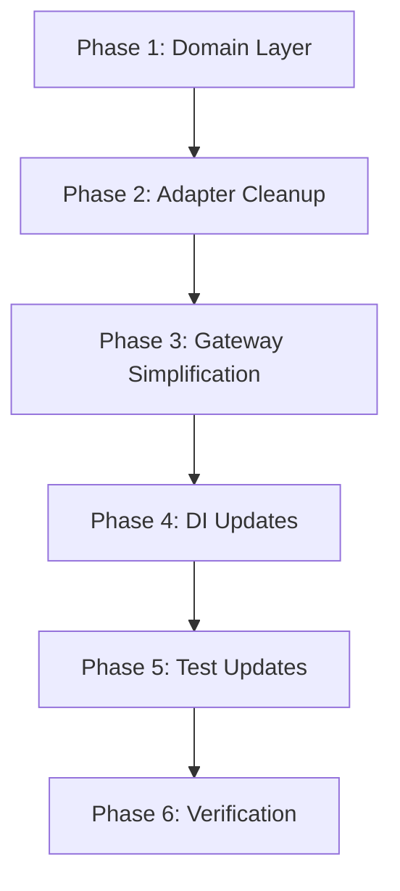

## Initial User Prompt

Simplify the storage architecture by using SeaweedFS Filer's native TUS support instead of a separate tusd server. This eliminates:
- Separate tusd server deployment
- Redis ticket storage for upload authentication  
- TUS webhook handlers
- Complex ticket lifecycle management

SeaweedFS Filer provides built-in TUS protocol support via Filer extension, so we can use a single service for both S3-compatible storage and resumable uploads.

Key changes:
- Remove TusdConfig, TicketService, TusHookHandler
- Remove TusWebhookPort and related infrastructure
- Simplify SeaweedFSStorageGateway to use native TUS endpoints
- Update StorageConfig to use flat structure
- Single SeaweedFS service handles both storage and resumable uploads

## Description

This refactoring simplifies the storage architecture by leveraging SeaweedFS Filer's built-in TUS (resumable upload) support instead of using a separate tusd server with Redis ticket storage.

**Current State**: The system uses a complex multi-service architecture where:
- Backend generates upload tickets stored in Redis
- Clients upload to a separate tusd server
- tusd validates tickets via webhooks to the backend
- Files are then stored in SeaweedFS

**Target State**: A simplified architecture where:
- Backend generates upload tokens
- Clients upload directly to SeaweedFS Filer's native TUS endpoint
- No intermediate services or ticket storage needed

**Business Value**: Reduces infrastructure complexity, operational overhead, and potential failure points while maintaining full resumable upload capability.

**Scope**:
- **Included**: Removing tusd-related components, simplifying storage gateway, updating configuration
- **Excluded**: Changes to storage backend (still SeaweedFS), client upload library changes (endpoint only)

**User Scenarios**:
1. **Primary Flow**: Client requests upload URL → Backend returns SeaweedFS TUS URL with token → Client uploads directly to SeaweedFS
2. **Error Handling**: Upload failures return appropriate errors; network interruptions allow TUS resume

---

## Architecture Overview

### Current Architecture (tusd-based)
```
Client → tusd Server → SeaweedFS S3
       ↓
   Webhook → Backend (ticket validation)
       ↓
     Redis (ticket storage)
```

### Target Architecture (Native TUS)
```
Client → SeaweedFS Filer TUS Endpoint
```

### Key Architectural Changes

| Component | Before | After |
|-----------|--------|-------|
| Upload Service | tusd server | SeaweedFS Filer native TUS |
| Ticket Storage | Redis | Removed (direct tokens) |
| Validation | Webhook callbacks | Direct SeaweedFS auth |
| Configuration | Complex (tusd+redis+ticket) | Simple (SeaweedFS only) |

### Files Affected

**Deleted:**
- `packages/adapters/src/storage/gateways/seaweedfs/hooks/TicketService.ts`
- `packages/adapters/src/storage/gateways/seaweedfs/hooks/TusHookHandler.ts`
- `packages/adapters/src/storage/gateways/seaweedfs/hooks/index.ts`
- `packages/adapters/src/storage/gateways/seaweedfs/TusWebhookGateway.ts`
- `apps/backend-server/src/controllers/TusHookController.ts`
- `packages/domain/src/storage/ports/TusWebhookPort.ts`
- `packages/use-cases/src/storage/ports/TusWebhookPort.ts`

**Modified:**
- `packages/adapters/src/storage/gateways/seaweedfs/SeaweedFSConfig.ts`
- `packages/adapters/src/storage/gateways/seaweedfs/SeaweedFSStorageGateway.ts`
- `packages/adapters/src/storage/gateways/seaweedfs/index.ts`
- `packages/adapters/src/storage/gateways/index.ts`
- `packages/adapters/src/storage/index.ts`
- `packages/adapters/src/index.ts`
- `packages/frameworks/src/di/layer/service.ts`
- `packages/frameworks/src/di/index.ts`
- `packages/use-cases/src/index.ts`

**See full analysis:** `.specs/analysis/analysis-storage-tus-simplification.md`

**See skill reference:** `.claude/skills/seaweedfs-tus/SKILL.md`

---

## Acceptance Criteria

### Functional Requirements

- [ ] **TusdConfig removed**: TusdConfig interface deleted from SeaweedFSConfig.ts
  - Given: Current SeaweedFSConfig.ts contains TusdConfig interface
  - When: Refactoring is complete
  - Then: TusdConfig interface no longer exists in the codebase

- [ ] **TicketConfig removed**: TicketConfig interface and validation deleted
  - Given: Current SeaweedFSConfig.ts contains TicketConfig interface
  - When: Refactoring is complete
  - Then: TicketConfig interface and validateTicketConfig function no longer exist

- [ ] **TicketService removed**: TicketService.ts file deleted
  - Given: TicketService.ts exists in hooks directory
  - When: Refactoring is complete
  - Then: TicketService.ts file is deleted and all imports removed

- [ ] **TusHookHandler removed**: TusHookHandler.ts file deleted
  - Given: TusHookHandler.ts exists in hooks directory
  - When: Refactoring is complete
  - Then: TusHookHandler.ts file is deleted

- [ ] **TusWebhookController removed**: TusHookController.ts file deleted
  - Given: TusHookController.ts exists in backend-server controllers
  - When: Refactoring is complete
  - Then: TusHookController.ts file is deleted

- [ ] **TusWebhookPort removed**: ITusWebhookPort interface and TusWebhookPortTag deleted
  - Given: TusWebhookPort exists in domain and use-cases
  - When: Refactoring is complete
  - Then: ITusWebhookPort interface and TusWebhookPortTag no longer exist

- [ ] **Exports updated**: All tusd/ticket exports removed from index.ts files
  - Given: Index files export tusd/ticket types
  - When: Refactoring is complete
  - Then: No tusd/ticket types are exported from any index.ts

- [ ] **Storage gateway simplified**: SeaweedFSStorageGateway constructor simplified
  - Given: Constructor accepts tusdConfig, redisConfig, ticketConfig
  - When: Refactoring is complete
  - Then: Constructor only accepts SeaweedFSConfig

- [ ] **createSignedUploadUrl updated**: Returns SeaweedFS Filer TUS URL
  - Given: Current method returns tusd URL with compound token
  - When: Refactoring is complete
  - Then: Method returns SeaweedFS Filer TUS endpoint URL with auth token

- [ ] **Service layer updated**: makeServiceLayer no longer creates TusWebhookLayer
  - Given: makeServiceLayer creates tusWebhookLayer
  - When: Refactoring is complete
  - Then: TusWebhookLayer creation is removed, only storageLayer remains

- [ ] **Configuration updated**: loadConfigFromEnv simplified
  - Given: loadConfigFromEnv loads tusd/ticket/redis config
  - When: Refactoring is complete
  - Then: Only loads SeaweedFS config

- [ ] **Tests updated**: All tests pass without tusd/ticket dependencies
  - Given: Tests reference tusd/ticket configuration
  - When: Refactoring is complete
  - Then: All unit and integration tests pass

### Non-Functional Requirements

- [ ] **Build passes**: No TypeScript compilation errors
  - Given: Codebase has TypeScript compilation
  - When: Build runs
  - Then: No compilation errors

- [ ] **Tests pass**: All tests pass
  - Given: Test suite exists
  - When: Tests run
  - Then: 100% pass rate

- [ ] **Code coverage**: No reduction in test coverage
  - Given: Current test coverage metrics
  - When: Refactoring is complete
  - Then: Coverage is maintained or improved

---

## Implementation Process

### Phase 1: Domain Layer Cleanup

**Step 1**: Remove TusWebhookPort from domain layer
- Delete `packages/domain/src/storage/ports/TusWebhookPort.ts`
- Remove export from `packages/domain/src/storage/ports/index.ts`
- **Success Criteria**: Domain layer no longer exports ITusWebhookPort

**Step 2**: Remove TusWebhookPortTag from use-cases layer
- Delete `packages/use-cases/src/storage/ports/TusWebhookPort.ts`
- Remove export from `packages/use-cases/src/index.ts`
- **Success Criteria**: TusWebhookPortTag no longer exported from use-cases

### Phase 2: Adapter Layer Cleanup

**Step 3**: Delete hook files
- Delete `packages/adapters/src/storage/gateways/seaweedfs/hooks/` directory
- **Success Criteria**: hooks directory no longer exists

**Step 4**: Delete TusWebhookGateway
- Delete `packages/adapters/src/storage/gateways/seaweedfs/TusWebhookGateway.ts`
- **Success Criteria**: TusWebhookGateway.ts deleted

**Step 5**: Delete TusHookController
- Delete `apps/backend-server/src/controllers/TusHookController.ts`
- **Success Criteria**: TusHookController.ts deleted

### Phase 3: Gateway Simplification

**Step 6**: Simplify SeaweedFSConfig
- Remove TusdConfig, TicketConfig, RedisConfig interfaces
- Remove validateTusdConfig, validateTicketConfig, validateRedisConfig functions
- Remove related environment variable loading
- **Success Criteria**: Only SeaweedFSConfig remains

**Step 7**: Simplify SeaweedFSStorageGateway
- Update constructor to accept only SeaweedFSConfig
- Remove ticketService dependency
- Update createSignedUploadUrl to return SeaweedFS Filer TUS URL
- Remove getTicketService method
- **Success Criteria**: Gateway works with simplified config

### Phase 4: DI Layer Updates

**Step 8**: Update service layer composition
- Remove createTusWebhookLayer function
- Remove TusWebhookPortTag import
- Simplify makeSeaweedFSStorageLayer
- **Success Criteria**: Service layer no longer references tusd/ticket

**Step 9**: Update exports
- Remove TusWebhookPortTag from `packages/frameworks/src/di/index.ts`
- Remove tusd/ticket exports from adapter index files
- **Success Criteria**: No tusd/ticket types exported

### Phase 5: Test Updates

**Step 10**: Update SeaweedFSStorageGateway tests
- Remove tusd/ticket test cases
- Update constructor tests
- Update createSignedUploadUrl tests
- **Success Criteria**: All gateway tests pass

**Step 11**: Update storage contract tests
- Update MockSeaweedFSStorageGateway
- Remove tusd URL format tests
- **Success Criteria**: Contract tests pass

**Step 12**: Update integration tests
- Remove tusd integration tests
- Update storage integration test setup
- **Success Criteria**: Integration tests pass

### Phase 6: Verification

**Step 13**: Run full test suite
- Execute `bun test`
- Verify 100% pass rate
- **Success Criteria**: All tests pass

**Step 14**: Build verification
- Run TypeScript compilation
- Verify no errors
- **Success Criteria**: Clean build

---

## Dependencies



### Parallel Execution Opportunities

- **Phase 1 and Phase 2 can run in parallel** (different packages)
- **Phase 3 and Phase 4 can run in parallel** (different concerns)
- **Phase 5 test files can be updated in parallel** (independent test files)

---

## Definition of Done

- [ ] All acceptance criteria pass
- [ ] All tusd-related code removed
- [ ] All ticket-related code removed
- [ ] All Redis upload ticket code removed (unless used elsewhere)
- [ ] TypeScript compilation succeeds with zero errors
- [ ] All tests pass (unit, integration, contract)
- [ ] No references to TusdConfig, TicketConfig, TicketService, TusHookHandler, TusWebhookPort in codebase
- [ ] Documentation updated (if applicable)

---

## Resources

- **Codebase Analysis**: `.specs/analysis/analysis-storage-tus-simplification.md`
- **Skill Reference**: `.claude/skills/seaweedfs-tus/SKILL.md`
- **Business Analysis**: `.specs/scratchpad/storage-tus-business-analysis.md`
