## Skill

Reusable patterns, resources, and pitfalls for this migration live in:

- `.claude/skills/travel-champ-multitenancy/SKILL.md`

## Initial User Prompt

Migrate the MIRAI/PJApp monorepo to a B2B SaaS foundation named Travel Champ. Rename all packages, change license to proprietary, add organizations as tenants, add organizationId to trips/users, wire org-membership middleware on all trip-scoped routers, and replace apps/seed with a Vite + React dashboard skeleton.

## Description

Sprint 0 transforms the MIRAI/PJApp monorepo into the Travel Champ B2B SaaS foundation. The product and package namespace are rebranded from `@mirai-app/*` to `@travel-champ/*`, and the license changes from AGPL-3.0 to proprietary. The platform is reshaped from a single-tenant event app into a multi-tenant system where each travel agency is represented by an `organization`.

This work is required so that Travel Champ can serve multiple travel agencies from a single deployment without allowing one agency to see another's trips, travelers, or operational data. It also protects the intellectual property under a proprietary license, gives the engineering team a single reusable package namespace, and establishes a dedicated admin dashboard for future agency-management features.

## Scope

### In Scope
- Renaming every package, import, workspace reference, and project name from `@mirai-app/*` to `@travel-champ/*`.
- Changing the license from AGPL-3.0 to proprietary across `LICENSE` and all `package.json` files.
- Adding `organizations` and `organizationMembers` schema tables with supporting enums.
- Adding `organizationId` to `trips` (NOT NULL after backfill) and `users` (nullable).
- Creating required database indexes: `trips_organization_id_idx`, `users_organization_id_idx`, `org_members_org_user_unique`.
- Writing and running a backfill script that assigns all existing trips and staff users to a sentinel migration organization.
- Implementing `requireOrgMembership` middleware that blocks cross-organization trip access.
- Wiring `requireOrgMembership` on all 15 trip-scoped router modules.
- Creating `apps/dashboard` as a Vite + React TypeScript SPA that replaces `apps/seed`.
- Updating the demo seed to create 3 demo agencies with non-overlapping trips.

### Out of Scope
- Billing, subscriptions, or payment features.
- Analytics, reporting, or dashboards beyond the skeleton landing page.
- White-label or agency-specific branding.
- i18n and localization.
- Challenge templates and native app feature changes beyond removing the `apps/seed` dependency.
- Advanced role-based permissions beyond organization membership enforcement.

## User Scenarios

1. **Primary Flow**: A developer applies Sprint 0, runs the test and build suite, and every package builds under `@travel-champ/*`; existing data is migrated into the sentinel organization; and cross-organization trip access returns HTTP 403.
2. **Alternative Flow**: A fresh development environment is seeded with 3 demo agencies, each with independent owners, staff, trips, and travelers, and the data sets do not overlap.
3. **Error Handling**: A user from organization A attempts to read or modify a trip in organization B and receives HTTP 403 without any trip data in the response body.

## Acceptance Criteria

### Functional Requirements

- [ ] **AC-1 Package rename is complete**
  - Given: source files, manifests, Nx configuration, and TypeScript path mappings contain `@mirai-app/*` references.
  - When: the Sprint 0 rename is applied.
  - Then: a repository-wide search for `@mirai-app/` returns exactly zero results.

- [ ] **AC-2 License is proprietary**
  - Given: the repository currently uses AGPL-3.0 in `LICENSE` and `package.json` files.
  - When: the license file and all `license` fields are updated.
  - Then: `LICENSE` contains a proprietary notice and every `package.json` declares a proprietary license value.

- [ ] **AC-3 Organization schema is in place**
  - Given: the database migrations define `organizations` and `organizationMembers` tables.
  - When: the migrations are applied to a fresh database.
  - Then: both tables exist with the expected columns and the required enums are defined.

- [ ] **AC-4 Trips and users are linked to organizations with indexes**
  - Given: the schema migrations add `organizationId` to `trips` and `users`.
  - When: the migrations are applied after backfill.
  - Then: `trips.organizationId` is NOT NULL, `users.organizationId` is nullable, and the indexes `trips_organization_id_idx`, `users_organization_id_idx`, and `org_members_org_user_unique` exist.

- [ ] **AC-5 Existing data backfills into the sentinel organization**
  - Given: a database contains trips and staff users created before Sprint 0.
  - When: the backfill script is executed.
  - Then: a sentinel migration organization is created and every existing trip and staff user references it.

- [ ] **AC-6 Cross-organization access returns 403**
  - Given: an authenticated user belongs to organization A and a trip belongs to organization B.
  - When: the user calls any of the 15 trip-scoped routers with that trip.
  - Then: the middleware returns HTTP 403 and no trip data is exposed.

- [ ] **AC-7 Middleware is wired on all 15 trip-scoped routers**
  - Given: the `requireOrgMembership` middleware exists.
  - When: each trip-scoped router is inspected.
  - Then: the middleware is applied to all 15 router modules: trip, user, challenge, challengeSubmission, challengeVote, reward, group, sponsor, coin, coinTransaction, activityFeed, location, notificationSchedule, notificationDelivery, and community.

- [ ] **AC-8 Dashboard Vite SPA builds and renders**
  - Given: `apps/dashboard` is a Vite + React TypeScript SPA that replaces `apps/seed`.
  - When: the dashboard build command runs.
  - Then: the build exits 0, produces a `dist/` folder, and the landing page renders at the configured dev port.

- [ ] **AC-9 Demo seed creates 3 non-overlapping demo agencies**
  - Given: the seed script runs in a fresh environment.
  - When: it executes the demo-agency seed path.
  - Then: exactly 3 `organizations` rows exist with distinct names and slugs, each owns trips, and no trip is shared between agencies.

### Non-Functional Requirements

- [ ] **NFR-1 Data integrity**: existing trips and staff users are preserved and assigned to the migration organization without data loss.
- [ ] **NFR-2 Security**: cross-organization requests are blocked at the application layer before any tenant data is returned.
- [ ] **NFR-3 Testability**: org isolation is verified by a parametric PGLite test across all 15 trip-scoped routers.
- [ ] **NFR-4 Build health**: `nx run-many -t build && nx run-many -t typecheck && nx run-many -t test` exits 0.

## Architecture Overview

### Solution Strategy

- **Mechanical rename**: Codemod every `@mirai-app/` import and package name to `@travel-champ/` across `package.json`, `project.json`, source files, docs, and root configs. Update `nx.json`, `tsconfig.base.json`, and root workspace manifests.
- **License change**: Replace the `AGPL-3.0` `LICENSE` text with a proprietary notice and set `license: "UNLICENSED"` in root and packge manifests.
- **Tenant model**: Introduce `organizations` as the agency tenant root and `organizationMembers` for user↔org↔role mappings. Add `organizationId` to `trips` (nullable for the first migration step, then enforced `NOT NULL` after backfill) and a nullable `organizationId` to `users` so travelers without an org remain valid.
- **Indexes**: Add `trips_organization_id_idx`, `users_organization_id_idx`, and the composite `org_members_org_user_unique` unique index to keep multi-tenant reads fast and membership rows deduplicated.
- **Security middleware**: Implement `requireOrgMembership` in oRPC that resolves the caller's organization from their authenticated user record, derives the target `tripId` from validated input, and rejects the request with `FORBIDDEN` when the trip belongs to a different organization. It must also fall back to `tripParticipants` membership for travelers that have no `organizationId` so legitimate participants are not accidentally blocked.
- **Replacement of `apps/seed`**: Delete `apps/seed/` entirely and create `apps/dashboard/` as a Vite + React + TypeScript SPA using `react-router-dom`. The dashboard reuses the existing `@travel-champ/orpc/client` and `@tanstack/react-query` patterns already used in `apps/native`, and the Hono server serves the built `dist/` in production. Existing seed scripts move to `apps/dashboard/scripts/`, and the demo seed is extended to create 3 isolated demo agencies.

### Key Architectural Decisions

1. **App-level org scoping (not Postgres RLS)**: Matches the existing oRPC middleware and procedure-composition patterns, avoids a Supabase RLS migration, and keeps the row-level tenant check visible and testable in TypeScript.
2. **Two-step migration for `trips.organizationId`**: The column is added as nullable in the first migration so the sentinel-org backfill can run without failing on existing rows; a second migration enforces `NOT NULL` after backfill completes.
3. **Sentinel migration organization**: All legacy trips and staff users are assigned to a single migration organization so no data is left orphaned and no pre-existing row is lost.
4. **Role-aware membership with traveler fallback**: Org `OWNER`/`ADMIN`/`STAFF` see all trips in their own org. Travelers without an org continue to access only the trips in which they are registered participants.
5. **Vite dashboard (not Next.js)**: Minimal new framework surface, consistent build tooling with existing Bun/NX workflows, and direct reuse of the React Query + oRPC client stack.

### Expected Changes

| Type | Path | Change | Analysis Reference |
|---|---|---|---|
| Modify | `package.json` (root) | Workspace name, license, scripts, lockfile | [3.1 Package/workspace names](.specs/analysis/analysis-travel-champ-s0-rename-multitenancy.md#31-packageworkspace-names) |
| Modify | `apps/*/package.json`, `packages/*/package.json` | `@mirai-app/*` → `@travel-champ/*` | [3.1 Package/workspace names](.specs/analysis/analysis-travel-champ-s0-rename-multitenancy.md#31-packageworkspace-names) |
| Modify | `apps/backend-server/project.json`, `apps/notification-sender/project.json`, `packages/db/project.json` | Project names, implicit dependencies | [3.1 Package/workspace names](.specs/analysis/analysis-travel-champ-s0-rename-multitenancy.md#31-packageworkspace-names) |
| Modify | `nx.json`, `tsconfig.base.json`, `eslint.boundaries.config.js` | Project graph, path aliases, boundary exceptions | [3.2 Root config files](.specs/analysis/analysis-travel-champ-s0-rename-multitenancy.md#32-root-config-files) |
| Modify | `LICENSE` | Proprietary license replacement | [3.2 Root config files](.specs/analysis/analysis-travel-champ-s0-rename-multitenancy.md#32-root-config-files) |
| Modify | `AGENTS.md` | Update `@mirai-app/*` references | [3.2 Root config files](.specs/analysis/analysis-travel-champ-s0-rename-multitenancy.md#32-root-config-files) |
| Create | `packages/db/src/schema/organizations.ts` | `organizations` table | [4.2 New/modified schema files](.specs/analysis/analysis-travel-champ-s0-rename-multitenancy.md#42-newmodified-schema-files) |
| Create | `packages/db/src/schema/organizationMembers.ts` | Membership table + unique index | [4.2 New/modified schema files](.specs/analysis/analysis-travel-champ-s0-rename-multitenancy.md#42-newmodified-schema-files) |
| Modify | `packages/db/src/schema/enums.ts` | Add `organizationRoleEnum`, `planTierEnum` | [4.2 New/modified schema files](.specs/analysis/analysis-travel-champ-s0-rename-multitenancy.md#42-newmodified-schema-files) |
| Modify | `packages/db/src/schema/trips.ts` | Add `organization_id` FK + `trips_organization_id_idx`; nullable first, then `NOT NULL` | [4.2 New/modified schema files](.specs/analysis/analysis-travel-champ-s0-rename-multitenancy.md#42-newmodified-schema-files) |
| Modify | `packages/db/src/schema/users.ts` | Add nullable `organization_id` FK + `users_organization_id_idx` | [4.2 New/modified schema files](.specs/analysis/analysis-travel-champ-s0-rename-multitenancy.md#42-newmodified-schema-files) |
| Modify | `packages/db/src/schema/index.ts`, `packages/db/src/schema/relations.ts` | Export new tables and add org relations | [4.2 New/modified schema files](.specs/analysis/analysis-travel-champ-s0-rename-multitenancy.md#42-newmodified-schema-files) |
| Create | `packages/db/drizzle/` migrations | New tables + backfill + `NOT NULL` enforcement | [4.3 Migration path](.specs/analysis/analysis-travel-champ-s0-rename-multitenancy.md#43-migration-path) |
| Create | `apps/dashboard/scripts/backfill.ts` | Sentinel organization backfill script | [4.3 Migration path](.specs/analysis/analysis-travel-champ-s0-rename-multitenancy.md#43-migration-path) |
| Create | `packages/orpc/src/api/middleware/requireOrgMembership.ts` | Org-isolation middleware | [5.2 New middleware](.specs/analysis/analysis-travel-champ-s0-rename-multitenancy.md#52-new-middleware) |
| Modify | `packages/orpc/src/api/orpc.ts` | Enrich context with org info, expose middleware | [5.1 Current oRPC setup](.specs/analysis/analysis-travel-champ-s0-rename-multitenancy.md#51-current-orpc-setup) |
| Modify | `packages/orpc/src/api/routers/*/` | Wire middleware on 15 trip-scoped routers | [5.3 Router wiring (15 trip-scoped routers)](.specs/analysis/analysis-travel-champ-s0-rename-multitenancy.md#53-router-wiring-15-trip-scoped-routers) |
| Modify | `packages/auth/src/types.ts`, `packages/auth/src/authServer.ts` | `DatabaseUser` gains `organizationId` | [7. Key Integration Points](.specs/analysis/analysis-travel-champ-s0-rename-multitenancy.md#7-key-integration-points) |
| Delete | `apps/seed/` | Remove legacy CLI seed app (~115 files) | [6. Dashboard App Impact](.specs/analysis/analysis-travel-champ-s0-rename-multitenancy.md#6-dashboard-app-impact) |
| Create | `apps/dashboard/` | Vite + React + TypeScript SPA with landing page, router, and oRPC client | [6. Dashboard App Impact](.specs/analysis/analysis-travel-champ-s0-rename-multitenancy.md#6-dashboard-app-impact) |
| Create | `apps/dashboard/scripts/seed.ts` | Ported and extended demo seed for 3 agencies | [6.3 Seed script port](.specs/analysis/analysis-travel-champ-s0-rename-multitenancy.md#63-seed-script-port) |
| Modify | `apps/backend-server/src/server.ts`, `apps/backend-server/src/bun-server.ts` | Import rename; serve `apps/dashboard/dist/` in production | [7. Key Integration Points](.specs/analysis/analysis-travel-champ-s0-rename-multitenancy.md#7-key-integration-points) |

### Router Wiring Summary

`requireOrgMembership` must be applied to all trip-scoped endpoints in the following 15 routers. Endpoint-level detail is documented in the analysis:

| Router | Path |
|---|---|
| `trip` | `packages/orpc/src/api/routers/trip/index.ts` |
| `user` | `packages/orpc/src/api/routers/user/index.ts` |
| `challenge` | `packages/orpc/src/api/routers/challenge/index.ts` |
| `challengeSubmission` | `packages/orpc/src/api/routers/challengeSubmission/index.ts` |
| `challengeVote` | `packages/orpc/src/api/routers/challengeVote/index.ts` |
| `reward` | `packages/orpc/src/api/routers/reward/index.ts` |
| `group` | `packages/orpc/src/api/routers/group/index.ts` |
| `sponsor` | `packages/orpc/src/api/routers/sponsor/index.ts` |
| `coin` | `packages/orpc/src/api/routers/coin/index.ts` |
| `coinTransaction` | `packages/orpc/src/api/routers/coinTransaction/index.ts` |
| `activityFeed` | `packages/orpc/src/api/routers/activityFeed/index.ts` |
| `location` | `packages/orpc/src/api/routers/location/index.ts` |
| `notificationSchedule` | `packages/orpc/src/api/routers/notificationSchedule/` |
| `notificationDelivery` | `packages/orpc/src/api/routers/notificationDelivery/` |
| `community` | `packages/orpc/src/api/routers/community/index.ts` |

See [5.3 Router wiring (15 trip-scoped routers)](.specs/analysis/analysis-travel-champ-s0-rename-multitenancy.md#53-router-wiring-15-trip-scoped-routers) for endpoint-level wiring.

### Boundary Layer Matrix

| Caller | Org membership | Data visibility |
|---|---|---|
| Org `OWNER` / `ADMIN` | Yes | All trips, users, and operational data inside their own organization |
| Org `STAFF` | Yes | Trips, users, and operational data inside their own organization |
| Traveler | No org | Only trips where they are a registered participant (via `tripParticipants`) |
| Cross-org caller | Any | `403 Forbidden`; no tenant data in response body |

### Key Integration Points

| Component | Path | Role in S0 |
|---|---|---|
| Workspace root | `package.json`, `nx.json`, `tsconfig.base.json`, `eslint.boundaries.config.js`, `LICENSE`, `AGENTS.md` | Mechanical rename + license + package graph |
| oRPC core | `packages/orpc/src/api/orpc.ts` | Import rename; extend procedures with org context; export new middleware |
| oRPC router barrel | `packages/orpc/src/api/root.ts` | Import rename only |
| Auth types | `packages/auth/src/types.ts`, `packages/auth/src/authServer.ts` | `DatabaseUser` gains `organizationId` |
| DB schema | `packages/db/src/schema/*` | New tenant tables, `organizationId` FKs, indexes, relations |
| DB migrations | `packages/db/drizzle/` | Generated migrations for new tables and backfill/NOT NULL transitions |
| Trip-scoped routers | `packages/orpc/src/api/routers/{trip,user,challenge,challengeSubmission,challengeVote,reward,group,sponsor,coin,coinTransaction,activityFeed,location,notificationSchedule,notificationDelivery,community}` | Wire `requireOrgMembership` on relevant endpoints |
| Server entry | `apps/backend-server/src/server.ts`, `apps/backend-server/src/bun-server.ts` | Import rename; serve dashboard dist in production |
| Native app | `apps/native/` | Import rename only |
| Old CLI | `apps/seed/` | Deleted |
| New dashboard | `apps/dashboard/` | Created with Vite + React + TypeScript SPA |

For full file-level detail see [7. Key Integration Points](.specs/analysis/analysis-travel-champ-s0-rename-multitenancy.md#7-key-integration-points).

### References

- [Travel Champ Multi-Tenant Migration Skill](.claude/skills/travel-champ-multitenancy/SKILL.md)
- [S0 Impact Analysis](.specs/analysis/analysis-travel-champ-s0-rename-multitenancy.md)

## Implementation Process

### Phase 1: Rename and license (foundation)

#### Step 1.1: Rename every `@mirai-app/` workspace reference to `@travel-champ/`
- **Agent:** category:unspecified-high
- **Parallel with:** Step 1.2

- **Goal:** Eliminate the old package scope so the workspace graph, imports, and builds all use the new Travel Champ namespace.
- **Subtasks:**
  1. Update root `package.json` name, workspace names, scripts, and dependency references.
  2. Rename `name` fields in all `apps/*/package.json` and `packages/*/package.json`.
  3. Update `apps/backend-server/project.json`, `apps/notification-sender/project.json`, and `packages/db/project.json` project names.
  4. Update `nx.json`, `tsconfig.base.json`, `eslint.boundaries.config.js`, and `AGENTS.md`.
  5. Run a codemod across all TS/TSX/MD files to replace `@mirai-app/` imports and string literals.
- **Success criteria:**
  - `ctx_search({ query: '"@mirai-app"' })` returns 0 source-file results.
  - `bun install` exits 0 and `bun.lock` reflects the new names.
  - `nx graph` renders without project-name errors.
- **Estimated size:** 2–4h.
- **Blockers / risks:**
  - Risk: dynamic imports or non-standard `package.json` fields are missed.
    - Mitigation: final search pass and a clean build before moving on.

#### Verification

- **Level:** MEDIUM
- **Method:** Per-Item
- **Artifacts to evaluate:**
  - Rename diff
  - `package.json`, `nx.json`, `tsconfig.base.json`, `eslint.boundaries.config.js`, `AGENTS.md`
  - All `apps/*/package.json` and `packages/*/package.json`
  - TS/TSX/MD files containing old scope strings
- **Rubric**

| Criterion | Weight | 1 (poor) | 3 (adequate) | 5 (excellent) |
|---|---|---|---|---|
| Completeness of scope rename | 0.30 | Many `@mirai-app/` references remain | Most references renamed; docs/CI still old | Zero `@mirai-app/` occurrences in source files or manifests |
| Workspace graph consistency | 0.25 | `nx graph` or install fails | Graph shows aliases but warnings | Clean `nx graph` and no alias errors |
| License/reference cleanup | 0.20 | AGPL/GNU strings remain | A few stale headers/comments | All old license/scope references removed |
| Scripts, lockfile, and CI | 0.15 | Scripts still import old scope | Partial updates | Workspace script/lockfile reflect `@travel-champ/*` |
| Documentation references | 0.10 | Docs use old name throughout | Mostly updated | All docs use `Travel Champ` and new scope |

- **Threshold:** 3.5/5.0
- **Evaluator:** Single LLM-as-judge (`category:deep`) evaluated against diff.

#### Step 1.2: Switch from AGPL-3.0 to a proprietary license
- **Agent:** category:unspecified-high
- **Parallel with:** Step 1.1

- **Goal:** Protect intellectual property under a proprietary license.
- **Subtasks:**
  1. Replace the contents of `LICENSE` with a proprietary notice.
  2. Set `"license": "UNLICENSED"` and `"private": true` in root and every package `package.json`.
  3. Remove any remaining `AGPL`/`GNU Affero` references in docs and manifests.
- **Success criteria:**
  - `grep -R "AGPL\|GNU Affero" . --include="*.md" --include="*.json"` returns nothing.
  - Every `package.json` declares `license: "UNLICENSED"`.
- **Estimated size:** 0.5h.
- **Blockers / risks:**
  - Risk: open-source headers remain in source comments.
    - Mitigation: include `.ts`, `.tsx`, and `.md` in the license-reference search.

#### Verification

- **Level:** MEDIUM
- **Method:** Per-Item
- **Artifacts to evaluate:**
  - `LICENSE`
  - Every `package.json` `license`/`private` fields
  - Source and documentation files mentioning AGPL/GNU
- **Rubric**

| Criterion | Weight | 1 (poor) | 3 (adequate) | 5 (excellent) |
|---|---|---|---|---|
| LICENSE content | 0.30 | Still contains AGPL text | Proprietary notice but weak | Clear proprietary notice replacing all open-source terms |
| package.json license fields | 0.25 | Some packages still declare GPL/AGPL | All declare UNLICENSED but missing private | All declare `UNLICENSED` and `private: true` |
| Source/header cleanup | 0.20 | AGPL headers remain in many files | Headers removed from most files | No AGPL/GNU strings in `.ts`, `.tsx`, `.md`, `.json` |
| Documentation references | 0.15 | README/docs still mention AGPL | A few stale license refs | Docs reference proprietary license only |
| Script/manifest sweep | 0.10 | CI/manifests not checked | Some files missed | Repository-wide search returns zero hits |

- **Threshold:** 3.5/5.0
- **Evaluator:** Single LLM-as-judge (`category:deep`) evaluated against repository files.

### Phase 2: Multi-tenant schema and backfill

#### Step 2.1: Add `organizations`, `organizationMembers`, and tenant FKs to the schema
- **Agent:** category:deep
- **Parallel with:** Step 1.2, Step 2.3, Step 2.5, Step 4.1

- **Goal:** Introduce the agency tenant model and link `trips`/`users` to organizations.
- **Subtasks:**
  1. Add `organizationRoleEnum` and `planTierEnum` to `packages/db/src/schema/enums.ts`.
  2. Create `packages/db/src/schema/organizations.ts` with `id`, `name`, unique `slug`, `planTier`, timestamps.
  3. Create `packages/db/src/schema/organizationMembers.ts` with FKs to `organizations` and `users` and `uniqueIndex('org_members_org_user_unique')`.
  4. Add nullable `organization_id` FK and `users_organization_id_idx` to `packages/db/src/schema/users.ts`.
  5. Add nullable `organization_id` FK and `trips_organization_id_idx` to `packages/db/src/schema/trips.ts`.
  6. Export the new tables from `packages/db/src/schema/index.ts` and add them to `schemaTables`.
  7. Add `organizations.trips`, `organizations.members`, `users.organization`, and `trips.organization` relations in `packages/db/src/schema/relations.ts`.
- **Success criteria:**
  - `nx run @travel-champ/db:typecheck` exits 0.
  - `bunx drizzle-kit generate` produces a migration that creates the new tables, tenant columns, and named indexes.
- **Estimated size:** 2–3h.
- **Blockers / risks:**
  - Risk: circular type imports or missing exports break schema inference.
    - Mitigation: run `nx run @travel-champ/db:typecheck` after each schema file change.

#### Verification

- **Level:** MEDIUM
- **Method:** Per-Item
- **Artifacts to evaluate:**
  - `packages/db/src/schema/organizations.ts`
  - `packages/db/src/schema/organizationMembers.ts`
  - `packages/db/src/schema/enums.ts`
  - `packages/db/src/schema/trips.ts`
  - `packages/db/src/schema/users.ts`
  - `packages/db/src/schema/relations.ts`
- **Rubric**

| Criterion | Weight | 1 (poor) | 3 (adequate) | 5 (excellent) |
|---|---|---|---|---|
| organizations table definition | 0.25 | Missing columns or indexes | Core columns present but weak constraints | `id`, `name`, unique `slug`, `planTier`, timestamps all defined |
| organizationMembers table & unique index | 0.25 | Missing table or index | Table present but wrong unique target | `org_members_org_user_unique` includes correct FKs |
| Enums exported | 0.15 | Enums not referenced from schema | Enums created but not used | `organizationRoleEnum`, `planTierEnum` exported and applied |
| Tenant FKs and indexes | 0.20 | No FK/index on trips/users | Nullable FKs added, generic indexes | Named `trips_organization_id_idx` and `users_organization_id_idx` added |
| Relations and exports wired | 0.15 | New tables missing from index/relations | Exported but relations incorrect | `organizations.trips/members`, `users.organization`, `trips.organization` defined |

- **Threshold:** 3.5/5.0
- **Evaluator:** Single LLM-as-judge (`category:deep`) evaluated against schema files.

#### Step 2.2: Generate and verify the baseline migration
- **Agent:** category:quick
- **Parallel with:** Step 2.4, Step 3.1, Step 4.2, Step 4.3

- **Goal:** Persist the schema changes as a runnable migration.
- **Subtasks:**
  1. Run `bunx drizzle-kit generate` and inspect generated SQL in `packages/db/drizzle/`.
  2. Apply the migration to a fresh PGLite instance.
  3. Assert that `organizations`, `organization_members`, `trips.organization_id`, and `users.organization_id` exist with the expected indexes.
- **Success criteria:**
  - Migration folder contains a new migration file for the baseline tenant schema.
  - PGLite introspection query returns the three required index names.
- **Estimated size:** 1h.
- **Blockers / risks:**
  - Risk: migration generator skips indexes or uses mismatched names.
    - Mitigation: inspect SQL before committing.

#### Verification

- **Level:** MEDIUM
- **Method:** Per-Item
- **Artifacts to evaluate:**
  - Generated Drizzle migration SQL in `packages/db/drizzle/`
  - PGLite introspection query results
- **Rubric**

| Criterion | Weight | 1 (poor) | 3 (adequate) | 5 (excellent) |
|---|---|---|---|---|
| Migration file generated | 0.20 | No new migration produced | File created but incomplete | New migration file present and committed |
| Required tables in SQL | 0.20 | Missing one or more tables | Tables present but names wrong | `organizations` and `organization_members` created |
| Required indexes with exact names | 0.25 | Indexes missing or unnamed | Indexes present but names mismatch | Exact `trips_organization_id_idx`, `users_organization_id_idx`, `org_members_org_user_unique` |
| Applies cleanly to PGLite | 0.20 | Migration errors out | Applies with warnings | `bunx drizzle-kit migrate` exits 0 |
| Introspection assertions | 0.15 | No assertions | Assertions but incomplete | All three index names confirmed by PGLite introspection |

- **Threshold:** 3.5/5.0
- **Evaluator:** Single LLM-as-judge (`category:deep`) evaluated against migration SQL and test output.

#### Step 2.3: Write and run the sentinel-organization backfill script
- **Agent:** category:ultrabrain
- **Parallel with:** Step 2.1, Step 2.5, Step 4.1

- **Goal:** Assign every existing trip and staff user to a single migration organization so no row is orphaned.
- **Subtasks:**
  1. Create `apps/dashboard/scripts/backfill.ts`.
  2. Implement insertion of a sentinel `organizations` row (slug `migration`) inside a transaction.
  3. Update all existing `trips` rows to the sentinel `organization_id`.
  4. Update all existing staff users (`role IN ('ADMIN','MODERATOR','SERVICE')`) to the sentinel `organization_id`; leave traveler `organization_id` NULL.
  5. Add a `--dry-run` flag and count logging.
- **Success criteria:**
  - Running `bun apps/dashboard/scripts/backfill.ts` exits 0 and reports trip count equals updated trip count.
  - A PGLite backfill test seeds old data, runs the script, and asserts all trips map to the sentinel org.
- **Estimated size:** 2–3h.
- **Blockers / risks (High):**
  - Risk: wrong role filter loses staff org assignment or accidentally assigns travelers.
    - Mitigation: explicit `where` on `role` and row-count assertions.
  - Risk: partial transaction failure leaves rows orphaned.
    - Mitigation: run inside `db.transaction()` and validate counts.

#### Verification

- **Level:** HIGH
- **Method:** Panel
- **Artifacts to evaluate:**
  - `apps/dashboard/scripts/backfill.ts`
  - Backfill test file and PGLite test output
  - Transaction and count logs
- **Rubric**

| Criterion | Weight | 1 (poor) | 3 (adequate) | 5 (excellent) |
|---|---|---|---|---|
| Transaction safety | 0.25 | No transaction wrapper | Transaction used but not verified | All updates run in one `db.transaction()` with rollback on failure |
| Sentinel org creation | 0.20 | Sentinel row not created or not slug-based | Created outside transaction or without unique slug | Single `migration` slug organization inserted inside the same transaction |
| Trip update correctness | 0.20 | No trip update or wrong column | Updates trips but count not logged | All trips updated; reported count matches actual count |
| Staff role filter correctness | 0.15 | Travelers also assigned or staff missed | Staff mostly updated with some edge-case misses | Only staff-like roles updated; travelers remain `NULL` |
| Dry-run and logging | 0.10 | No dry-run or logging | One of dry-run/logging missing | `--dry-run` flag supported with clear before/after counts |
| PGLite test coverage | 0.10 | No automated test | Test exists but weak assertions | Test seeds old rows, runs script, asserts sentinel assignment |

- **Threshold:** 4.0/5.0
- **Evaluator:** LLM-as-judge panel — two independent `category:deep` evaluators + meta-judge cross-check.

#### Step 2.4: Enforce `NOT NULL` on `trips.organization_id`
- **Agent:** category:deep
- **Parallel with:** Step 3.1, Step 4.2, Step 4.3

- **Goal:** Guarantee every trip belongs to an organization.
- **Subtasks:**
  1. Change `organization_id` in `packages/db/src/schema/trips.ts` to `.notNull()`.
  2. Generate a second migration.
  3. Apply the migration only after the backfill is confirmed to have succeeded.
- **Success criteria:**
  - `trips.organization_id` column is `NOT NULL` after migration.
  - `bunx drizzle-kit migrate` exits 0 against a backfilled database.
- **Estimated size:** 1h.
- **Blockers / risks (High):**
  - Risk: `NOT NULL` migration fails because existing rows still have NULL values.
    - Mitigation: gate on backfill success; run migration in the same deployment pipeline.

#### Verification

- **Level:** HIGH
- **Method:** Panel
- **Artifacts to evaluate:**
  - `packages/db/src/schema/trips.ts`
  - Second Drizzle migration SQL
  - Migration run output against backfilled database
- **Rubric**

| Criterion | Weight | 1 (poor) | 3 (adequate) | 5 (excellent) |
|---|---|---|---|---|
| NOT NULL enforcement | 0.25 | Column remains nullable | `notNull()` added but migration not generated | Schema migration enforce `trips.organization_id NOT NULL` |
| Backfill gating | 0.25 | No dependency on backfill outcome | Gated informally | Step declares dependency on 2.3 dry-run/live-count match |
| Migration applies cleanly | 0.20 | Migration fails on backfilled data | Applies with manual tweaks | `bunx drizzle-kit migrate` exits 0 |
| No data loss | 0.15 | Existing rows lost or still NULL | Rows assigned but no verification | All pre-existing trips retain a non-null `organization_id` |
| Recovery/rollback plan | 0.15 | No rollback strategy | Rollback mentioned but not tested | Rollback steps or down migration validated |

- **Threshold:** 4.0/5.0
- **Evaluator:** LLM-as-judge panel — two independent `category:deep` evaluators + meta-judge cross-check.

#### Step 2.5: Enrich auth and oRPC context with `organizationId`
- **Agent:** category:deep
- **Parallel with:** Step 2.1, Step 2.3, Step 4.1

- **Goal:** Make the caller’s organization available to routers and middleware.
- **Subtasks:**
  1. Add `organizationId: string | null` to `DatabaseUser` in `packages/auth/src/types.ts`.
  2. Ensure `requireAuth`, `requireModerator`, and `requireAdmin` return `dbUser` including `organizationId`.
  3. Extend `ORPCContext` / protected-procedure context in `packages/orpc/src/api/orpc.ts` to carry `organizationId`.
- **Success criteria:**
  - TypeScript infers `context.dbUser.organizationId` in oRPC handlers.
  - `nx run @travel-champ/orpc:typecheck` exits 0.
- **Estimated size:** 1h.
- **Blockers / risks:**
  - Risk: `User` type from `@travel-champ/db` drifts from the auth types.
    - Mitigation: regenerate the `db` build after the schema change.

#### Verification

- **Level:** MEDIUM
- **Method:** Per-Item
- **Artifacts to evaluate:**
  - `packages/auth/src/types.ts`
  - `packages/auth/src/authServer.ts`
  - `packages/orpc/src/api/orpc.ts`
- **Rubric**

| Criterion | Weight | 1 (poor) | 3 (adequate) | 5 (excellent) |
|---|---|---|---|---|
| `DatabaseUser` type enrichment | 0.25 | `organizationId` missing | Added as required string | `organizationId: string \| null` on `DatabaseUser` |
| Context propagation | 0.25 | Context does not carry orgId | Carried but not typed correctly | `ORPCContext` exposes `dbUser.organizationId` |
| Auth middleware updates | 0.20 | `requireAuth`/`requireModerator`/`requireAdmin` ignore orgId | Returns orgId with cast/hack | Return typed `dbUser` including `organizationId` |
| ORPC typecheck | 0.15 | Typecheck fails | Passes with `any` | `nx run @travel-champ/orpc:typecheck` exits 0 |
| Auth regression | 0.15 | Existing auth tests fail | Tests pass but coverage dropped | Existing auth tests still pass |

- **Threshold:** 3.5/5.0
- **Evaluator:** Single LLM-as-judge (`category:deep`) evaluated against auth and oRPC files.

### Phase 3: Organization-isolation middleware

#### Step 3.1: Implement `requireOrgMembership` middleware
- **Agent:** category:deep
- **Parallel with:** Step 2.2, Step 2.4, Step 4.2, Step 4.3

- **Goal:** Block cross-organization trip access while preserving participant access for travelers without an org.
- **Subtasks:**
  1. Create `packages/orpc/src/api/middleware/requireOrgMembership.ts`.
  2. Build `resolveTargetTripId(input, db)` that reads `tripId` when present, otherwise resolves via `challengeId`/`scheduleId`/`activityId`/etc.
  3. Resolve the caller’s organization from `context.dbUser.organizationId`.
  4. If caller has an `organizationId`, compare it with the trip’s `organizationId` and throw `ORPCError('FORBIDDEN')` on mismatch.
  5. If caller has no `organizationId`, fall back to verifying the caller is a registered `tripParticipants` row for the target trip.
- **Success criteria:**
  - `requireOrgMembership` unit test passes for: same org → allowed, cross org → 403, traveler participant → allowed, non-participant traveler → 403.
  - `packages/orpc/src/api/orpc.ts` re-exports the middleware.
- **Estimated size:** 3–4h.
- **Blockers / risks (High):**
  - Risk: input shapes vary across routers and `tripId` is missing from some endpoints.
    - Mitigation: central `resolveTargetTripId` helper with exhaustive handlers; test each shape before wiring.

#### Verification

- **Level:** HIGH
- **Method:** Panel
- **Artifacts to evaluate:**
  - `packages/orpc/src/api/middleware/requireOrgMembership.ts`
  - `packages/orpc/src/api/orpc.ts`
  - Middleware unit tests
- **Rubric**

| Criterion | Weight | 1 (poor) | 3 (adequate) | 5 (excellent) |
|---|---|---|---|---|
| Cross-org blocking | 0.25 | Does not compare organization | Compares but raises wrong error | Raises `ORPCError('FORBIDDEN')` when caller org differs from trip org |
| Participant fallback | 0.25 | Travelers always blocked or always allowed | Fallback exists but not robust | Verifies `tripParticipants` membership when caller has no `organizationId` |
| TripId resolution | 0.20 | Only handles direct `tripId` | Handles most shapes | `resolveTargetTripId` covers all 15-router input shapes |
| No data leak | 0.15 | Error contains trip/other-org data | Minimal leak | Error response contains no tenant data |
| Unit test coverage | 0.15 | Missing tests | Tests for 2 cases | Tests for same-org, cross-org, participant, non-participant |

- **Threshold:** 4.0/5.0
- **Evaluator:** LLM-as-judge panel — two independent `category:deep` evaluators + meta-judge cross-check.

#### Step 3.2: Build the parametric PGLite isolation test
- **Agent:** category:deep
- **Parallel with:** Step 3.3

- **Goal:** Prove cross-org requests are rejected on all 15 trip-scoped routers before/after wiring.
- **Subtasks:**
  1. Create a test factory in `packages/orpc/src/api/middleware/__tests__/requireOrgMembership.routers.test.ts`.
  2. Seed two organizations, a trip in each, a staff user in org A, and trip participants in org A/B as needed.
  3. For each router in the 15 target routers, pick one trip-scoped endpoint and call it with the org-B trip while authenticated as org-A user.
  4. Assert `ORPCError.code === 'FORBIDDEN'` and no tenant data in the thrown or returned payload.
- **Success criteria:**
  - Test fails before middleware wiring; passes after.
  - `bun test packages/orpc/src/api/middleware/__tests__/requireOrgMembership.routers.test.ts` exits 0.
- **Estimated size:** 3h.
- **Blockers / risks:**
  - Risk: some routers need entity-id resolution that is not available in the test setup.
    - Mitigation: implement `resolveTargetTripId` first and use endpoints that expose `tripId` for the initial coverage.

#### Verification

- **Level:** MEDIUM
- **Method:** Per-Item
- **Artifacts to evaluate:**
  - `packages/orpc/src/api/middleware/__tests__/requireOrgMembership.routers.test.ts`
  - Test output before and after wiring
- **Rubric**

| Criterion | Weight | 1 (poor) | 3 (adequate) | 5 (excellent) |
|---|---|---|---|---|
| 15-router coverage | 0.30 | Fewer than 15 routers tested | All routers touched but shallowly | Every target router has at least one trip-scoped endpoint tested |
| Seed factory correctness | 0.20 | Seed setup incomplete | Two orgs/trips but users wrong | Two orgs, trip in each, staff and participant users correctly assigned |
| FORBIDDEN assertion | 0.25 | Does not assert error code | Asserts error but not code | Asserts `ORPCError.code === 'FORBIDDEN'` |
| No tenant data leak | 0.15 | Does not inspect response | Inspects some responses | Confirms no org/trip data in forbidden response body |
| Before/after wiring signal | 0.10 | Test passes at all times | Passes after wiring only | Demonstrably fails before middleware wiring and passes after |

- **Threshold:** 3.5/5.0
- **Evaluator:** Single LLM-as-judge (`category:deep`) evaluated against test file and output.

#### Step 3.3: Wire `requireOrgMembership` on all 15 trip-scoped routers
- **Agent:** category:unspecified-high
- **Parallel with:** Step 3.2

- **Goal:** Apply the middleware to every trip-scoped endpoint.
- **Subtasks:**
  1. **trip** router: wire on `getById`, `getByIdFull`, `getByIdAdmin`, `getResources`, `create`, `update`, `delete`.
  2. **user** router: wire on `getTripParticipant`, `getByIdWithGroup`, `getMyWithGroup`, `getAll`, `createUser`, `deleteUser`, `updateWristNumber`, `removeWristNumber`, `updateHouseNumber`, `removeHouseNumber`, `searchWithPagination`.
  3. **challenge** router: wire on `getAllByTrip`, `getById`, `create`, `update`, `delete`, `forceCloseVoting`.
  4. **challengeSubmission** router: wire on `getByChallengeForAdmin`, `getByChallenge`, `getById`, `getMyForChallenge`, `create`, `updateMine`, `deleteMine`.
  5. **challengeVote** router: wire on `getMyByChallenge`, `getJudgedStaffProgress`, `getJudgedStaffProgressByTrip`, `forceEndJudgedStaffVoting`, `submitVotes`, `submitVote`.
  6. **reward** router: wire on `getByTrip`, `getByTripAdmin`, `create`, `update`, `setHidden`, `delete`, `getPurchaseHistory`, `getTotalAvailablePoints`.
  7. **group** router: wire on `getAllNames`, `getMy`, `getAll`, `getGroupList`, `create`, `update`, `join`, `addCoins`, `ranking`.
  8. **sponsor** router: wire on public `getByTripId` and on `addToTrip`/`removeFromTrip`.
  9. **coin** router: wire on `addCoins` and `removeCoins`.
  10. **coinTransaction** router: wire on `getStatistics`, `getMostActiveAdminStats`, `getAll`, `getQuickStats`, `getAdditionalInsights`, `getCoinTransactions`.
  11. **activityFeed** router: wire on `getByTrip`, `getByTripModeration`, `createCustom`, `createUserPost`, `createSubmissionActivity`, `createChallengeActivity`, `createRankChangeActivity`, `update`, `setPinned`, `hide`, `unhide`.
  12. **location** router: wire on `updateSharingSettings` and `getAllUsersForSharing` when `tripId` is provided; keep non-trip endpoints participant-scoped.
  13. **notificationSchedule** router: wire on `getAll` when `filter.tripId` is provided and on `upsertTemplate`; resolve `tripId` from `scheduleId` for `getById`, `update`, `delete`, `duplicate`, etc.
  14. **notificationDelivery** router: wire on `getDeliveries`, `getDeliveryByNotificationId`, `getDeliveryStats`, `getFailedDeliveries` when `tripId` is present or derivable.
  15. **community** router: wire on `getCommunityFull`.
- **Success criteria:**
  - The parametric 15-router PGLite test passes.
  - `aft_search({ query: 'requireOrgMembership' })` finds references in all 15 router modules.
  - `nx run @travel-champ/orpc:test` exits 0.
- **Estimated size:** 4–5h.
- **Blockers / risks (High):**
  - Risk: endpoints that accept only an entity id (`id`, `activityId`, etc.) bypass derivation.
    - Mitigation: implement and unit-test `resolveTargetTripId` for every entity referenced by the 15 routers.
  - Risk: public `sponsor.getByTripId` leaks org data before wiring.
    - Mitigation: include public trip endpoints in the parametric test.

#### Verification

- **Level:** HIGH
- **Method:** Panel
- **Artifacts to evaluate:**
  - Diff on each of the 15 router modules
  - Parametric PGLite test results
- **Rubric**

| Criterion | Weight | 1 (poor) | 3 (adequate) | 5 (excellent) |
|---|---|---|---|---|
| Endpoint coverage | 0.30 | Many endpoints lack middleware | Most endpoints wired | Every trip-scoped endpoint in all 15 routers uses middleware |
| Consistent use of middleware | 0.25 | Inline checks mixed in | Mostly uses `.use(requireOrgMembership)` | Uniform composition pattern across routers |
| Entity-id resolution | 0.20 | Endpoints with indirect tripId bypassed | Partial use of `resolveTargetTripId` | All indirect endpoints resolve tripId before check |
| Public endpoints | 0.10 | Public trip endpoints leak org data | Protected but over-protected | Public endpoints enforced where trip org applies |
| Test pass | 0.15 | Parametric test still fails | Passes for most routers | All 15-router parametric tests pass |

- **Threshold:** 4.0/5.0
- **Evaluator:** LLM-as-judge panel — two independent `category:deep` evaluators + meta-judge cross-check.

### Phase 4: Dashboard skeleton

#### Step 4.1: Remove `apps/seed` and scaffold `apps/dashboard`
- **Agent:** category:deep
- **Parallel with:** Step 2.1, Step 2.3, Step 2.5

- **Goal:** Replace the CLI seed app with a Vite + React TypeScript SPA.
- **Subtasks:**
  1. Delete the entire `apps/seed/` directory.
  2. Run `bun create vite@latest apps/dashboard --template react-ts`.
  3. Add `apps/dashboard/project.json`, set `name` to `@travel-champ/dashboard`, and register NX targets (`build`, `dev`, `typecheck`).
  4. Update root `package.json` workspaces and `nx.json` to include the new app.
  5. Configure `apps/dashboard/vite.config.ts` to proxy `/api` and `/rpc` to `http://localhost:3001`.
- **Success criteria:**
  - `nx run @travel-champ/dashboard:build` exits 0 and produces `apps/dashboard/dist/`.
  - `nx run @travel-champ/dashboard:dev` serves the app on `http://localhost:5173`.
- **Estimated size:** 2–3h.
- **Blockers / risks:**
  - Risk: old seed scripts are deleted before they are ported.
    - Mitigation: copy `apps/seed/src/seed.ts` to a temporary location before deletion and restore in Step 4.3.

#### Verification

- **Level:** MEDIUM
- **Method:** Per-Item
- **Artifacts to evaluate:**
  - `apps/dashboard/` scaffold
  - `apps/dashboard/project.json`
  - Root `package.json` workspaces and `nx.json`
- **Rubric**

| Criterion | Weight | 1 (poor) | 3 (adequate) | 5 (excellent) |
|---|---|---|---|---|
| Vite react-ts scaffold | 0.25 | Missing core files | scaffold exists but unconfigured | `bun create vite@latest` scaffold in place |
| NX targets and workspace registration | 0.20 | Not registered | Partially registered; build fails | `build`, `dev`, `typecheck` targets wired in project graph |
| Proxy config | 0.20 | No proxy for /api or /rpc | One proxy configured | Both `/api` and `/rpc` proxied to backend port |
| apps/seed removal | 0.20 | Old app still exists | Deleted but references remain | Entire `apps/seed/` directory removed |
| Build/dev verification | 0.15 | Neither command works | One command works | Build produces `dist/` and dev serves on 5173 |

- **Threshold:** 3.5/5.0
- **Evaluator:** Single LLM-as-judge (`category:deep`) evaluated against scaffold files.

#### Step 4.2: Create dashboard client, router, and landing page
- **Agent:** category:deep
- **Parallel with:** Step 2.2, Step 2.4, Step 3.1, Step 4.3

- **Goal:** Provide a runnable admin SPA that reuses the existing oRPC client stack.
- **Subtasks:**
  1. Create `apps/dashboard/src/main.tsx` and `apps/dashboard/src/App.tsx`.
  2. Add `apps/dashboard/src/router.tsx` using `createBrowserRouter` from `react-router-dom` with a single `/` route.
  3. Create `apps/dashboard/src/pages/Index.tsx` as a landing page that calls a non-trip or org profile endpoint.
  4. Configure `@tanstack/react-query` and `@travel-champ/orpc/client` in `apps/dashboard/src/lib/orpc.ts`.
- **Success criteria:**
  - `nx run @travel-champ/dashboard:typecheck` exits 0.
  - The landing page renders without runtime errors at `http://localhost:5173`.
- **Estimated size:** 2h.
- **Blockers / risks:**
  - Risk: oRPC client imports from `@travel-champ/orpc/client` fail due to package export configuration.
    - Mitigation: verify `packages/orpc/package.json` exports after rename.

#### Verification

- **Level:** MEDIUM
- **Method:** Per-Item
- **Artifacts to evaluate:**
  - `apps/dashboard/src/main.tsx`
  - `apps/dashboard/src/App.tsx`
  - `apps/dashboard/src/router.tsx`
  - `apps/dashboard/src/pages/Index.tsx`
  - `apps/dashboard/src/lib/orpc.ts`
- **Rubric**

| Criterion | Weight | 1 (poor) | 3 (adequate) | 5 (excellent) |
|---|---|---|---|---|
| React Router setup | 0.25 | No router or broken routes | Router exists with a single route | `createBrowserRouter` with `/` route declared |
| Landing page | 0.25 | Page crashes or is blank | Renders but makes no API call | Landing page renders and calls an org/profile endpoint |
| oRPC client reuse | 0.25 | Client not configured | Configured but incorrect imports | `@travel-champ/orpc/client` and React Query configured |
| Dashboard typecheck | 0.15 | Typecheck fails | Passes with warnings | `nx run @travel-champ/dashboard:typecheck` exits 0 |
| Runtime verification | 0.10 | Not served | Served but errors in console | Landing page loads without runtime errors |

- **Threshold:** 3.5/5.0
- **Evaluator:** Single LLM-as-judge (`category:deep`) evaluated against dashboard source.

#### Step 4.3: Port seed scripts and update root scripts
- **Agent:** category:unspecified-high
- **Parallel with:** Step 2.4, Step 3.1, Step 4.2

- **Goal:** Keep the existing seed and reset commands working under the dashboard app.
- **Subtasks:**
  1. Move adapted seed logic from `apps/seed/src/seed.ts` to `apps/dashboard/scripts/seed.ts`.
  2. Port `apps/seed/src/reset.ts` to `apps/dashboard/scripts/reset.ts`.
  3. Create `apps/dashboard/scripts/backfill.ts` from Step 2.3.
  4. Update root `package.json` scripts (`seed:dev`, `seed:prod`, `reset:dev`, etc.) to target `@travel-champ/dashboard`.
  5. Add NX run targets for `seed:dev`, `seed:prod`, `reset` in `apps/dashboard/project.json`.
- **Success criteria:**
  - `nx run @travel-champ/dashboard:seed:dev` executes without import errors.
  - `nx run @travel-champ/dashboard:reset:dev` executes without import errors.
- **Estimated size:** 2h.
- **Blockers / risks:**
  - Risk: seed script still imports deleted `@mirai-app/*` packages after rename.
    - Mitigation: finalize rename before porting; typecheck the script.

#### Verification

- **Level:** MEDIUM
- **Method:** Per-Item
- **Artifacts to evaluate:**
  - `apps/dashboard/scripts/seed.ts`
  - `apps/dashboard/scripts/reset.ts`
  - `apps/dashboard/scripts/backfill.ts`
  - `apps/dashboard/project.json` run targets
  - Root `package.json` scripts
- **Rubric**

| Criterion | Weight | 1 (poor) | 3 (adequate) | 5 (excellent) |
|---|---|---|---|---|
| Seed/reset ports | 0.30 | Scripts not moved | Moved but broken imports | `seed.ts` and `reset.ts` run under `apps/dashboard` |
| Import scope | 0.20 | Still import `@mirai-app/*` | Mostly renamed | All imports use `@travel-champ/*` |
| Run targets | 0.20 | Targets missing | Targets exist but misconfigured | `seed:dev`, `seed:prod`, `reset` targets in project.json |
| Backfill integration | 0.15 | Duplicated/missing | Present but not wired | `backfill.ts` located with scripts, referenced by docs |
| Execution without errors | 0.15 | Commands fail | Commands run but warnings | `nx run @travel-champ/dashboard:seed:dev` and `:reset:dev` exit 0 |

- **Threshold:** 3.5/5.0
- **Evaluator:** Single LLM-as-judge (`category:deep`) evaluated against dashboard scripts and targets.

### Phase 5: Demo data and final verification

#### Step 5.1: Extend demo seed to create 3 isolated demo agencies
- **Agent:** category:deep
- **Parallel with:** None

- **Goal:** Provide a fresh developer environment with multiple non-overlapping agencies.
- **Subtasks:**
  1. Refactor `apps/dashboard/scripts/seed.ts` to create three `organizations` rows (e.g. `Demo Agency A`, `Demo Agency B`, `Demo Agency C`) with unique slugs.
  2. For each agency create an owner user, staff users, trips, travelers, challenges, and rewards.
  3. Ensure every created trip receives the agency’s `organization_id`.
  4. Leave travelers’ `organization_id` NULL.
- **Success criteria:**
  - After running the seed, `SELECT count(*) FROM organizations` returns 3.
  - No trip appears in more than one organization.
- **Estimated size:** 2–3h.
- **Blockers / risks:**
  - Risk: shared constants or helper functions reuse the same trip across agencies.
    - Mitigation: assert trip-org mapping in a PGLite seed test.

#### Verification

- **Level:** MEDIUM
- **Method:** Per-Item
- **Artifacts to evaluate:**
  - `apps/dashboard/scripts/seed.ts` demo-agency logic
  - PGLite seed test
- **Rubric**

| Criterion | Weight | 1 (poor) | 3 (adequate) | 5 (excellent) |
|---|---|---|---|---|
| Three organizations | 0.25 | Not exactly 3 orgs | 3 orgs but names/slugs not unique | Exactly 3 organizations with distinct names and slugs |
| Trip-org assignments | 0.25 | Trips unassigned or shared | Most trips linked per org | Every trip has one and only one `organization_id` |
| Traveler organizationId | 0.20 | Travelers assigned to org | Mixed | Travelers retain `NULL organizationId` |
| Staff/owner per agency | 0.10 | Missing agency owners | Owners created but roles wrong | Each agency has an owner and staff users |
| Non-overlap assertion | 0.20 | No assertion | Weak assertion | PGLite test asserts no trip appears in multiple agencies |

- **Threshold:** 3.5/5.0
- **Evaluator:** Single LLM-as-judge (`category:deep`) evaluated against seed logic and test.

#### Step 5.2: Run final verification suite
- **Agent:** category:ultrabrain
- **Parallel with:** None

- **Goal:** Confirm the whole Sprint 0 implementation satisfies every acceptance criterion.
- **Subtasks:**
  1. Run `nx run-many -t build`.
  2. Run `nx run-many -t typecheck`.
  3. Run `nx run-many -t test`.
  4. Confirm `ctx_search({ query: '"@mirai-app"' })` returns 0 source results.
  5. Run the backfill PGLite test and the 15-router isolation PGLite test.
  6. Build and serve the dashboard landing page.
- **Success criteria:**
  - All commands in subtasks 1–3 exit 0.
  - Cross-org endpoint returns `FORBIDDEN`.
  - Seeded DB has 3 organizations with non-overlapping trips.
  - Dashboard renders at `http://localhost:5173`.
- **Estimated size:** 2h.
- **Blockers / risks:**
  - Risk: a late rename or schema import error breaks the full build pipeline.
    - Mitigation: run the verification suite after every phase, not only at the end.

#### Verification

- **Level:** LOW
- **Method:** None
- **Artifacts to evaluate:**
  - Final build/typecheck/test output
  - Acceptance criteria checklist
- **Judge:** No LLM-as-judge evaluation for this step.
- **Rationale:** Step 5.2 is a read-only functional verification aggregator; correctness is determined by the preceding automated checks, the global functional verification list, and acceptance criteria.

### Implementation Summary

| Step | Phase | Owner Estimate | Dependencies | Risk Level |
|---|---|---|---|---|
| 1.1 | Rename and license | Agent · 2–4h | None | Low |
| 1.2 | Rename and license | Agent · 0.5h | 1.1 | Low |
| 2.1 | Multi-tenant schema | Agent · 2–3h | 1.1 | Medium |
| 2.2 | Multi-tenant schema | Agent · 1h | 2.1 | Low |
| 2.3 | Multi-tenant schema | Agent · 2–3h | 2.1 | High |
| 2.4 | Multi-tenant schema | Agent · 1h | 2.3 | High |
| 2.5 | Multi-tenant schema | Agent · 1h | 2.1 | Medium |
| 3.1 | Security middleware | Agent · 3–4h | 2.5 | High |
| 3.2 | Security middleware | Agent · 3h | 3.1 | Medium |
| 3.3 | Security middleware | Agent · 4–5h | 3.1, 3.2 | High |
| 4.1 | Dashboard skeleton | Agent · 2–3h | 1.1 | Medium |
| 4.2 | Dashboard skeleton | Agent · 2h | 4.1 | Low |
| 4.3 | Dashboard skeleton | Agent · 2h | 4.1, 5.1 (partial) | Medium |
| 5.1 | Demo data and verification | Agent · 2–3h | 2.1, 2.4 | Medium |
| 5.2 | Demo data and verification | Agent · 2h | All above | Low |

## Parallelization

> Full dependency graph, agent rationale, and wave checkpoints live in `.specs/scratchpad/981768fc691cab17.md`.

Execution is split into dependency waves so independent work can run concurrently. Each sub-agent owns the step marked in the Implementation Process section.

### Parallelization waves

| Wave | Steps | Entry gate | Max concurrent |
|---|---|---|---|
| W0 | 1.1, 1.2 | Repository checkout | 2 |
| W1 | 2.1, 2.3, 2.5, 4.1 | Step 1.1 complete | 4 |
| W2 | 2.2, 2.4, 3.1, 4.2, 4.3 | 2.1 (2.2/3.1/4.2), 2.3 (2.4/4.3), 4.1 (4.2/4.3), 2.5 (3.1) | 5 |
| W3 | 3.2, 3.3 | Step 3.1 complete | 2 |
| W4 | 5.1 | Steps 2.4 and 4.3 complete | 1 |
| W5 | 5.2 | Steps 3.3 and 5.1 complete | 1 |

**Maximum parallelization depth:** 5 concurrent steps (Wave W2).

### Parallelization diagram

```mermaid
gantt
  title S0 Parallel Execution Plan
  dateFormat X
  axisFormat %

  section Phase 1
  1.1 Rename workspace :p1_1, 0, 4
  1.2 License          :p1_2, 0, 1

  section Phase 2
  2.1 Schema tenant    :p2_1, after p1_1, 3
  2.2 Gen migration    :p2_2, after p2_1, 1
  2.3 Backfill script  :p2_3, after p2_1, 3
  2.4 NOT NULL         :p2_4, after p2_3, 1
  2.5 Auth context     :p2_5, after p2_1, 1

  section Phase 3
  3.1 Middleware       :p3_1, after p2_5, 4
  3.2 Isolation test   :p3_2, after p3_1, 3
  3.3 Wire routers     :p3_3, after p3_1, 5

  section Phase 4
  4.1 Scaffold dashboard :p4_1, after p1_1, 3
  4.2 Dashboard UI       :p4_2, after p4_1, 2
  4.3 Port seed scripts  :p4_3, after p4_1 p2_3, 2

  section Phase 5
  5.1 Demo agencies      :p5_1, after p2_4 p4_3, 3
  5.2 Final verification :p5_2, after p3_3 p5_1, 2
```

### Sub-Agent Execution Directive

MUST rules for running steps in parallel and maintaining state:

1. **Gate on declared dependencies.** No sub-agent may start a step until every predecessor step is marked `verified` in the scratchpad.
2. **File-ownership lock.** When two parallel steps touch the same file, one agent owns the file and the other provides a patch; conflicts are resolved by the owner agent.
3. **Build gate after each wave.** Before a wave is considered complete, run `nx run-many -t typecheck` for every package touched in that wave and record the exit code in the scratchpad.
4. **Single source of state.** Each sub-agent records progress only in `.specs/scratchpad/981768fc691cab17.md`; separate todo lists must be mirrored there.
5. **No schema consumers ahead of migration.** Steps that need Drizzle-generated types (2.5, 3.1, 3.3, 4.2) wait for the migration generated in 2.2 to be applied and verified locally.
6. **Backfill precedes NOT NULL.** Step 2.4 is blocked until 2.3 reports a successful dry-run and live-run row-count match.
7. **Test-first wiring.** Step 3.3 is authored in parallel with 3.2 but may not be declared done until the parametric PGLite isolation test passes.
8. **Rename precedes dashboard wiring.** Steps 4.1–4.3 must not introduce new `@mirai-app/*` imports; they inherit the workspace state from 1.1.
9. **Demo data waits for schema.** Step 5.1 cannot create trips until 2.4 enforces `trips.organization_id NOT NULL`.
10. **Final verification is read-only on source.** Step 5.2 fixes nothing; any failure creates a new sub-task and rolls the responsible step back to `in_progress`.

### Definition of Done

- Every `@mirai-app/` reference is removed; a repository-wide search returns zero results.
- `LICENSE` and every `package.json` declare a proprietary license (`UNLICENSED`/`private`).
- Drizzle migrations create `organizations`, `organization_members`, `organizationRoleEnum`, and `planTierEnum` with the required columns and indexes.
- `trips.organization_id` is `NOT NULL`, `users.organization_id` is nullable, and the indexes `trips_organization_id_idx`, `users_organization_id_idx`, and `org_members_org_user_unique` exist.
- The sentinel backfill script assigned all pre-S0 trips and staff users to the migration organization without data loss.
- `requireOrgMembership` is implemented in `packages/orpc/src/api/middleware/requireOrgMembership.ts` and exported from `packages/orpc/src/api/orpc.ts`.
- The middleware is wired on all 15 trip-scoped router modules and a parametric PGLite test confirms cross-org requests return `FORBIDDEN` with no tenant data.
- `apps/dashboard` builds successfully, produces `dist/`, and serves a landing page at `http://localhost:5173`.
- Demo seed creates exactly three organizations with distinct slugs and non-overlapping trips.
- `nx run-many -t build && nx run-many -t typecheck && nx run-many -t test` exits 0.

## Verification

### Functional verification
- `nx run-many -t build && nx run-many -t typecheck && nx run-many -t test` exits 0.
- `aft_search({query: "@mirai-app"})` returns 0 results.
- Cross-org trip query returns HTTP 403.
- Seeded DB contains 3 organizations with non-overlapping trips.
- Dashboard landing page renders at `http://localhost:5173`.

### Verification Summary

| Step | Level | Method | Threshold | Evaluator model/agent |
|---|---|---|---|---|
| 1.1 Rename workspace scope | MEDIUM | Per-Item | 3.5/5.0 | Single LLM-as-judge (category:deep) |
| 1.2 Switch to proprietary license | MEDIUM | Per-Item | 3.5/5.0 | Single LLM-as-judge (category:deep) |
| 2.1 Add org/member/tenant FK schema | MEDIUM | Per-Item | 3.5/5.0 | Single LLM-as-judge (category:deep) |
| 2.2 Generate baseline migration | MEDIUM | Per-Item | 3.5/5.0 | Single LLM-as-judge (category:deep) |
| 2.3 Sentinel-organization backfill | HIGH | Panel | 4.0/5.0 | LLM-as-judge panel (2× category:deep + meta-judge) |
| 2.4 Enforce NOT NULL on trips.orgId | HIGH | Panel | 4.0/5.0 | LLM-as-judge panel (2× category:deep + meta-judge) |
| 2.5 Enrich auth/oRPC context | MEDIUM | Per-Item | 3.5/5.0 | Single LLM-as-judge (category:deep) |
| 3.1 Implement requireOrgMembership | HIGH | Panel | 4.0/5.0 | LLM-as-judge panel (2× category:deep + meta-judge) |
| 3.2 Parametric PGLite isolation test | MEDIUM | Per-Item | 3.5/5.0 | Single LLM-as-judge (category:deep) |
| 3.3 Wire middleware on 15 routers | HIGH | Panel | 4.0/5.0 | LLM-as-judge panel (2× category:deep + meta-judge) |
| 4.1 Remove seed and scaffold dashboard | MEDIUM | Per-Item | 3.5/5.0 | Single LLM-as-judge (category:deep) |
| 4.2 Dashboard client/router/landing | MEDIUM | Per-Item | 3.5/5.0 | Single LLM-as-judge (category:deep) |
| 4.3 Port seed scripts | MEDIUM | Per-Item | 3.5/5.0 | Single LLM-as-judge (category:deep) |
| 5.1 Extend demo seed to 3 agencies | MEDIUM | Per-Item | 3.5/5.0 | Single LLM-as-judge (category:deep) |
| 5.2 Final verification suite | LOW | None | N/A | N/A |

### Test coverage
- PGLite tests for `organizations` CRUD and membership.
- Parametric PGLite test for org isolation across all 15 routers.
- Backfill script test on fresh PGLite database.

## Files touched (estimated)

- `package.json`, `LICENSE`, `nx.json`, `tsconfig.base.json`, root `AGENTS.md`
- `packages/*/package.json`, `apps/*/package.json`
- All source files importing `@mirai-app/*`
- `packages/db/src/schema/organizations.ts` (NEW)
- `packages/db/src/schema/organizationMembers.ts` (NEW)
- `packages/db/src/schema/enums.ts`
- `packages/db/src/schema/trips.ts`
- `packages/db/src/schema/users.ts`
- `packages/orpc/src/api/middleware/requireOrgMembership.ts` (NEW)
- `packages/orpc/src/api/routers/{trip,user,challenge,challengeSubmission,challengeVote,reward,group,sponsor,coin,coinTransaction,activityFeed,location,notificationSchedule,notificationDelivery,community}/`
- `apps/dashboard/` (NEW)
- `apps/dashboard/scripts/seed.ts` (moved from `apps/seed`)
- `apps/dashboard/scripts/backfill.ts` (NEW)
