## Skill

See `.claude/skills/travel-champ-agency-onboarding/SKILL.md` for reusable patterns on Supabase OTP self-serve signup, organization router design, React Query + oRPC, React Router protected routes, Playwright E2E, PGLite transaction tests, slug normalization, and trial banner logic.

## Initial User Prompt

Add agency self-serve signup to the Travel Champ dashboard. Agency owners verify with OTP, create an organization, create trips, and invite staff. Implement organization and trip creation routers and the dashboard UI for signup, onboarding, trip list, new-trip form, and staff invite.

## Description

Sprint 1 delivers the first end-to-end B2B workflow in the Travel Champ dashboard: a travel agency owner can self-register using email OTP, create the agency's organization, start creating trips under that organization, and invite staff to collaborate. All functionality is exposed through the dashboard web application; server-side organization and trip routers enforce that every data operation is scoped to the caller's organization.

The organization router captures the multi-tenant boundary introduced in Sprint 0. Creating an organization makes the authenticated user its OWNER, assigns the STARTER plan tier, and starts a 14-day trial. The trip router is extended so trip creation is only available to authenticated members of an organization and stores the associated `organizationId`. Staff invitations use the existing OTP flow: an invitee verifies their email and is added to the organization with the assigned role upon acceptance.

A trial countdown banner is visible on every authenticated, organization-scoped dashboard page so owners are continually aware of the trial window. Billing, payment collection, plan quota enforcement, analytics, white-label customization, trip templates, and native app changes are intentionally out of scope and reserved for later Sprints.

### Scope

- **In Scope**:
  - OTP signup and verification in the dashboard.
  - Organization creation with automatic owner assignment and 14-day STARTER trial.
  - Organization queries and mutations (e.g., get/update own organization).
  - Organization-scoped trip creation and trip list.
  - Dashboard pages and navigation for signup, verify, onboarding, trip list, new-trip form, and staff management.
  - Staff invite and accept flow.
  - Trial countdown banner on authenticated org-scoped pages.
  - Cross-organization 403 protection.

- **Out of Scope**:
  - Billing and payments.
  - Plan quota hard enforcement (placeholder only for future billing).
  - Dashboard analytics.
  - White-label customization.
  - Trip templates.
  - Native app changes.
  - Admin provisioning UI or manual organization creation by platform admins.

### User Scenarios

1. **Primary Flow**: Agency owner visits the dashboard, signs up with email OTP, creates the "Alpine Ski School" organization, creates a trip, and invites two staff members. The owner lands on the trip list after onboarding and sees the trial banner.
2. **Alternative Flow**: A staff member receives an invite email, verifies their email via OTP, and joins the organization with the assigned role (e.g., `STAFF`).
3. **Error Handling**: A duplicate organization slug is rejected with a clear localized error; non-members cannot create trips; cross-organization requests are rejected with 403.

## Acceptance Criteria

### Functional Requirements

- [ ] **AC-1 OTP signup**: An unauthenticated user on `/signup` can enter a valid email and submit the form to request an OTP, then be redirected to `/verify`.
  - Given: an unauthenticated user on the `/signup` page.
  - When: they enter a valid email and submit.
  - Then: the system requests an OTP and redirects the user to `/verify`.

- [ ] **AC-2 OTP verify**: A user who received an OTP can enter it and establish an authenticated session.
  - Given: a user has a pending OTP session on `/verify` and enters the correct code.
  - When: they submit the verification form.
  - Then: an authenticated session is established and the user is routed to `/onboarding` if they have no organization, or `/trips` if they already belong to one.

- [ ] **AC-3 Organization creation**: An authenticated user without an organization can create one and become OWNER with a STARTER trial.
  - Given: an authenticated user without an organization submits a unique slug on `/onboarding`.
  - When: `createOrganization` is called.
  - Then: an Organization row is created with the user as `ownerUserId`, `planTier=STARTER`, and `trialEndsAt` set to 14 days from creation.

- [ ] **AC-4 Unique organization slug**: The system rejects duplicate organization slugs during onboarding.
  - Given: an organization with slug `alpine-ski-school` already exists.
  - When: a user submits onboarding with the same slug.
  - Then: the request is rejected and a localized "slug already taken" error is shown; no duplicate organization is created.

- [ ] **AC-5 Get and update organization**: Organization owners can query and update their own organization.
  - Given: an authenticated owner belongs to an organization.
  - When: they call `getMyOrganization` or `updateOrganization`.
  - Then: the correct organization is returned or updated, and the caller's organization context cannot be bypassed.

- [ ] **AC-6 Org-scoped trip creation**: Authenticated organization members can create trips under their own organization.
  - Given: an authenticated member of Org A submits a new trip.
  - When: they call `createTrip`.
  - Then: the trip row is persisted with `organizationId=Org A` and appears in the organization's trip list.

- [ ] **AC-7 Non-member trip creation blocked**: Users without an organization cannot create trips.
  - Given: an authenticated user has no organization.
  - When: they call `createTrip`.
  - Then: the server returns 403 and no trip is created.

- [ ] **AC-8 Cross-organization protection**: Members cannot read or mutate data belonging to another organization.
  - Given: an authenticated member of Org A sends a request referencing Org B.
  - When: the server authorizes the action.
  - Then: the server returns 403 and Org B data is neither read nor modified.

- [ ] **AC-9 Dashboard pages and navigation**: Authenticated organization members can navigate the dashboard funnel.
  - Given: a user has completed onboarding or already belongs to an organization.
  - When: they visit `/trips`, `/trips/new`, or `/staff`.
  - Then: the dashboard renders the corresponding page and navigation reflects the current organization context.

- [ ] **AC-10 Staff invite**: Organization owners or admins can invite staff by email and role.
  - Given: an authenticated owner/admin on `/staff` enters an invitee email and role.
  - When: they submit the invite.
  - Then: the server creates an invite that the invitee can accept.

- [ ] **AC-11 Staff invite accept**: An invited user can join the organization after OTP verification.
  - Given: an invitee has received an invite and verifies with OTP.
  - When: they complete the accept flow.
  - Then: an `organizationMembers` row is created with the invited role and `acceptedAt` set.

- [ ] **AC-12 Trial banner**: Authenticated org-scoped dashboard pages display the remaining trial days.
  - Given: the organization has a `trialEndsAt` value.
  - When: a user views any authenticated org-scoped dashboard page.
  - Then: a banner displays the remaining trial days computed from `organizations.trialEndsAt`.

### Non-Functional Requirements

- [ ] **Security**: Organization isolation is enforced server-side; cross-organization attempts return 403 without leaking data.
- [ ] **Usability**: The trial banner is visible on every authenticated, organization-scoped dashboard page.
- [ ] **Compatibility**: The Sprint builds on Sprint 0 multi-tenant tables and reuses existing Supabase OTP and trip infrastructure.

### Definition of Done

- [ ] All acceptance criteria pass.
- [ ] PGLite tests cover the organization router and org-scoped trip creation.
- [ ] Playwright E2E tests cover signup → onboarding → create trip and staff invite → accept.
- [ ] Cross-organization access returns 403 in tests.
- [ ] Documentation updated (task file and relevant README / docs).
- [ ] Code reviewed.

## Architecture Overview

### S0 Dependency Blocker

S1 **must not** start until `.specs/tasks/todo/travel-champ-s0-rename-multitenancy.feature.md` is merged. Required S0 gates:

- `@travel-champ/*` package scope applied and `@mirai-app/*` eliminated.
- `packages/db/src/schema/organizations.ts` and `organizationMembers.ts` created with `OWNER`/`ADMIN`/`STAFF` roles and `STARTER`/`PRO`/`ENTERPRISE` plan tiers.
- `trips` and `users` tables carry `organizationId` (`trips.organizationId` must be `NOT NULL`).
- `requireOrgMembership` middleware exists and `protectedProcedure` exposes `organizationId`/role context.
- `apps/dashboard/` Vite SPA scaffold builds and runs.
- `apps/seed/` is removed.
- `packages/auth/src/types.ts` exposes `DatabaseUser.organizationId`.

### Solution Strategy

- **Auth layer**: Reuse Supabase email OTP (`signInWithOtp` / `verifyOtp`) in a new `apps/dashboard/src/lib/auth.ts` helper. Session metadata exposes `userId`; organization context is resolved server-side from the membership table.
- **Organization router**: Add a new `packages/orpc/src/api/routers/organization/` router split into `queries.ts` (`getMyOrganization`, `getOrganizationBySlug`) and `mutations.ts` (`createOrganization`, `updateOrganization`, `inviteStaff`, `acceptInvite`). Creating an organization sets the caller as `ownerUserId`, `planTier=STARTER`, and `trialEndsAt` 14 days from creation.
- **Org-scoped authorization**: Reuse/extend the S0 `requireOrgMembership` middleware so context carries `{ org, member, role }`. All org-scoped mutations verify this context server-side and return 403 on failure.
- **Trip creation**: Extend `packages/orpc/src/api/routers/trip/mutations.ts` so `createTrip` requires org `OWNER`/`ADMIN` role and stores `organizationId` on the row.
- **Dashboard frontend**: Vite + React Router SPA with pages `/signup`, `/verify`, `/onboarding`, `/trips`, `/trips/new`, `/staff`. The `/trips`, `/trips/new`, and `/staff` routes nest under a protected layout that redirects unauthenticated users to `/signup` and org-less users to `/onboarding`.
- **Data fetching**: `apps/dashboard/src/lib/orpc.ts` configures an `@orpc/client` + `RPCLink` that injects the Supabase access token and exports typed React Query hooks. Query keys include `organizationId` to avoid stale data after logout or org switch.
- **Trial banner**: `apps/dashboard/src/components/TrialBanner.tsx` renders inside `DashboardLayout` and consumes `organization.trialEndsAt` to display remaining days.
- **Tests**: PGLite transaction tests cover the organization router and org-scoped trip creation; Playwright E2E covers signup → onboarding → create trip and staff invite → accept.

### Key Architectural Decisions

1. **Self-serve, no admin gatekeeper**: Any authenticated dashboard user can create an organization; the first user becomes `OWNER`.
2. **Slug auto-generation from name with collision handling**: `slugify(name, { lower: true, strict: true })` produces the base slug; a short random suffix is appended on collision. A unique database index enforces final integrity.
3. **Single `orgProcedure` middleware**: Resolve membership once, enrich context, and short-circuit with `FORBIDDEN` before any org-scoped handler runs.
4. **Staff invite reuses OTP**: Service-role `inviteUserByEmail` issues the invite; acceptance validates the invite token and inserts `organizationMembers` with `role` and `acceptedAt`.
5. **Trip creation is org-scoped, not global-admin**: The existing global `adminProcedure` on `trip.create` is replaced with org-role authorization to match the B2B boundary.
6. **Trial state lives on `organizations.trialEndsAt`**: Calculated and cached in the dashboard layout using React Query; localized countdown via `date-fns`.
7. **Client never owns org scope**: `organizationId` is taken from the authenticated user's membership server-side, not from the dashboard form payload, preventing cross-org injection.

### Boundary Layer Matrix

| Boundary | Responsibility | Key Files |
|---|---|---|
| Database schema | Multi-tenant org tables, roles, plan tiers, trial stamp, org FK on trips/users | `packages/db/src/schema/{organizations,organizationMembers,trips,users,enums,relations,index}.ts` |
| Auth package | Return `DatabaseUser` including `organizationId`; resolve Supabase session | `packages/auth/src/{types.ts,authServer.ts}` |
| oRPC middleware | Enforce org membership and roles; attach `org`/`member`/`role` to context | `packages/orpc/src/api/middleware/requireOrgMembership.ts`, `packages/orpc/src/api/orpc.ts` |
| Organization router | Org CRUD and staff invite/accept procedures | `packages/orpc/src/api/routers/organization/{queries,mutations,utils,index}.ts` |
| Trip router | Org-scoped trip creation | `packages/orpc/src/api/routers/trip/{mutations,index}.ts` |
| Dashboard auth | Supabase OTP helpers for Vite SPA | `apps/dashboard/src/lib/auth.ts` |
| Dashboard routing | Protected routes and conditional redirects | `apps/dashboard/src/router.tsx`, `apps/dashboard/src/layouts/DashboardLayout.tsx` |
| Dashboard data | Typed oRPC client + React Query hooks | `apps/dashboard/src/lib/orpc.ts` |
| Dashboard UI | Onboarding funnel, trip pages, staff page, trial banner | `apps/dashboard/src/pages/*.tsx`, `apps/dashboard/src/components/TrialBanner.tsx` |
| Tests | PGLite router tests and end-to-end flows | `packages/orpc/src/api/routers/**/__tests__/*.pglite.test.ts`, `apps/dashboard/e2e/*.spec.ts` |

### Expected Changes

| Type | Path | Change |
|---|---|---|
| Create | `packages/orpc/src/api/routers/organization/index.ts` | Barrel export `organizationRouter` |
| Create | `packages/orpc/src/api/routers/organization/queries.ts` | `getMyOrganization`, `getOrganizationBySlug` |
| Create | `packages/orpc/src/api/routers/organization/mutations.ts` | `createOrganization`, `updateOrganization`, `inviteStaff`, `acceptInvite` |
| Create | `packages/orpc/src/api/routers/organization/utils.ts` | Shared slug generation, role checks |
| Create | `packages/orpc/src/api/routers/organization/__tests__/organization.pglite.test.ts` | PGLite tests for all 5 endpoints |
| Modify | `packages/orpc/src/api/routers/trip/mutations.ts` | Add org-scoped `createTrip` with role check |
| Modify | `packages/orpc/src/api/routers/trip/index.ts` | Wire org-protected procedure |
| Create | `packages/orpc/src/api/routers/__tests__/trip.create.pglite.test.ts` | PGLite test for org-scoped creation |
| Create | `packages/orpc/src/api/routers/__tests__/organization.crossOrg.pglite.test.ts` | Cross-org 403 test |
| Create | `apps/dashboard/src/pages/Signup.tsx` | Email OTP request page |
| Create | `apps/dashboard/src/pages/Verify.tsx` | OTP code verification page |
| Create | `apps/dashboard/src/pages/Onboarding.tsx` | Organization name/slug creation |
| Create | `apps/dashboard/src/pages/Trips.tsx` | Org-scoped trip list |
| Create | `apps/dashboard/src/pages/TripsNew.tsx` | New trip form |
| Create | `apps/dashboard/src/pages/Staff.tsx` | Staff list + invite form |
| Create | `apps/dashboard/src/components/TrialBanner.tsx` | Trial countdown banner |
| Create | `apps/dashboard/src/layouts/DashboardLayout.tsx` | Protected layout with banner/nav |
| Create | `apps/dashboard/src/lib/auth.ts` | Supabase OTP helpers |
| Create | `apps/dashboard/src/lib/orpc.ts` | oRPC React Query client |
| Create | `apps/dashboard/src/router.tsx` | Route definitions and protected wrapper |
| Modify | `apps/dashboard/src/main.tsx` | Render `RouterProvider` |
| Modify | `apps/dashboard/src/App.tsx` | Remove default landing, defer to router |
| Modify | `apps/dashboard/package.json` | Add `@travel-champ/orpc`, `@tanstack/react-query`, `react-router-dom`, `date-fns`, etc. |
| Modify | `packages/orpc/src/api/root.ts` | Import and export `organizationRouter` |
| Modify | `packages/orpc/src/api/orpc.ts` | Add org-context helpers if S0 incomplete |
| Modify | `packages/auth/src/types.ts` | Include `organizationId` on `DatabaseUser` if S0 incomplete |
| Modify | `apps/backend-server/src/server.ts` / `bun-server.ts` | Serve `apps/dashboard/dist/` in production |
| Create | `apps/dashboard/e2e/signup-onboarding-create-trip.spec.ts` | Full owner signup → trip E2E |
| Create | `apps/dashboard/e2e/staff-invite-accept.spec.ts` | Staff invite → OTP accept E2E |

### References

- Reusable patterns: [`../../../.claude/skills/travel-champ-agency-onboarding/SKILL.md`](../../../.claude/skills/travel-champ-agency-onboarding/SKILL.md)
- Impact analysis: [`../analysis-travel-champ-s1-agency-onboarding.md`](../analysis-travel-champ-s1-agency-onboarding.md)

## Implementation Process

### Phase 0: Setup — S0 dependency verification

**Goal**: Confirm every S0 gate is satisfied before S1 code changes begin.

#### Step 0.1 Validate S0 artifact readiness

- **Agent:** `category:oracle`
- **Parallel with:** none — S0 gate; must finish before any S1 work

- **Subtasks**
  1. Run a repo-wide search for `@mirai-app/` imports and confirm zero source matches.
  2. Verify `packages/db/src/schema/organizations.ts` and `organizationMembers.ts` exist with `OWNER`/`ADMIN`/`STAFF` and `STARTER`/`PRO`/`ENTERPRISE` enums.
  3. Confirm `trips.organizationId` is `NOT NULL` and `users.organizationId` exists and is indexed.
  4. Confirm `packages/orpc/src/api/middleware/requireOrgMembership.ts` exists and `protectedProcedure` exposes `{ organizationId, role }` context.
  5. Verify `apps/dashboard/` Vite SPA scaffold builds and `apps/seed/` is removed.
- **Success Criteria**
  - `aft_search({ query: "@mirai-app" })` returns zero source hits.
  - `nx run-many -t typecheck --projects=db,auth,orpc,dashboard` exits `0`.
  - `nx run @travel-champ/dashboard:build` exits `0`.

#### Verification
- **Level**: HIGH (Panel)
- **Artifacts**: S0 gate checklist, typecheck/build logs, `@mirai-app` search results
- **Rubric** (sum = 1.0)
  - `@mirai-app/*` imports fully removed from source — **0.25**
  - `organizations.ts` and `organizationMembers.ts` exist with correct roles/plan enums — **0.25**
  - `trips.organizationId` is `NOT NULL` and `users.organizationId` indexed — **0.20**
  - `requireOrgMembership` middleware exists and `protectedProcedure` exposes `{ organizationId, role }` — **0.20**
  - Dashboard scaffold builds and `apps/seed/` is removed — **0.10**
- **Threshold**: 4.0 / 5.0

- **Blockers / Risks**
  - **(High)** S0 not merged blocks all S1 work. **Mitigation**: stop S1 and complete or apply S0 first.
  - **(Medium)** `trips.organizationId` left nullable breaks org-scoping assumptions. **Mitigation**: require S0 backfill and `NOT NULL` enforcement before proceeding.

### Phase 1: Foundational — Organization router & auth context

**Goal**: Build the backend boundary that every dashboard operation uses: schema, auth context, and the organization router.

#### Step 1.1 Finalize organizations schema

- **Agent:** `category:deep`
- **Parallel with:** none — foundational schema for Wave 1b backend work

- **Subtasks**
  1. Add `trialEndsAt` timestamp to `packages/db/src/schema/organizations.ts`.
  2. Add `organizations.trips`, `organizations.members`, `users.organization`, and `trips.organization` relations in `packages/db/src/schema/relations.ts`.
  3. Export new tables from `packages/db/src/schema/index.ts` and add them to `schemaTables`.
  4. Generate and inspect Drizzle migration in `packages/db/drizzle/`.
- **Success Criteria**
  - `packages/db:typecheck` passes.
  - `packages/db:generate` produces a new migration adding `trialEndsAt`.
  - Migration applies cleanly on a fresh PGLite instance.

#### Verification
- **Level**: MEDIUM (Per-Item)
- **Artifacts**: `packages/db/src/schema/organizations.ts`, `relations.ts`, `index.ts`, generated Drizzle migration
- **Rubric** (sum = 1.0)
  - `trialEndsAt` timestamp added correctly to `organizations` — **0.25**
  - Relations (`organizations.trips`, `organizations.members`, `users.organization`, `trips.organization`) defined and exported — **0.25**
  - New tables present in `schemaTables` and barrel export — **0.20**
  - Migration generated, applies cleanly on fresh PGLite — **0.20**
  - `packages/db:typecheck` passes — **0.10**
- **Threshold**: 3.5 / 5.0

#### Step 1.2 Enrich auth context for dashboard

- **Agent:** `category:deep`
- **Parallel with:** Step 1.3, Step 2.1 (after S0 gate and schema in Step 1.1)

- **Subtasks**
  1. Ensure `packages/auth/src/types.ts` exposes `DatabaseUser.organizationId: string | null`.
  2. Update `packages/auth/src/authServer.ts` `requireAuth` to resolve active membership/organization if `users.organizationId` is null.
  3. Ensure returned context carries `organizationId` and `organizationRole` where applicable.
- **Success Criteria**
  - `packages/auth:typecheck` passes.
  - A unit test asserts `requireAuth` returns `organizationId` for a member and `null` for a non-member.

#### Verification
- **Level**: HIGH (Panel)
- **Artifacts**: `packages/auth/src/types.ts`, `packages/auth/src/authServer.ts`, unit test
- **Rubric** (sum = 1.0)
  - `DatabaseUser.organizationId: string | null` exposed in types — **0.20**
  - `requireAuth` resolves active membership/organization when `users.organizationId` is null — **0.30**
  - Returned context carries `organizationId` and `organizationRole` where applicable — **0.25**
  - Unit test asserts `organizationId` for member and `null` for non-member — **0.15**
  - `packages/auth:typecheck` passes — **0.10**
- **Threshold**: 4.0 / 5.0

#### Step 1.3 Implement organization router procedures

- **Agent:** `category:deep`
- **Parallel with:** Step 1.2, Step 2.1 (after schema in Step 1.1)

- **Subtasks**
  1. Create `packages/orpc/src/api/routers/organization/queries.ts` with `getMyOrganization` and `getOrganizationBySlug`.
  2. Create `packages/orpc/src/api/routers/organization/mutations.ts` with `createOrganization`, `updateOrganization`, `inviteStaff`, and `acceptInvite`.
  3. Create `packages/orpc/src/api/routers/organization/utils.ts` with `uniqueOrgSlug(name)` (slugify + random suffix collision handling) and `requireOrgRole(role)`.
  4. Create `packages/orpc/src/api/routers/organization/index.ts` as a barrel exporting `organizationRouter`.
  5. Import and register `organizationRouter` in `packages/orpc/src/api/root.ts`.
- **Success Criteria**
  - `packages/orpc:typecheck` passes.
  - `organizationRouter` appears in the app router type exports.
  - `createOrganization` sets `ownerUserId`, `planTier='STARTER'`, and `trialEndsAt = now + 14 days`.

#### Verification
- **Level**: HIGH (Panel)
- **Artifacts**: `packages/orpc/src/api/routers/organization/{queries,mutations,utils,index}.ts`, `packages/orpc/src/api/root.ts`
- **Rubric** (sum = 1.0)
  - All five procedures (`getMyOrganization`, `getOrganizationBySlug`, `createOrganization`, `updateOrganization`, `inviteStaff`, `acceptInvite`) present and typed — **0.25**
  - `createOrganization` sets caller as `ownerUserId`, `planTier='STARTER'`, `trialEndsAt` 14 days out — **0.30**
  - Shared utilities (`uniqueOrgSlug`, `requireOrgRole`) correctly implemented and reused — **0.20**
  - `organizationRouter` imported and wired into app router — **0.15**
  - `packages/orpc:typecheck` passes — **0.10**
- **Threshold**: 4.0 / 5.0

#### Step 1.4 PGLite-test the organization router

- **Agent:** `category:quick`
- **Parallel with:** Step 2.2 (after organization router in Step 1.3)

- **Subtasks**
  1. Create `packages/orpc/src/api/routers/organization/__tests__/organization.pglite.test.ts`.
  2. Test `createOrganization` with owner/trial/slug generation.
  3. Test duplicate slug rejection and suffix collision handling.
  4. Test `getMyOrganization`, `updateOrganization`.
  5. Test `inviteStaff` → `acceptInvite` inserts a member row with `role` and `acceptedAt`.
- **Success Criteria**
  - `nx run @travel-champ/orpc:test` passes for organization tests.
  - Coverage report shows all five endpoints exercised.

#### Verification
- **Level**: MEDIUM (Per-Item)
- **Artifacts**: `packages/orpc/src/api/routers/organization/__tests__/organization.pglite.test.ts`, coverage report
- **Rubric** (sum = 1.0)
  - All five endpoints exercised in tests — **0.30**
  - Duplicate slug rejection and suffix collision handling tested — **0.25**
  - `inviteStaff` → `acceptInvite` lifecycle tested with `role` and `acceptedAt` — **0.25**
  - `createOrganization` owner/trial assertions present — **0.10**
  - Tests pass under `nx run @travel-champ/orpc:test` — **0.10**
- **Threshold**: 3.5 / 5.0

### Phase 2: Foundational — Org-scoped trip creation

**Goal**: Make trip creation multi-tenant and protected so only org OWNER/ADMIN can create trips under their own org.

#### Step 2.1 Secure `trip.create` with org membership

- **Agent:** `category:unspecified-high`
- **Parallel with:** Step 1.2, Step 1.3 (after S0 gate and schema in Step 1.1)

- **Subtasks**
  1. Modify `packages/orpc/src/api/routers/trip/mutations.ts`: replace the `adminProcedure` input path with an org-protected `createTrip` that reads `{ organizationId, role }` from context.
  2. Insert `organizationId` into the trip row from context.
  3. Reject callers whose role is `STAFF` or who have no org with `ORPCError("FORBIDDEN")`.
  4. Update `packages/orpc/src/api/routers/trip/index.ts` to wire the new procedure into the trip router.
- **Success Criteria**
  - `packages/orpc:typecheck` passes.
  - `trip.create` handler reads `organizationId` from `ctx.organizationId` only, never from input.

#### Verification
- **Level**: HIGH (Panel)
- **Artifacts**: `packages/orpc/src/api/routers/trip/mutations.ts`, `packages/orpc/src/api/routers/trip/index.ts`
- **Rubric** (sum = 1.0)
  - `createTrip` uses org-protected procedure and reads `{ organizationId, role }` from context only — **0.35**
  - `organizationId` inserted into trip row from context, never from input — **0.25**
  - `STAFF` and org-less callers receive `ORPCError("FORBIDDEN")` — **0.25**
  - `trip/index.ts` wires new procedure correctly — **0.10**
  - `packages/orpc:typecheck` passes — **0.05**
- **Threshold**: 4.0 / 5.0

#### Step 2.2 Add PGLite tests for org-scoped trip creation

- **Agent:** `category:quick`
- **Parallel with:** Step 1.4 (after `trip.create` security in Step 2.1)

- **Subtasks**
  1. Create `packages/orpc/src/api/routers/__tests__/trip.create.pglite.test.ts`.
  2. Assert OWNER can create a trip and returned trip has correct `organizationId`.
  3. Assert STAFF cannot create trips and receives 403.
  4. Create `packages/orpc/src/api/routers/__tests__/organization.crossOrg.pglite.test.ts` and assert a member of Org A cannot create a trip in Org B.
- **Success Criteria**
  - Both PGLite test files pass under `nx run @travel-champ/orpc:test`.
  - Cross-org attempts return status 403 or `FORBIDDEN` error code.

#### Verification
- **Level**: HIGH (Panel)
- **Artifacts**: `packages/orpc/src/api/routers/__tests__/trip.create.pglite.test.ts`, `organization.crossOrg.pglite.test.ts`
- **Rubric** (sum = 1.0)
  - OWNER can create trip and returned trip has correct `organizationId` — **0.20**
  - STAFF cannot create trips and receives 403 — **0.20**
  - No-org user cannot create trips and receives 403 — **0.15**
  - Org A member cannot create/read/mutate Org B trip data — **0.30**
  - Both test files pass under `nx run @travel-champ/orpc:test` — **0.15**
- **Threshold**: 4.0 / 5.0

### Phase 3: User Stories — Dashboard auth & onboarding

**Goal**: Build the dashboard funnel so an agency owner can sign up, verify, and create an organization.

#### Step 3.1 Add dashboard dependencies and clients

- **Agent:** `category:unspecified-high`
- **Parallel with:** none — depends on backend routers ready; unblocks all UI waves

- **Subtasks**
  1. Update `apps/dashboard/package.json` to add `@travel-champ/orpc`, `@travel-champ/auth`, `@travel-champ/supabase`, `@tanstack/react-query`, `react-router-dom`, `date-fns`, and `slugify`.
  2. Run `bun install` at the workspace root.
  3. Create `apps/dashboard/src/lib/orpc.ts` exporting a typed oRPC client with an `RPCLink` that injects the Supabase access token.
  4. Create `apps/dashboard/src/lib/auth.ts` with `signInWithOtp`, `verifyOtp`, `signOut`, and `refreshSession` helpers.
  5. Add `apps/dashboard/src/vite-env.d.ts` typing for `import.meta.env.VITE_*` variables.
- **Success Criteria**
  - `bun install` exits `0`.
  - `apps/dashboard:typecheck` passes with no unresolved workspace packages.

#### Verification
- **Level**: MEDIUM (Per-Item)
- **Artifacts**: `apps/dashboard/package.json`, `apps/dashboard/src/lib/orpc.ts`, `apps/dashboard/src/lib/auth.ts`, `apps/dashboard/src/vite-env.d.ts`
- **Rubric** (sum = 1.0)
  - Required dependencies added (`@travel-champ/orpc`, `@tanstack/react-query`, `react-router-dom`, etc.) and `bun install` passes — **0.20**
  - Typed oRPC client injects Supabase access token in `RPCLink` — **0.30**
  - `auth.ts` helpers (`signInWithOtp`, `verifyOtp`, `signOut`, `refreshSession`) typed and exported — **0.25**
  - `VITE_*` env vars typed in `vite-env.d.ts` — **0.15**
  - `apps/dashboard:typecheck` passes — **0.10**
- **Threshold**: 3.5 / 5.0

#### Step 3.2 Wire routing and protected layout

- **Agent:** `category:unspecified-high`
- **Parallel with:** Step 3.3, Step 3.4, Step 4.1, Step 4.2 (after dashboard clients in Step 3.1)

- **Subtasks**
  1. Create `apps/dashboard/src/router.tsx` using `createBrowserRouter` with routes `/signup`, `/verify`, `/onboarding`, `/trips`, `/trips/new`, `/staff`.
  2. Create `apps/dashboard/src/components/ProtectedRoute.tsx` that redirects unauthenticated users to `/signup` and org-less users to `/onboarding`.
  3. Create `apps/dashboard/src/layouts/DashboardLayout.tsx` with navigation `<Outlet />` and placeholders for trial banner.
  4. Update `apps/dashboard/src/main.tsx` to render `RouterProvider`.
  5. Update `apps/dashboard/src/App.tsx` to defer to the router.
- **Success Criteria**
  - `nx run @travel-champ/dashboard:build` exits `0`.
  - Visiting an org-scoped route while logged out redirects to `/signup`.

#### Verification
- **Level**: MEDIUM (Per-Item)
- **Artifacts**: `apps/dashboard/src/router.tsx`, `apps/dashboard/src/components/ProtectedRoute.tsx`, `apps/dashboard/src/layouts/DashboardLayout.tsx`, `apps/dashboard/src/main.tsx`, `apps/dashboard/src/App.tsx`
- **Rubric** (sum = 1.0)
  - All routes (`/signup`, `/verify`, `/onboarding`, `/trips`, `/trips/new`, `/staff`) defined with `createBrowserRouter` — **0.20**
  - `ProtectedRoute` redirects unauthenticated users to `/signup` and org-less users to `/onboarding` — **0.35**
  - `DashboardLayout` renders navigation, `<Outlet />`, and banner placeholder — **0.25**
  - `main.tsx` and `App.tsx` defer to router without leftover landing UI — **0.10**
  - `nx run @travel-champ/dashboard:build` exits `0` — **0.10**
- **Threshold**: 3.5 / 5.0

#### Step 3.3 Build Signup and Verify pages

- **Agent:** `category:quick`
- **Parallel with:** Step 3.2, Step 3.4, Step 4.1, Step 4.2 (after dashboard clients in Step 3.1)

- **Subtasks**
  1. Create `apps/dashboard/src/pages/Signup.tsx` with email form, calls `signInWithOtp`, shows loading/error states, redirects to `/verify`.
  2. Create `apps/dashboard/src/pages/Verify.tsx` with OTP code input, calls `verifyOtp`.
  3. On successful verify, route to `/onboarding` if `dbUser.organizationId` is null, otherwise `/trips`.
  4. Add minimal form validation and localized error messages.
- **Success Criteria**
  - AC-1 and AC-2 pass in local manual verification.
  - `Signup` and `Verify` render without type errors.

#### Verification
- **Level**: MEDIUM (Per-Item)
- **Artifacts**: `apps/dashboard/src/pages/Signup.tsx`, `apps/dashboard/src/pages/Verify.tsx`
- **Rubric** (sum = 1.0)
  - Signup form calls OTP helper, manages loading/error, redirects to `/verify` — **0.25**
  - Verify form calls `verifyOtp` and establishes session — **0.25**
  - Post-verify routing: `/onboarding` for org-less, `/trips` for org members — **0.25**
  - Form validation and localized error states implemented — **0.15**
  - AC-1 and AC-2 manually verified — **0.10**
- **Threshold**: 3.5 / 5.0

#### Step 3.4 Build Onboarding page

- **Agent:** `category:quick`
- **Parallel with:** Step 3.2, Step 3.3, Step 4.1, Step 4.2 (after dashboard clients in Step 3.1)

- **Subtasks**
  1. Create `apps/dashboard/src/pages/Onboarding.tsx` with organization name input.
  2. Derive slug via `slugify(name, { lower: true, strict: true })` and call `createOrganization`.
  3. Handle duplicate-slug error from the server and show a localized message.
  4. Redirect to `/trips` after successful creation.
- **Success Criteria**
  - AC-3 and AC-4 pass in manual verification.
  - Dashboard creates an organization row with `planTier=STARTER`, `trialEndsAt` 14 days out, and owner id.

#### Verification
- **Level**: MEDIUM (Per-Item)
- **Artifacts**: `apps/dashboard/src/pages/Onboarding.tsx`
- **Rubric** (sum = 1.0)
  - Organization name input derives slug via `slugify(name, { lower: true, strict: true })` — **0.20**
  - Calls `createOrganization` and handles duplicate slug with localized error — **0.30**
  - Redirects to `/trips` after successful creation — **0.20**
  - Created row has `planTier=STARTER`, `trialEndsAt` 14 days out, caller as owner — **0.20**
  - AC-3 and AC-4 pass — **0.10**
- **Threshold**: 3.5 / 5.0

### Phase 4: User Stories — Dashboard trip & staff pages

**Goal**: Let org members manage trips and staff from the dashboard.

#### Step 4.1 Build Trips and TripsNew pages

- **Agent:** `category:quick`
- **Parallel with:** Step 3.2, Step 3.3, Step 3.4, Step 4.2 (after dashboard clients in Step 3.1)

- **Subtasks**
  1. Create `apps/dashboard/src/pages/Trips.tsx` displaying org-scoped trips using `useQuery(orpc.trip.getAll.queryOptions())` (or existing list procedure) and org context.
  2. Create `apps/dashboard/src/pages/TripsNew.tsx` form with name, description, dates, image upload placeholder, calls `trip.createTrip`.
  3. Redirect to `/trips` after successful creation.
  4. Handle 403 and validation errors.
- **Success Criteria**
  - AC-6 and AC-9 pass in manual verification.
  - Creating a trip persists `organizationId` matching the user's org.

#### Verification
- **Level**: MEDIUM (Per-Item)
- **Artifacts**: `apps/dashboard/src/pages/Trips.tsx`, `apps/dashboard/src/pages/TripsNew.tsx`
- **Rubric** (sum = 1.0)
  - Trip list queries org-scoped trips using typed React Query hook — **0.25**
  - New trip form calls `trip.createTrip` and redirects to `/trips` on success — **0.25**
  - Form handles validation, 403, and generic errors — **0.20**
  - Created trip persists with user's `organizationId` — **0.20**
  - AC-6 and AC-9 pass — **0.10**
- **Threshold**: 3.5 / 5.0

#### Step 4.2 Build Staff page and invite accept flow

- **Agent:** `category:quick`
- **Parallel with:** Step 3.2, Step 3.3, Step 3.4, Step 4.1 (after dashboard clients in Step 3.1)

- **Subtasks**
  1. Create `apps/dashboard/src/pages/Staff.tsx` listing current members and an invite form with email + role.
  2. Call `organization.inviteStaff` on submit; show pending invite state.
  3. Implement the invitee accept path in `apps/dashboard/src/pages/Verify.tsx` (or a dedicated `/invite/accept` route) that validates the invite token and calls `organization.acceptInvite`.
  4. Ensure acceptance inserts an `organizationMembers` row with provided role and `acceptedAt`.
- **Success Criteria**
  - AC-10 and AC-11 pass in manual verification.
  - PGLite tests from Step 1.4 cover the backend invite lifecycle.

#### Verification
- **Level**: MEDIUM (Per-Item)
- **Artifacts**: `apps/dashboard/src/pages/Staff.tsx`, invite accept route/page
- **Rubric** (sum = 1.0)
  - Staff page lists members and exposes invite form with email + role — **0.25**
  - `organization.inviteStaff` called on submit with pending/loading state — **0.20**
  - Invitee accept path validates token and calls `organization.acceptInvite` — **0.25**
  - Acceptance inserts `organizationMembers` row with provided `role` and `acceptedAt` — **0.20**
  - AC-10 and AC-11 pass — **0.10**
- **Threshold**: 3.5 / 5.0

### Phase 5: Polish — Trial banner & error handling

**Goal**: Surface trial state and give clear feedback on 403 and duplicate-slug errors.

#### Step 5.1 Integrate the trial banner

- **Agent:** `category:quick`
- **Parallel with:** Step 5.2 (after protected layout, onboarding, and trips pages)

- **Subtasks**
  1. Create `apps/dashboard/src/components/TrialBanner.tsx` reading `organization.trialEndsAt` and computing remaining days via `date-fns`.
  2. Render `<TrialBanner />` inside `DashboardLayout` so it appears on `/trips`, `/trips/new`, and `/staff`.
  3. Hide or show a dismissible state; keep visible on every authenticated org-scoped page.
- **Success Criteria**
  - AC-12 passes in manual verification.
  - Banner computes `Math.max(0, differenceInDays(trialEndsAt, now))`.

#### Verification
- **Level**: MEDIUM (Per-Item)
- **Artifacts**: `apps/dashboard/src/components/TrialBanner.tsx`, `apps/dashboard/src/layouts/DashboardLayout.tsx`
- **Rubric** (sum = 1.0)
  - Component reads `organization.trialEndsAt` and computes remaining days via `date-fns` — **0.25**
  - Renders inside `DashboardLayout` on every authenticated org-scoped page — **0.30**
  - Handles expired trial with `Math.max(0, ...)` and clear copy — **0.20**
  - Dismissible state preserved or gracefully defaults to visible — **0.15**
  - AC-12 passes — **0.10**
- **Threshold**: 3.5 / 5.0

#### Step 5.2 Add localized error states

- **Agent:** `category:quick`
- **Parallel with:** Step 5.1 (after all dashboard pages are available)

- **Subtasks**
  1. Map `FORBIDDEN` oRPC errors to a user-facing 403/org-access message.
  2. Map duplicate slug errors from `createOrganization` to a localized "slug already taken" message.
  3. Add a generic error boundary or toast for network failures.
- **Success Criteria**
  - Duplicate slug shows localized error without leaking other org details.
  - Non-member trip attempts result in a clear 403 message.

#### Verification
- **Level**: MEDIUM (Per-Item)
- **Artifacts**: Error mapping in dashboard pages/components
- **Rubric** (sum = 1.0)
  - `FORBIDDEN` oRPC error mapped to clear user-facing 403/org-access message — **0.30**
  - Duplicate slug error localized to "slug already taken" without leaking other org details — **0.30**
  - Generic network/server failures surfaced via toast or error boundary — **0.25**
  - Manual UX verification of 403 and duplicate slug flows — **0.15**
- **Threshold**: 3.5 / 5.0

### Phase 6: Verification — E2E coverage

**Goal**: Add automated coverage for the complete owner and staff flows.

#### Step 6.1 Owner signup → onboarding → create trip E2E

- **Agent:** `category:unspecified-high`
- **Parallel with:** Step 6.2 (after backend and UI work are green)

- **Subtasks**
  1. Create `apps/dashboard/e2e/signup-onboarding-create-trip.spec.ts`.
  2. Add Playwright page objects: `SignupPage`, `VerifyPage`, `OnboardingPage`, `TripsPage`, `TripsNewPage`.
  3. Use a test-only OTP inbox endpoint (or documented env bypass) to fill the verification code.
- **Success Criteria**
  - Playwright test passes in CI/local and ends with the new trip visible on `/trips`.

#### Verification
- **Level**: HIGH (Panel)
- **Artifacts**: `apps/dashboard/e2e/signup-onboarding-create-trip.spec.ts`, page objects
- **Rubric** (sum = 1.0)
  - Playwright spec covers signup → verify → onboarding → create trip end-to-end — **0.35**
  - Page objects (`SignupPage`, `VerifyPage`, `OnboardingPage`, `TripsNewPage`) reusable and typed — **0.20**
  - Test-only OTP inbox endpoint or documented env bypass fills verification code — **0.25**
  - Test passes in CI/local and ends with new trip visible on `/trips` — **0.20**
- **Threshold**: 4.0 / 5.0

#### Step 6.2 Staff invite → accept E2E

- **Agent:** `category:unspecified-high`
- **Parallel with:** Step 6.1 (after backend and UI work are green)

- **Subtasks**
  1. Create `apps/dashboard/e2e/staff-invite-accept.spec.ts`.
  2. Owner invites a staff email from `/staff`.
  3. Invitee signs in with OTP, accepts the invite, and lands in the org.
  4. Assert `organizationMembers` row has `role=STAFF` and `acceptedAt` set.
- **Success Criteria**
  - Playwright test passes and covers AC-10, AC-11 end-to-end.

#### Verification
- **Level**: HIGH (Panel)
- **Artifacts**: `apps/dashboard/e2e/staff-invite-accept.spec.ts`
- **Rubric** (sum = 1.0)
  - Owner invites staff email from `/staff` — **0.20**
  - Invitee signs in with OTP and accepts invite — **0.25**
  - Asserts `organizationMembers` row has `role=STAFF` and `acceptedAt` set — **0.35**
  - Spec passes in CI/local and covers AC-10, AC-11 — **0.20**
- **Threshold**: 4.0 / 5.0

### Implementation Summary

| Phase | Goal | Key Deliverables | Verification |
|---|---|---|---|
| 0. Setup | Validate S0 gates | Dependency checklist; no `@mirai-app` refs | Type-check db/auth/orpc/dashboard |
| 1. Foundational backend | Organization router + auth context | `organizations.schema.ts`, auth context, `organizationRouter` | PGLite tests for 5 org endpoints |
| 2. Org-scoped trips | Secure trip creation | `trip.create` uses org context, role check | PGLite 403 tests |
| 3. Auth & onboarding | Dashboard signup funnel | `Signup.tsx`, `Verify.tsx`, `Onboarding.tsx`, router | Manual AC-1..AC-4 |
| 4. Trips & staff | Org management UI | `Trips.tsx`, `TripsNew.tsx`, `Staff.tsx` | Manual AC-6, AC-9, AC-10, AC-11 |
| 5. Polish | Trial banner + errors | `TrialBanner.tsx`, error mapping | Manual AC-12, 403 UX |
| 6. E2E | Automated flows | Two Playwright specs | CI green |

### Definition of Done (Implementation)

The implementation is considered done when:

- [ ] All 12 acceptance criteria (AC-1 through AC-12) pass.
- [ ] `organization.pglite.test.ts` covers `createOrganization`, `getMyOrganization`, `updateOrganization`, `inviteStaff`, `acceptInvite` and passes.
- [ ] `trip.create.pglite.test.ts` and `organization.crossOrg.pglite.test.ts` pass and assert 403 on cross-org requests.
- [ ] `signup-onboarding-create-trip.spec.ts` Playwright E2E passes.
- [ ] `staff-invite-accept.spec.ts` Playwright E2E passes.
- [ ] `nx run-many -t typecheck --projects=db,auth,orpc,dashboard` exits `0`.
- [ ] `nx run-many -t build --projects=orpc,dashboard,backend-server` exits `0`.
- [ ] This task file and relevant README/docs are updated.
- [ ] Code is reviewed and merged.

## Parallelization

The 17 implementation steps are reorganized into execution waves that maximize concurrency while respecting true dependencies: S0 gating, schema-first backend foundation, parallel backend routers, parallel dashboard UI builds, shared polish, and final E2E verification.

### Execution waves

| Wave | Steps | Parallel factor | Gate |
|------|-------|-----------------|------|
| 0 | 0.1 | 1 | S0 dependencies merged |
| 1a | 1.1 | 1 | Organization schema finalized |
| 1b | 1.2, 1.3, 2.1 | 3 | S0 gate + schema |
| 2 | 1.4, 2.2, 3.1 | 3 | Backend routers ready |
| 3 | 3.2, 3.3, 3.4, 4.1, 4.2 | 5 | Dashboard clients ready |
| 4 | 5.1, 5.2 | 2 | Dashboard pages/layout ready |
| 5 | 6.1, 6.2 | 2 | Backend + UI + polish green |

**Maximum parallelization depth: 5** (Wave 3).

### Parallelization diagram

```mermaid
gantt
    title S1 Agency Onboarding — Parallel Execution Waves
    dateFormat X
    section Wave 0
    S0 gate (0.1) :crit, w0, 0, 1
    section Wave 1a
    Finalize org schema (1.1) :w1a, after w0, 1
    section Wave 1b
    Enrich auth context (1.2) :w1b, after w1a, 1
    Implement org router (1.3) :w1c, after w1a, 1
    Secure trip.create (2.1) :w1d, after w0, 1
    section Wave 2
    PGLite org router tests (1.4) :w2a, after w1c, 1
    PGLite trip/cross-org tests (2.2) :w2b, after w1d, 1
    Dashboard deps/clients (3.1) :w2c, after w1b w1c w1d, 1
    section Wave 3
    Routing & protected layout (3.2) :w3a, after w2c, 1
    Signup/Verify pages (3.3) :w3b, after w2c, 1
    Onboarding page (3.4) :w3c, after w2c, 1
    Trips/TripsNew pages (4.1) :w3d, after w2c, 1
    Staff page & invite accept (4.2) :w3e, after w2c, 1
    section Wave 4
    Trial banner (5.1) :w4a, after w3a w3c w3d, 1
    Localized error states (5.2) :w4b, after w3a w3b w3c w3d w3e, 1
    section Wave 5
    E2E owner flow (6.1) :w5a, after w4a w4b, 1
    E2E staff flow (6.2) :w5b, after w4a w4b, 1
```

### Agent assignments

| Step | Agent | Depends on | Parallel with |
|------|-------|------------|---------------|
| 0.1 | `category:oracle` | S0 task | — |
| 1.1 | `category:deep` | 0.1 | — |
| 1.2 | `category:deep` | 0.1, 1.1 | 1.3, 2.1 |
| 1.3 | `category:deep` | 0.1, 1.1 | 1.2, 2.1 |
| 1.4 | `category:quick` | 1.3 | 2.2 |
| 2.1 | `category:unspecified-high` | 0.1, 1.1 | 1.2, 1.3 |
| 2.2 | `category:quick` | 2.1 | 1.4 |
| 3.1 | `category:unspecified-high` | 1.3, 2.1 | — |
| 3.2 | `category:unspecified-high` | 3.1 | 3.3, 3.4, 4.1, 4.2 |
| 3.3 | `category:quick` | 3.1 | 3.2, 3.4, 4.1, 4.2 |
| 3.4 | `category:quick` | 3.1 | 3.2, 3.3, 4.1, 4.2 |
| 4.1 | `category:quick` | 3.1 | 3.2, 3.3, 3.4, 4.2 |
| 4.2 | `category:quick` | 3.1 | 3.2, 3.3, 3.4, 4.1 |
| 5.1 | `category:quick` | 3.2, 3.4, 4.1 | 5.2 |
| 5.2 | `category:quick` | 3.2, 3.3, 3.4, 4.1, 4.2 | 5.1 |
| 6.1 | `category:unspecified-high` | 5.1, 5.2 | 6.2 |
| 6.2 | `category:unspecified-high` | 5.1, 5.2 | 6.1 |

### Agent distribution

- `category:deep`: 3 steps
- `category:unspecified-high`: 5 steps
- `category:quick`: 8 steps
- `category:oracle`: 1 step
- `category:ultrabrain`: 0 steps
- `subagent_type:explore`: 0 steps
- `subagent_type:librarian`: 0 steps
- `subagent_type:oracle`: 0 steps (only the `category:oracle` agent is used for gate validation)
- `subagent_type:general`: 0 steps

### Sub-Agent Execution Directive

#### MUST rules

1. **S0 gating**: No Step 1–6 sub-agent may start until Step 0.1 verifies every S0 artifact listed in the `S0 Dependency Blocker` section and reports green.
2. **Schema-first backend**: Step 1.1 must complete before Steps 1.2, 1.3, and 2.1 start.
3. **Parallel backend routers**: Steps 1.2, 1.3, and 2.1 are independent after the schema is ready; run them in parallel, not sequentially.
4. **Typed-client gate**: Step 3.1 must wait until Steps 1.3 and 2.1 produce passing type-checks, because `apps/dashboard/src/lib/orpc.ts` imports the generated `organizationRouter` and typed `trip` mutations.
5. **Parallel dashboard UI**: Steps 3.2, 3.3, 3.4, 4.1, and 4.2 are independent after Step 3.1; run them as a single parallel wave.
6. **Polish after pages**: Steps 5.1 and 5.2 may start after the layout and relevant pages exist, and may run in parallel.
7. **E2E last**: Steps 6.1 and 6.2 run only after Waves 1–4 are green and a single combined `nx run-many -t typecheck --projects=db,auth,orpc,dashboard` passes.
8. **Merge coordination on shared files**: `packages/orpc/src/api/root.ts`, `packages/db/src/schema/*`, and `apps/dashboard/package.json` are touched by multiple waves. Agents must coordinate edits (one agent owns, others rebase) or split into focused PRs.

#### S0 gating checklist

- [ ] `@mirai-app/*` imports removed from source.
- [ ] `packages/db/src/schema/organizations.ts` and `organizationMembers.ts` exist with enums/roles.
- [ ] `trips.organizationId` is `NOT NULL` and `users.organizationId` indexed.
- [ ] `requireOrgMembership` middleware exists and `protectedProcedure` exposes `{ organizationId, role }`.
- [ ] `apps/dashboard/` Vite SPA scaffold builds and `apps/seed/` is removed.
- [ ] `packages/auth/src/types.ts` exposes `DatabaseUser.organizationId`.

#### Reporting

Each sub-agent must update the shared scratchpad (`.specs/scratchpad/feb82f8f331dd503.md`) with its wave status and unblock the next wave only after its defined success criteria pass.

## Verification

### Global verification
- New user completes signup → verify → onboarding → organization row created with `ownerUserId` and `planTier=STARTER`.
- Owner creates trip → trip appears in `/trips` with correct `organizationId`.
- Owner invites staff → staff accepts via OTP → `organizationMembers` row with `role=STAFF` and `acceptedAt` set.
- Cross-org trip creation blocked with 403.
- Trial banner shows days remaining.

### Test coverage
- PGLite tests for organization router (all 5 endpoints).
- PGLite test for trip creation org scoping.
- Playwright E2E for signup → onboarding → create trip.
- Playwright E2E for staff invite + accept.

### Verification Summary

| Step | Level | Artifacts | Threshold |
|------|-------|-----------|-----------|
| 0.1 | HIGH (Panel) | S0 gate checklist, typecheck/build logs, `@mirai-app` search results | 4.0 / 5.0 |
| 1.1 | MEDIUM (Per-Item) | `organizations` schema, Drizzle migration | 3.5 / 5.0 |
| 1.2 | HIGH (Panel) | `auth` types/server, unit test | 4.0 / 5.0 |
| 1.3 | HIGH (Panel) | `organization` router files, `root.ts` | 4.0 / 5.0 |
| 1.4 | MEDIUM (Per-Item) | `organization.pglite.test.ts`, coverage report | 3.5 / 5.0 |
| 2.1 | HIGH (Panel) | `trip/mutations.ts`, `trip/index.ts` | 4.0 / 5.0 |
| 2.2 | HIGH (Panel) | `trip.create.pglite.test.ts`, `organization.crossOrg.pglite.test.ts` | 4.0 / 5.0 |
| 3.1 | MEDIUM (Per-Item) | Dashboard `package.json`, `lib/orpc.ts`, `lib/auth.ts` | 3.5 / 5.0 |
| 3.2 | MEDIUM (Per-Item) | `router.tsx`, `ProtectedRoute.tsx`, `DashboardLayout.tsx` | 3.5 / 5.0 |
| 3.3 | MEDIUM (Per-Item) | `Signup.tsx`, `Verify.tsx` | 3.5 / 5.0 |
| 3.4 | MEDIUM (Per-Item) | `Onboarding.tsx` | 3.5 / 5.0 |
| 4.1 | MEDIUM (Per-Item) | `Trips.tsx`, `TripsNew.tsx` | 3.5 / 5.0 |
| 4.2 | MEDIUM (Per-Item) | `Staff.tsx`, invite accept route | 3.5 / 5.0 |
| 5.1 | MEDIUM (Per-Item) | `TrialBanner.tsx`, `DashboardLayout.tsx` | 3.5 / 5.0 |
| 5.2 | MEDIUM (Per-Item) | Error mapping in dashboard pages | 3.5 / 5.0 |
| 6.1 | HIGH (Panel) | `signup-onboarding-create-trip.spec.ts` | 4.0 / 5.0 |
| 6.2 | HIGH (Panel) | `staff-invite-accept.spec.ts` | 4.0 / 5.0 |

## Files touched (estimated)

- `packages/orpc/src/api/routers/organization/` (NEW)
- `packages/orpc/src/api/routers/trip/mutations.ts`
- `apps/dashboard/src/pages/{Signup,Verify,Onboarding,Trips,TripsNew,Staff}.tsx` (NEW)
- `apps/dashboard/src/router.tsx`
- `apps/dashboard/src/lib/auth.ts`
- `apps/dashboard/src/components/TrialBanner.tsx`
- `apps/dashboard/src/layouts/DashboardLayout.tsx`
