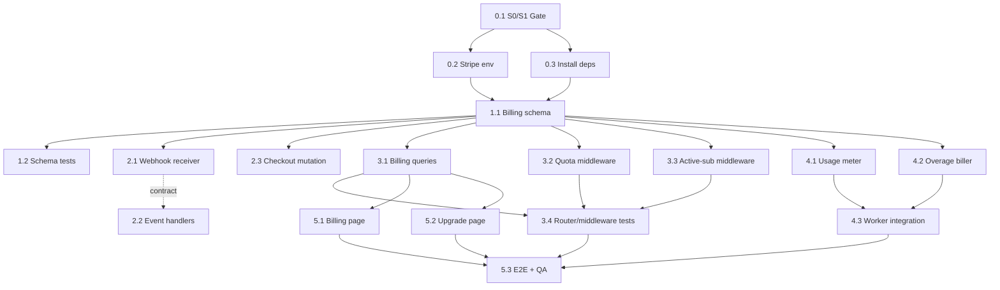

## Initial User Prompt

Add Stripe billing to Travel Champ so agencies can subscribe to Starter/Growth/Pro plans. Implement Stripe webhooks, plan quota enforcement, nightly usage metering, and monthly overage billing. Build the dashboard billing page with plan upgrade, usage widget, and invoice history.

## Description

Sprint 2 turns Travel Champ into a monetizable SaaS. Agencies created in Sprint 1 select a paid plan and subscribe through Stripe Checkout. Stripe webhooks keep the platform in sync with subscription status, invoices, and payment outcomes. The backend enforces tier limits on active trips and travelers, meters usage nightly, and reports overage travelers to Stripe's metered billing once per billing period. A dashboard billing page gives agency owners visibility into their current plan, real-time usage, invoice history, and an upgrade path. When a trial expires or a subscription lapses, write operations are blocked while read access remains available.

**Scope**:
- Included:
  - Stripe Checkout session creation and plan-tier mapping.
  - Secure Stripe webhook lifecycle handling (checkout completion, subscription updates/deletions, invoice paid/payment_failed).
  - Plan quota enforcement that returns 402 Payment Required when active-trip or traveler caps would be exceeded.
  - Active-subscription/trial middleware that blocks writes on expired trial or inactive subscription.
  - Nightly usage metering that records daily active-trip and traveler counts per organization.
  - Monthly overage billing that reports the correct overage traveler quantity at the tier-specific rate.
  - Dashboard billing UI showing current plan, usage progress, invoice history, and plan upgrade flow.
  - Invoice sync from Stripe webhook events.
- Excluded:
  - Refunds and disputes beyond basic invoice.payment_failed handling.
  - Advanced dunning or payment recovery workflows.
  - Annual-plan checkout customization beyond a standard discount.
  - Tax, VAT, or multi-currency pricing.
  - Payment-method management or off-session payment setup.
  - Subscription proration logic.
  - Cancellation flows beyond webhook-driven status updates.

## Skill

For implementation guidance, patterns, and Stripe/Hono snippets, see `.claude/skills/travel-champ-billing-subscription/SKILL.md`.

## User Scenarios

1. **Primary Flow**: Agency owner opens the dashboard billing page, clicks "Upgrade", selects the Pro plan, and completes Stripe Checkout. The webhook updates the agency's subscription to active with the Pro tier and the dashboard reflects the new plan limits.
2. **Alternative Flow**: A Starter agency with 3 active trips attempts to create a 4th trip. The request is rejected with HTTP 402 Payment Required and an upgrade CTA is shown.
3. **Alternative Flow**: A new agency is on an active trial. Members can create trips and travelers within trial limits. Once the trial expires, write operations are blocked while read-only access remains.
4. **Error Handling**: Stripe sends a webhook with an invalid signature. The system returns HTTP 400 and makes no database changes.
5. **Error Handling**: Stripe sends invoice.payment_failed. The local invoice is marked failed and an alert is recorded for the agency owner.

## Acceptance Criteria

### Functional Requirements

- [ ] **AC1 — Checkout session maps to selected plan tier**
  - Given an agency owner chooses a plan tier (Starter, Growth, or Pro).
  - When the system creates a Stripe Checkout session.
  - Then the session metadata contains the selected tier and the redirect returns the Stripe session URL.

- [ ] **AC2 — Completed checkout records the correct subscription tier**
  - Given a Stripe Checkout session for the Pro tier completes successfully.
  - When the system receives checkout.session.completed for that session.
  - Then the agency's subscription is created or updated with plan tier Pro, status active, and the associated Stripe customer/subscription IDs.

- [ ] **AC3 — Webhook signature verification rejects invalid events**
  - Given a POST request to the Stripe webhook endpoint with an invalid or missing signature.
  - When the system validates the signature.
  - Then it responds with HTTP 400 and no local subscription, invoice, or usage state changes.

- [ ] **AC4 — Subscription lifecycle events update local status**
  - Given a subscription exists for an agency with status active.
  - When Stripe sends customer.subscription.updated with status past_due or canceled.
  - Then the local subscription status is updated to the received value.

- [ ] **AC5 — Subscription deletion marks the local subscription inactive**
  - Given an agency has an active subscription.
  - When Stripe sends customer.subscription.deleted.
  - Then the local subscription status is updated to canceled and subsequent writes are blocked unless an active trial remains.

- [ ] **AC6 — Expired trial blocks writes but preserves reads**
  - Given an agency has no active subscription and the trial end date has passed.
  - When a member attempts a mutating operation (create trip, add traveler, etc.).
  - Then the request is rejected with HTTP 402 Payment Required, while read-only requests for existing data continue to succeed.

- [ ] **AC7 — Active-trip quota returns 402 when exceeded**
  - Given a Starter agency already has 3 active trips.
  - When a member attempts to create a 4th active trip.
  - Then the request is rejected with HTTP 402 Payment Required and a response indicating the active-trip limit.

- [ ] **AC8 — Traveler quota returns 402 when exceeded**
  - Given a Starter agency already has 150 active travelers.
  - When a member attempts to add one more active traveler.
  - Then the request is rejected with HTTP 402 Payment Required and a response indicating the traveler limit.

- [ ] **AC9 — Nightly metering records daily usage rows**
  - Given multiple agencies exist with varying active-trip and traveler counts.
  - When the nightly metering job runs.
  - Then usageEvents rows are inserted for each agency with one ACTIVE_TRIPS row and one TRAVELERS row per calendar day, and re-running the job for the same day does not create duplicates.

- [ ] **AC10 — Monthly overage billing reports correct quantity and rate**
  - Given a Starter agency had a maximum of 200 active travelers on any day in the prior billing period and the Starter cap is 150 travelers.
  - When the monthly overage billing job runs for that period.
  - Then the job reports an overage quantity of 50 travelers to the Stripe metered price for the Starter tier at the Starter overage rate.

- [ ] **AC11 — Dashboard billing UI displays plan, usage, invoices, and upgrade**
  - Given an agency owner navigates to the billing page.
  - When the page loads.
  - Then it shows the current plan card, active-trip and traveler usage progress bars, a list of invoices with status and amount, and a visible action to upgrade the plan.

- [ ] **AC12 — Invoice sync reflects paid and failed invoices**
  - Given a Stripe invoice exists for an agency.
  - When Stripe sends invoice.paid, the local invoice is marked paid with paid date and PDF URL.
  - When Stripe sends invoice.payment_failed, the local invoice is marked failed and an alert is recorded.

### Non-Functional Requirements

- [ ] **NF1 — Webhook security**: All Stripe webhook requests that fail signature verification are rejected before any business logic runs.
- [ ] **NF2 — Quota check performance**: Plan quota checks complete within the request path in under 100 ms.
- [ ] **NF3 — Metering reliability**: Nightly usage metering is idempotent for the same calendar day.
- [ ] **NF4 — Auditability**: Subscription, usage, and invoice records are append-only/auditable; financial rows are never hard-deleted.

### Definition of Done

- [ ] All acceptance criteria pass.
- [ ] Tests cover checkout/tier mapping, webhook handling, quota enforcement, trial gating, nightly metering, monthly overage billing, and invoice sync.
- [ ] Dashboard billing UI is verified with automated UI tests or manual QA.
- [ ] Documentation updated with plan caps, overage rates, and webhook event handling.
- [ ] Code reviewed and merged.


## Architecture Overview

> Synthesis: [`.specs/scratchpad/59833dc51d94a766.md`](../../scratchpad/59833dc51d94a766.md)<br>
> Skill: [`.claude/skills/travel-champ-billing-subscription/SKILL.md`](../../../.claude/skills/travel-champ-billing-subscription/SKILL.md)<br>
> Analysis: [`.specs/analysis/analysis-travel-champ-s2-billing-subscription.md`](../../analysis/analysis-travel-champ-s2-billing-subscription.md)

### S0/S1 Dependency Blocker

S2 cannot be built or type-checked until S1 lands. See [S1 agency onboarding](travel-champ-s1-agency-onboarding.feature.md).

| Prerequisite | Why it blocks S2 |
|---|---|
| `apps/dashboard` Vite SPA + auth router | Billing UI has no host app. |
| `packages/db/src/schema/organizations.ts` + `organizationMembers.ts` | Subscription/trial state scopes to an org. |
| `trips.organizationId` and `users.organizationId` | Plan quotas and usage metering need org-scoped counts. |
| `requireOrgMembership` middleware + org context | Billing procedures must know the caller's org and role. |
| `trip.create` converted from `adminProcedure` to org-protected | `requirePlanQuota` must mount on a real org procedure. |
| `apps/seed/` removed | Inherited S0 cleanup blocker. |

### Solution Strategy

Stripe Checkout drives plan selection; Stripe webhooks keep local subscription/invoice state in sync. Two oRPC middlewares enforce commercial policy (`requirePlanQuota`, `requireActiveSubscription`). Nightly and monthly notification-sender jobs meter usage and report metered overages. A React dashboard exposes plan status, usage, invoice history, and the upgrade flow.

### Component Architecture

```
Dashboard (React)
├── /billing            → plan card, usage bars, invoice table
└── /billing/upgrade    → tier cards → createCheckoutSession → Stripe

backend-server (Hono)
├── POST /webhooks/stripe   → constructEvent + 5 event handlers
└── /api/* (oRPC)           → billing router + middlewares

orpc
├── routers/billing/        → queries, mutations, types
├── middleware/requirePlanQuota.ts
└── middleware/requireActiveSubscription.ts

db
├── schema/billing.ts       → subscriptions, usageEvents, invoices
└── schema/enums.ts         → subscriptionStatusEnum, usageMetricEnum

notification-sender
├── jobs/usageMeter.ts      → nightly usageEvents per org
└── jobs/overageBiller.ts   → monthly Stripe usage report
```

### Key Architectural Decisions

1. **Plain Hono webhook route, not oRPC**
   - Stripe signature verification requires the raw request body; oRPC JSON parsing breaks it.
2. **Hybrid pricing model**
   - Fixed subscription + metered traveler overage balances predictable base MRR with expansion revenue.
3. **Value metric = active travelers**
   - Metered overage aligns price with agency scale; active-trip cap controls feature breadth separately.
4. **Monthly overage `action: 'set'`**
   - Prevents ever-increasing metered totals; reports the peak daily traveler count once per billing period.
5. **Separate quota and active-subscription middleware**
   - Keeps read paths free while gating writes; quota can be applied per mutation.
6. **Notification-sender owns metering/billing jobs**
   - Reuses existing worker infrastructure; keeps the backend request path fast and stateless.
7. **Append-only financial records**
   - `subscriptions`, `usageEvents`, and `invoices` are auditable; rows are never hard-deleted.
8. **Webhook route registered before oRPC catch-all**
   - Guarantees raw body availability for `constructEvent`.

### Boundary Layer Matrix

| Concern | Layer | Notes |
|---|---|---|
| Stripe signature verification | `backend-server` raw Hono route | Runs before any body parser. |
| Subscription/invoice writes | `backend-server` webhooks + `db` | Idempotent upserts by Stripe IDs. |
| Checkout / portal mutations | `orpc` billing router | Org-scoped; calls Stripe SDK. |
| Quota / active-sub gating | `orpc` middleware | Reusable across trip and organization routers. |
| Daily usage snapshots | `notification-sender` cron | Reads live DB counts; writes `usageEvents`. |
| Monthly overage reporting | `notification-sender` cron | Computes `MAX(dailyTravelers)`; uses `action: 'set'`. |
| Billing UI | `apps/dashboard` React pages | React Query + oRPC client. |

### Expected Changes

| Type | Path | Change | Dependency / Note |
|---|---|---|---|
| Create | `packages/db/src/schema/billing.ts` | `subscriptions`, `usageEvents`, `invoices` tables + relations | S1 org tables must exist first. |
| Modify | `packages/db/src/schema/enums.ts` | add `subscriptionStatusEnum`, `usageMetricEnum` | None. |
| Modify | `packages/db/src/schema/relations.ts` | wire `organizations.subscriptions` / `organizations.invoices` | S1 org tables. |
| Modify | `packages/db/src/schema/index.ts` | export billing tables/types, add to `schemaTables` | None. |
| Modify | `packages/db/src/schema/organizations.ts` | add `stripeCustomerId`, `planTier`, `trialEndsAt` if not in S1 | S1 org schema. |
| Create | `apps/backend-server/src/webhooks/stripe.ts` | webhook receiver with raw-body verification | Stripe env vars. |
| Modify | `apps/backend-server/src/server.ts` | register `POST /webhooks/stripe` **before** oRPC catch-all | None. |
| Modify | `apps/backend-server/src/index.ts` | validate Stripe env at startup | None. |
| Modify | `apps/backend-server/package.json` | add `stripe` dependency | None. |
| Create | `packages/orpc/src/api/routers/billing/types.ts` | Zod input/output types for billing | None. |
| Create | `packages/orpc/src/api/routers/billing/queries.ts` | `getSubscription`, `getUsage`, `getInvoices` | S1 org context. |
| Create | `packages/orpc/src/api/routers/billing/mutations.ts` | `createCheckoutSession`, `createBillingPortalSession` | Stripe price IDs. |
| Create | `packages/orpc/src/api/routers/billing/index.ts` | barrel export | None. |
| Modify | `packages/orpc/src/api/root.ts` | mount `billingRouter` under `appRouter.billing` | None. |
| Create | `packages/orpc/src/api/middleware/requirePlanQuota.ts` | quota check returning 402 ORPCError | None. |
| Create | `packages/orpc/src/api/middleware/requireActiveSubscription.ts` | write gate for active sub/trial | None. |
| Modify | `packages/orpc/src/api/routers/trip/mutations.ts` | chain quota + active-subscription on `trip.create` | S1 org-protected procedure. |
| Modify | `packages/orpc/src/api/routers/organization/mutations.ts` | chain `requirePlanQuota('travelers', 1)` on staff invite | S1 file. |
| Create | `packages/orpc/src/api/routers/billing/__tests__/billing.pglite.test.ts` | PGLite tests mocking Stripe | S1 test harness. |
| Create | `packages/orpc/src/api/routers/__tests__/quota.middleware.pglite.test.ts` | quota/trial middleware tests | S1 test harness. |
| Create | `apps/backend-server/src/__tests__/webhooks/stripe.test.ts` | mocked `constructEvent` + DB assertions | None. |
| Create | `apps/notification-sender/src/jobs/usageMeter.ts` | nightly `usageEvents` insert | None. |
| Create | `apps/notification-sender/src/jobs/overageBiller.ts` | monthly `createUsageRecord` | Stripe metered price IDs. |
| Create | `apps/notification-sender/src/__tests__/usageMeter.test.ts` | fixture-based count assertions | S1 test harness. |
| Create | `apps/notification-sender/src/__tests__/overageBiller.test.ts` | overage qty + tier rate assertions | S1 test harness. |
| Create | `apps/dashboard/src/pages/Billing.tsx` | plan/usage/invoices page | S1 dashboard scaffold. |
| Create | `apps/dashboard/src/pages/BillingUpgrade.tsx` | tier cards + checkout redirect | S1 dashboard scaffold. |
| Create | `apps/dashboard/e2e/billing.spec.ts` | Playwright upgrade flow | S1 E2E setup. |
| Modify | `apps/dashboard/src/router.tsx` | add `/billing` and `/billing/upgrade` routes | S1 router. |
| Modify | `apps/dashboard/src/layouts/DashboardLayout.tsx` | add Billing nav link | S1 layout. |
| Modify | `environment/.env.example` | add Stripe secrets + price IDs | None. |
| Modify | `apps/backend-server/.env.example` | add Stripe secrets + price IDs | None. |
| Modify | `apps/notification-sender/.env.example` | add Stripe secrets if worker runs overage job | None. |

### References

- [`.specs/scratchpad/59833dc51d94a766.md`](../../scratchpad/59833dc51d94a766.md)
- [`.claude/skills/travel-champ-billing-subscription/SKILL.md`](../../../.claude/skills/travel-champ-billing-subscription/SKILL.md)
- [`.specs/analysis/analysis-travel-champ-s2-billing-subscription.md`](../../analysis/analysis-travel-champ-s2-billing-subscription.md)
- [Stripe Checkout quickstart](https://docs.stripe.com/checkout/quickstart?lang=node)
- [Stripe webhook quickstart](https://docs.stripe.com/webhooks/quickstart)
- [Legacy usage records](https://docs.stripe.com/billing/subscriptions/usage-based-legacy/recording-usage)
- [Modern meter events](https://docs.stripe.com/billing/subscriptions/usage-based/recording-usage-api)

## Implementation Process

### Phase 0 — Setup & S0/S1 Gate

#### Step 0.1 — Verify S0/S1 prerequisites

**Agent:** subagent_type:oracle

**Goal:** Confirm every S1 deliverable exists before changing S2 code.

**Subtasks:**

1. Confirm `apps/dashboard/` exists as a Vite SPA with auth router, React Query, and `@mirai-app/orpc` client.
2. Confirm `packages/db/src/schema/organizations.ts` and `organizationMembers.ts` exist.
3. Confirm `trips.organizationId` and `users.organizationId` columns exist and are `NOT NULL`.
4. Confirm `packages/orpc/src/api/middleware/requireOrgMembership.ts` exists and `protectedProcedure` context exposes `organizationId` and role.
5. Confirm `trip.create` is org-protected (no longer global `adminProcedure`).
6. Confirm `apps/seed/` is removed.
7. Record the gate result in the scratchpad `f0c9622cb52f0392.md`.

**Success criteria:**

- `apps/dashboard/src/router.tsx` is present.
- `nx run-many -t typecheck` passes on the current S1 branch.
- S1 acceptance criteria are all checked off.

**Blockers / Risks:**

| Risk | Severity | Mitigation |
|------|----------|------------|
| S1 not merged | High | Do not start Step 1.1 until S1 ACs pass; re-run impact analysis after S1 lands. |
| Org schema still shifting | High | Freeze S1 schema before S2 migration generation; re-generate after any S1 change. |

#### Step 0.2 — Stripe environment + price catalog

**Agent:** category:deep

**Goal:** Obtain and configure Stripe keys and price IDs for dev/staging/test.

**Subtasks:**

1. Create or reuse a Stripe test account.
2. Create products/prices for Starter, Growth, Pro fixed recurring plans.
3. Create metered overage prices per tier.
4. Add `STRIPE_SECRET_KEY`, `STRIPE_WEBHOOK_SECRET`, fixed price IDs, and metered price IDs to `environment/.env.example`, `apps/backend-server/.env.example`, and `apps/notification-sender/.env.example`.
5. Validate required Stripe env vars at backend startup (`apps/backend-server/src/index.ts`).

**Success criteria:**

- `.env.example` contains every required Stripe variable.
- Backend startup fails fast with a clear message if a Stripe var is missing.
- `stripe listen --forward-to http://localhost:3000/webhooks/stripe` connects successfully.

**Blockers / Risks:**

| Risk | Severity | Mitigation |
|------|----------|------------|
| Webhook secret per endpoint mismatch | High | Store one secret per deployed endpoint; never disable verification. |
| Price IDs differ across environments | Medium | Load IDs from env only; never hard-code. |

#### Step 0.3 — Install dependencies and review skill

**Agent:** category:quick

**Goal:** Add Stripe SDKs and ensure the billing skill is reviewed.

**Subtasks:**

1. Add `stripe` to `apps/backend-server/package.json`.
2. Add `@stripe/stripe-js` to `apps/dashboard/package.json` if missing.
3. Run `bun install`.
4. Review `.claude/skills/travel-champ-billing-subscription/SKILL.md` and `.specs/analysis/analysis-travel-champ-s2-billing-subscription.md`.

**Success criteria:**

- `bun.lock` updated.
- `import Stripe from 'stripe'` resolves in `apps/backend-server`.
- No peer-dep warnings for Stripe packages.

---

### Phase 1 — Foundational: Billing Schema

#### Step 1.1 — Database schema additions

**Agent:** category:deep

**Goal:** Add tables and enums for subscriptions, usage, and invoices.

**Subtasks:**

1. In `packages/db/src/schema/enums.ts`, add `subscriptionStatusEnum` and `usageMetricEnum`.
2. Create `packages/db/src/schema/billing.ts` with `subscriptions`, `usageEvents`, and `invoices` tables plus relations.
3. In `packages/db/src/schema/relations.ts`, wire `organizations.subscriptions` and `organizations.invoices`.
4. In `packages/db/src/schema/index.ts`, export new billing tables/types and add them to `schemaTables`.
5. In `packages/db/src/schema/organizations.ts`, add `stripeCustomerId`, `planTier`, and `trialEndsAt` if S1 did not add them.
6. Generate Drizzle migrations (`bunx drizzle-kit generate` or `nx run @mirai-app/db:generate`).

**Success criteria:**

- `packages/db/src/schema/billing.ts` type-checks.
- Migration SQL files exist under `packages/db/drizzle/`.
- PGLite setup can create and query `subscriptions`, `usageEvents`, and `invoices`.

**Blockers / Risks:**

| Risk | Severity | Mitigation |
|------|----------|------------|
| S1 org schema changes after migration | High | Re-generate migration after S1 freeze; run diff at PR time. |
| Relations mismatch with S1 org table | High | Verify FK names match S1 `organizations.id` conventions. |

#### Step 1.2 — Schema CRUD tests

**Agent:** category:deep

**Goal:** Validate the new tables and idempotency guarantees.

**Subtasks:**

1. Add a PGLite test file for billing schema CRUD.
2. Test upsert of `subscriptions` by `stripeSubscriptionId` is idempotent.
3. Test insertion of `usageEvents` for the same org+date+metric is idempotent.
4. Test `invoices` upsert by `stripeInvoiceId`.

**Success criteria:**

- New test file passes (`bun test packages/db/...` or the relevant nx target).
- Re-running upsert scenarios does not create duplicate rows.

---

### Phase 2 — Foundational: Stripe Integration + Webhooks

#### Step 2.1 — Raw Hono webhook receiver

**Agent:** category:deep

**Goal:** Securely receive and verify Stripe webhook events before any body parsing.

**Subtasks:**

1. Create `apps/backend-server/src/webhooks/stripe.ts` exporting `stripeWebhook` handler.
2. Capture raw body with `c.req.raw.text()`.
3. Verify `stripe-signature` header using `stripe.webhooks.constructEvent`.
4. Return HTTP 400 on invalid/missing signature without touching the database.
5. Register `app.post('/webhooks/stripe', stripeWebhook)` in `apps/backend-server/src/server.ts` **before** the oRPC catch-all.
6. Log event type and idempotency key for observability.

**Success criteria:**

- `apps/backend-server/src/__tests__/webhooks/stripe.test.ts` asserts 400 on bad signature and 200 on valid signature.
- `stripe trigger checkout.session.completed --forward-to http://localhost:3000/webhooks/stripe` reaches the handler.

**Blockers / Risks:**

| Risk | Severity | Mitigation |
|------|----------|------------|
| Raw body consumed by JSON parser | High | Mount route before oRPC; use `c.req.raw.text()`. Add a regression test that pipes a raw body through. |
| Webhook secret rotation | High | Always verify in all environments; treat missing secret as fatal. |

#### Step 2.2 — Webhook event handlers

**Agent:** category:deep

**Goal:** Idempotently update local subscription/invoice state for each event.

**Subtasks:**

1. `checkout.session.completed`: upsert subscription with tier from `metadata.tier`, status `active`, stripe customer/subscription IDs.
2. `customer.subscription.updated`: update local status and plan tier.
3. `customer.subscription.deleted`: set local status to `canceled`.
4. `invoice.paid`: upsert invoice with status paid, paid date, and PDF URL.
5. `invoice.payment_failed`: upsert invoice with status failed and create an agency owner alert.
6. Use upsert by Stripe IDs for all writes.
7. Add backend webhook tests covering each event and asserting DB side effects.

**Success criteria:**

- Each handler returns HTTP 200 and persists expected rows.
- Re-running the same webhook payload does not create duplicate rows.

#### Step 2.3 — Checkout session creation

**Agent:** category:deep

**Goal:** Dashboard can ask backend to create a Stripe Checkout session for a selected tier.

**Subtasks:**

1. In `packages/orpc/src/api/routers/billing/mutations.ts`, implement `createCheckoutSession`.
2. Map tier input to Stripe fixed price IDs from env.
3. Set `metadata.tier` to the selected tier.
4. Return `{ url }` from `stripe.checkout.sessions.create`.
5. Add Zod types in `packages/orpc/src/api/routers/billing/types.ts`.

**Success criteria:**

- PGLite test mocks `stripe.checkout.sessions.create` and asserts returned `url`.
- Metadata in the mock contains the selected tier.

---

### Phase 3 — User Stories: Billing Router + Quota/Subscription Enforcement

#### Step 3.1 — Billing router queries

**Agent:** category:deep

**Goal:** Expose subscription, usage, and invoice data to the dashboard.

**Subtasks:**

1. Create `packages/orpc/src/api/routers/billing/queries.ts` with `getSubscription`, `getUsage`, `getInvoices`.
2. Create `packages/orpc/src/api/routers/billing/types.ts` for inputs/outputs.
3. Create `packages/orpc/src/api/routers/billing/index.ts` as a barrel file.
4. Mount `billingRouter` under `appRouter.billing` in `packages/orpc/src/api/root.ts`.
5. Compute current usage from `usageEvents` for the active billing period.

**Success criteria:**

- `billing.getSubscription`, `billing.getUsage`, and `billing.getInvoices` are callable from the oRPC client.
- PGLite tests return the expected plan card and invoice list payloads.

#### Step 3.2 — Plan quota middleware

**Agent:** category:deep

**Goal:** Enforce active-trip and traveler caps, returning HTTP 402 when exceeded.

**Subtasks:**

1. Create `packages/orpc/src/api/middleware/requirePlanQuota.ts`.
2. Define plan caps (Starter: 3 active trips / 150 travelers; Growth/Pro from docs/env).
3. Accept `metric: 'trips' | 'travelers'` and `count: number`.
4. Count current usage for the caller's org and reject if `current + count > limit` with ORPCError `PAYMENT_REQUIRED`.
5. Mount on `trip.create` (`requirePlanQuota('trips', 1)`) and organization staff invite (`requirePlanQuota('travelers', 1)`).

**Success criteria:**

- Starter org with 3 active trips receives HTTP 402 on 4th trip.
- Starter org with 150 travelers receives HTTP 402 on adding traveler 151.
- Growth/Pro orgs allow limits above Starter cap.

**Blockers / Risks:**

| Risk | Severity | Mitigation |
|------|----------|------------|
| Concurrent writes exceed quota | High | Wrap quota check + insert in a transaction with `SELECT ... FOR UPDATE` or serializable isolation; add concurrency test. |
| Plan cap drift from marketing docs | Medium | Store caps in code constants and tests; update both together. |

#### Step 3.3 — Active subscription / trial middleware

**Agent:** category:deep

**Goal:** Block writes when trial expired or subscription inactive; reads stay open.

**Subtasks:**

1. Create `packages/orpc/src/api/middleware/requireActiveSubscription.ts`.
2. Allow writes when subscription status is `active` or `trialing` and `trialEndsAt > NOW()`.
3. Return HTTP 402 for mutating operations when inactive/expired.
4. Leave read-only procedures untouched.
5. Mount on all mutating trip and organization procedures.

**Success criteria:**

- Expired-trial PGLite test blocks `trip.create` with HTTP 402.
- Same test confirms `trip.get` still returns data.
- Active subscription allows writes.

**Blockers / Risks:**

| Risk | Severity | Mitigation |
|------|----------|------------|
| Writes exactly at expiration boundary behave inconsistently | High | Compare `trialEndsAt > NOW()` in UTC only; test with frozen clock. |

#### Step 3.4 — Billing router and middleware tests

**Agent:** category:deep

**Goal:** Cover AC1–AC8 and prevent regressions.

**Subtasks:**

1. Add `packages/orpc/src/api/routers/billing/__tests__/billing.pglite.test.ts` (mocked Stripe).
2. Add `packages/orpc/src/api/routers/__tests__/quota.middleware.pglite.test.ts`.
3. Run `nx run-many -t test` for `db`, `orpc`, and `backend-server`.

**Success criteria:**

- All new PGLite tests pass.
- S1 tests still pass.

---

### Phase 4 — User Stories: Usage Metering + Overage Billing

#### Step 4.1 — Nightly usage metering job

**Agent:** category:deep

**Goal:** Record daily active-trip and traveler counts per organization.

**Subtasks:**

1. Create `apps/notification-sender/src/jobs/usageMeter.ts`.
2. Query all `organizations`.
3. Count active trips and active travelers per org.
4. Insert one `ACTIVE_TRIPS` row and one `TRAVELERS` row per org per calendar day.
5. Use upsert semantics so re-running for the same day is idempotent.
6. Wire the job into the notification-sender worker schedule.

**Success criteria:**

- `apps/notification-sender/src/__tests__/usageMeter.test.ts` passes with fixture orgs/trips/travelers.
- Re-running the job for the same day does not duplicate rows.

**Blockers / Risks:**

| Risk | Severity | Mitigation |
|------|----------|------------|
| Large count queries are slow | Medium | Add indexes on `trips.organizationId`, `trips.status`, `users.organizationId`. |

#### Step 4.2 — Monthly overage billing job

**Agent:** category:deep

**Goal:** Report traveler overage to Stripe metered billing once per period.

**Subtasks:**

1. Create `apps/notification-sender/src/jobs/overageBiller.ts`.
2. For each org, compute `MAX(dailyTravelers)` in the prior billing period.
3. Subtract plan allowance (Starter 150, Growth/Pro from config).
4. If > 0, call `stripe.subscriptionItems.createUsageRecord(stripeSubscriptionItemId, { quantity: overage, action: 'set', timestamp })`.
5. Use tier-specific metered price IDs and overage rates.
6. Add test with fixture: Starter org max 200 travelers → 50 overage × Starter rate.

**Success criteria:**

- `apps/notification-sender/src/__tests__/overageBiller.test.ts` asserts quantity and tier rate.
- Manual Stripe test dashboard shows expected metered usage.

**Blockers / Risks:**

| Risk | Severity | Mitigation |
|------|----------|------------|
| Wrong aggregation (sum vs max) | High | Code uses explicit `MAX`; fixture test locks behavior. |
| Wrong tier rate after plan change | High | Use subscription-period tier recorded in `subscriptions` row, not current `organizations.planTier`. |
| Metered total keeps growing | Medium | Use `action: 'set'` once per billing period. |

#### Step 4.3 — Worker integration and env

**Agent:** category:unspecified-high

**Goal:** Schedule the jobs and ensure env vars reach the worker.

**Subtasks:**

1. Import and schedule `usageMeter` and `overageBiller` in the notification-sender runner.
2. Add Stripe env vars to `apps/notification-sender/.env.example`.
3. Add nx test target run for notification-sender.

**Success criteria:**

- `nx run @mirai-app/notification-sender:test` passes.
- Job logs show daily run and monthly run.

---

### Phase 5 — Polish: Dashboard Billing UI + E2E

#### Step 5.1 — Billing page

**Agent:** category:deep

**Goal:** Show agency owners their plan, usage, invoices, and upgrade path.

**Subtasks:**

1. Create `apps/dashboard/src/pages/Billing.tsx`.
2. Fetch `billing.getSubscription`, `billing.getUsage`, `billing.getInvoices` via React Query.
3. Render plan card, active-trip progress bar, traveler progress bar, invoice table (status, amount, PDF).
4. Add “Upgrade plan” button linking to `/billing/upgrade`.
5. Handle empty/loading/error states.

**Success criteria:**

- Page renders in local dev with no console errors.
- Manual QA confirms all AC11 elements are visible.

#### Step 5.2 — Upgrade page + navigation

**Agent:** category:deep

**Goal:** Let users select a tier and start Stripe Checkout.

**Subtasks:**

1. Create `apps/dashboard/src/pages/BillingUpgrade.tsx` with Starter/Growth/Pro tier cards.
2. On click, call `billing.createCheckoutSession.mutate({ tier })` and redirect to returned `url`.
3. Add `/billing` and `/billing/upgrade` routes in `apps/dashboard/src/router.tsx`.
4. Add a “Billing” nav link in `apps/dashboard/src/layouts/DashboardLayout.tsx`.

**Success criteria:**

- Clicking a tier navigates the browser to a Stripe Checkout URL.
- Route renders under org-auth guard.

#### Step 5.3 — Playwright E2E + final QA

**Agent:** category:unspecified-high

**Goal:** Verify the dashboard flow end-to-end.

**Subtasks:**

1. Create `apps/dashboard/e2e/billing.spec.ts`.
2. Mock the Stripe Checkout redirect (intercept `createCheckoutSession` response, simulate return).
3. Assert updated plan is reflected after successful webhook-driven update (seed or mock subscription).
4. Run `nx run @mirai-app/dashboard-e2e:e2e` or the Playwright target.

**Success criteria:**

- E2E spec passes.
- Dashboard screenshots match design expectations.

**Blockers / Risks:**

| Risk | Severity | Mitigation |
|------|----------|------------|
| External Stripe dependency in CI | Medium | Mock Stripe calls in E2E; use test keys only for local Stripe CLI smoke tests. |
| S1 dashboard layout missing or auth guard broken | Medium | Gate on S1 dashboard scaffold; add fallback route if guard not ready. |

---

## Parallelization

This task is split into 6 sequential waves. The maximum parallel depth is 8 steps inside Wave 3 (backend/core foundation), which can run once S0/S1 is green and the billing schema (Step 1.1) is landed. See full rationale in [`.specs/scratchpad/1f5cb22cea8311fc.md`](../../scratchpad/1f5cb22cea8311fc.md).

### Dependency waves

```text
Wave 0 — Gate
  0.1 Verify S0/S1 prerequisites

Wave 1 — Setup  **Parallel with:**
  0.2 Stripe environment + price catalog
  0.3 Install dependencies and review skill

Wave 2 — Schema
  1.1 Database schema additions

Wave 3 — Backend core  **Parallel with:**
  1.2 Schema CRUD tests
  2.1 Raw Hono webhook receiver
  2.2 Webhook event handlers         **Parallel with:** 2.1
  2.3 Checkout session creation
  3.1 Billing router queries
  3.2 Plan quota middleware
  3.3 Active subscription / trial middleware
  4.1 Nightly usage metering job
  4.2 Monthly overage billing job

Wave 4 — Integration
  3.4 Billing router and middleware tests   waits for 3.1, 3.2, 3.3
  4.3 Worker integration and env            waits for 4.1, 4.2

Wave 5 — Dashboard UI  **Parallel with:**
  5.1 Billing page                     waits for 3.1 typed client
  5.2 Upgrade page + navigation        waits for 3.1 typed client

Wave 6 — E2E
  5.3 Playwright E2E + final QA        waits for 3.4, 4.3, 5.1, 5.2
```

### Mermaid dependency diagram



### Sub-Agent Execution Directive

#### MUST rules

1. **S0/S1 gating** — No work starts until the Oracle agent returns a green gate checklist for Step 0.1. If S1 typecheck fails, stop and escalate.
2. **Coordinate shared files** — `packages/db/src/schema/index.ts`, `packages/db/src/schema/relations.ts`, and `packages/orpc/src/api/root.ts` are shared ownership. Any agent touching them must log a `### Shared-file lock` entry in the scratchpad and release it after the edit lands.
3. **Stripe mock secrets** — Real `STRIPE_SECRET_KEY` and `STRIPE_WEBHOOK_SECRET` must never enter tests or scratchpad output. Tests use deterministic mock values loaded via `process.env` only inside test files.
4. **Idempotency** — Webhook handlers and batch jobs must be idempotent by Stripe/primary IDs. Steps 1.2, 2.2, 4.1, and 4.2 require explicit idempotency regression tests.
5. **Typed-consumer contract** — Dashboard agents (5.1, 5.2) may only import billing router types after Step 3.1 creates a runnable typed client. If the router contract changes, dashboard agents must re-run typecheck.
6. **E2E gate queuing** — Step 5.3 must not start until 3.4 (backend tests), 4.3 (worker integration), 5.1, and 5.2 are merged and `nx run-many -t typecheck` is green.
7. **Environment propagation** — Changes to `.env.example` files must be copied to `environment/`, `apps/backend-server/`, and `apps/notification-sender/`.
8. **No hard-coded plan prices** — Plan caps, overage rates, and Stripe price IDs must load from environment variables or code constants documented in the billing skill.

#### SHOULD rules

- Backend agents should open PR-sized branches per wave for focused review.
- Dashboard agents should run UI against a mocked backend before the backend is fully merged.
- Agents working on 3.2 and 3.3 should align error shape on `ORPCError('PAYMENT_REQUIRED', ...)`.

## Implementation Summary

| Phase | Step | Goal | Key Deliverable(s) | Verification Command / Test | Risk Level |
|-------|------|------|--------------------|-----------------------------|------------|
| 0 | 0.1 | S0/S1 gate | Gate checklist | `nx run-many -t typecheck` passes S1 | High |
| 0 | 0.2 | Stripe env + prices | Updated `.env.example` files + startup validation | `bun run dev` fails fast if vars missing | High |
| 0 | 0.3 | Install deps | `stripe`, `@stripe/stripe-js` in lockfile | `import Stripe from 'stripe'` resolves | Low |
| 1 | 1.1 | Billing schema | `packages/db/src/schema/billing.ts` + migrations | `nx run @mirai-app/db:generate` + PGLite setup | High |
| 1 | 1.2 | Schema tests | Billing CRUD PGLite tests | `bun test packages/db/...` passes | Low |
| 2 | 2.1 | Raw webhook receiver | `apps/backend-server/src/webhooks/stripe.ts` | `stripe.test.ts` 400/200 assertions | High |
| 2 | 2.2 | Event handlers | 5 event handler implementations | DB-side-effect tests pass | Medium |
| 2 | 2.3 | Checkout mutation | `createCheckoutSession` in billing router | Mock test returns Stripe URL | Low |
| 3 | 3.1 | Billing queries | `getSubscription`, `getUsage`, `getInvoices` | oRPC PGLite tests pass | Low |
| 3 | 3.2 | Quota middleware | `requirePlanQuota.ts` | HTTP 402 tests for trip/traveler limits | High |
| 3 | 3.3 | Subscription middleware | `requireActiveSubscription.ts` | Expired-trial blocks writes, allows reads | High |
| 3 | 3.4 | Router + middleware tests | Test files for billing and quota | All orpc tests green | Medium |
| 4 | 4.1 | Nightly usage meter | `apps/notification-sender/src/jobs/usageMeter.ts` | `usageMeter.test.ts` passes | Low |
| 4 | 4.2 | Monthly overage biller | `apps/notification-sender/src/jobs/overageBiller.ts` | `overageBiller.test.ts` passes | High |
| 4 | 4.3 | Worker integration | Scheduled jobs + env vars | Notification-sender test target passes | Low |
| 5 | 5.1 | Billing page | `Billing.tsx` | Manual QA / UI screenshot | Low |
| 5 | 5.2 | Upgrade page | `BillingUpgrade.tsx` + routes + nav | Click-through reaches Stripe URL | Low |
| 5 | 5.3 | E2E + final QA | `billing.spec.ts` | Playwright target passes | Medium |

**Plan totals:** 18 implementation steps, 90 subtasks, 11 high-priority risks.

## Definition of Done (Implementation)

Aligned with the **Verification** section below:

- [ ] Stripe `checkout.session.completed` creates/updates a `subscriptions` row with the correct plan tier.
- [ ] `customer.subscription.updated` / `customer.subscription.deleted` change local status correctly.
- [ ] Invalid webhook signatures return HTTP 400 and make no DB changes.
- [ ] `trip.create` on Starter plan returns HTTP 402 when active-trip or traveler cap is exceeded.
- [ ] Expired trial blocks mutating operations but read-only requests succeed.
- [ ] Nightly `usageMeter` inserts idempotent `usageEvents` rows for every org per day.
- [ ] Monthly `overageBiller` calls Stripe `createUsageRecord` with the expected overage quantity and tier rate (fixture: Starter 200 travelers = 50 overage × €0.75).
- [ ] Dashboard billing page and upgrade page render plan, usage, invoices, and checkout redirect.
- [ ] PGLite tests, webhook tests, worker tests, and Playwright E2E all pass.
- [ ] `nx run-many -t typecheck` and `nx run-many -t build` exit 0.
- [ ] Documentation updated with plan caps, overage rates, and webhook handling notes.
- [ ] Code reviewed and merged.
## Verification

Full step-by-step rubric with extended failure examples and E2E setup notes lives in `.specs/scratchpad/2e23a18dc05a7108.md`. Run these checks after every implementation wave.

### E2E / local Stripe setup

```bash
cp environment/.env.example environment/.env
cp apps/backend-server/.env.example apps/backend-server/.env
cp apps/notification-sender/.env.example apps/notification-sender/.env
# Fill in STRIPE_SECRET_KEY, STRIPE_WEBHOOK_SECRET, STRIPE_PRICE_*

# Terminal A
nx run @mirai-app/backend-server:dev
# Terminal B
stripe listen --forward-to http://localhost:3000/webhooks/stripe
# Terminal C
stripe trigger checkout.session.completed
stripe trigger customer.subscription.updated
stripe trigger customer.subscription.deleted
stripe trigger invoice.paid
stripe trigger invoice.payment_failed
```

Real Stripe secrets must only live in `.env` files. Tests use mocks or the Stripe CLI `--forward-to` path; never commit `sk_test_` / `sk_live_` / `whsec_` values.

### Category 1 — Unit / Integration tests (PGLite + mocked Stripe)

| # | Check | Command | Expected | Related AC / Requirement | Failure example |
|---|-------|---------|----------|--------------------------|-----------------|
| 1.1 | Billing schema CRUD is idempotent | `bunx --bun vitest run packages/db/src/__tests__/billing-schema.pglite.test.ts` | Exit `0`; upserts by Stripe IDs do not duplicate rows. | AC2, AC9, AC12, NF4 | Second `checkout.session.completed` creates a duplicate `subscriptions` row. |
| 1.2 | Billing router queries return plan/usage/invoices | `bunx --bun vitest run packages/orpc/src/api/routers/billing/__tests__/billing.pglite.test.ts` | Exit `0`; typed payloads returned. | AC11 | `getUsage` returns `null` instead of `0`. |
| 1.3 | Checkout maps tier to price ID and metadata | Same command, filter `-t "checkout"` | Mock receives correct `price` ID and `metadata.tier`. | AC1 | `createCheckoutSession({ tier: "pro" })` uses Starter price ID. |
| 1.4 | Quota middleware rejects 4th Starter trip | `bunx --bun vitest run packages/orpc/src/api/routers/__tests__/quota.middleware.pglite.test.ts` | Exit `0`; `ORPCError('PAYMENT_REQUIRED')` after 3 active trips. | AC7 | 4th trip returns HTTP 200. |
| 1.5 | Quota middleware rejects 151st Starter traveler | Same as 1.4 | Exit `0`; `PAYMENT_REQUIRED` after 150 active travelers. | AC8 | Staff invite accepted past cap. |
| 1.6 | Expired trial blocks writes but keeps reads | Same as 1.4, filter `-t "expired trial"` | `trip.create` 402; `trip.get` still returns data. | AC6 | Queries also blocked. |
| 1.7 | Webhook handlers update subscriptions/invoices | `bunx --bun vitest run apps/backend-server/src/__tests__/webhooks/stripe.test.ts` | Exit `0`; all 5 events assert DB side effects. | AC2, AC4, AC5, AC12 | `customer.subscription.deleted` leaves status `active`. |
| 1.8 | Nightly usage meter is idempotent | `bunx --bun vitest run apps/notification-sender/src/__tests__/usageMeter.test.ts` | One `ACTIVE_TRIPS` + one `TRAVELERS` row per org per day; rerun is no-op. | AC9, NF3 | Re-run duplicates rows. |
| 1.9 | Monthly overage reports peak travelers × tier rate | `bunx --bun vitest run apps/notification-sender/src/__tests__/overageBiller.test.ts` | Starter max 200 travelers reports quantity `50` at Starter rate. | AC10 | Reports quantity 50 at Growth rate. |

Package-level equivalents: `nx run @mirai-app/db:test`, `nx run @mirai-app/orpc:test`, `nx run @mirai-app/backend-server:test`, `nx run @mirai-app/notification-sender:test`, and `nx run-many -t test`.

### Category 2 — Type-check & build

| # | Check | Command | Expected | Related AC / Requirement | Failure example |
|---|-------|---------|----------|--------------------------|-----------------|
| 2.1 | Workspace type-check | `nx run-many -t typecheck` | Exit `0` for all changed packages. | DoD | `billingRouter` type errors because Stripe types missing. |
| 2.2 | Production build | `nx run-many -t build` | Exit `0`; artifacts generated. | DoD | Build fails due to missing `/webhooks/stripe` import. |
| 2.3 | Drizzle migrations | `nx run @mirai-app/db:db:generate` | Exit `0`; SQL files under `packages/db/drizzle/`. | AC2, AC9 | Migration references `organizations` columns not yet in S1. |

### Category 3 — Lint & format

| # | Check | Command | Expected | Related AC / Requirement | Failure example |
|---|-------|---------|----------|--------------------------|-----------------|
| 3.1 | Biome lint | `nx run-many -t lint` | Exit `0`. | DoD | `console.log` left in webhook handler. |
| 3.2 | Format check | `bun run format:check` | Exit `0`. | DoD | Formatting diff in `billing.ts`. |

### Category 4 — Local Stripe webhook E2E

| # | Check | Command | Expected | Related AC / Requirement | Failure example |
|---|-------|---------|----------|--------------------------|-----------------|
| 4.1 | Backend + Stripe listener up | `nx run @mirai-app/backend-server:dev`<br>`stripe listen --forward-to http://localhost:3000/webhooks/stripe` | Backend listens on `3000`; CLI prints `Ready`. | NF1 | 404 on `/webhooks/stripe`. |
| 4.2 | Checkout completed creates active subscription | `stripe trigger checkout.session.completed` | DB `subscriptions.status = active` with correct `planTier`. | AC1, AC2 | `metadata.tier` missing or wrong. |
| 4.3 | Subscription updated to `past_due` | `stripe trigger customer.subscription.updated --override subscription:status=past_due` | Local status = `past_due`. | AC4 | Status stays `active`. |
| 4.4 | Subscription deleted cancels local record | `stripe trigger customer.subscription.deleted` | Status = `canceled`; writes blocked. | AC5 | Mutations still succeed. |
| 4.5 | Invoice paid / failed sync | `stripe trigger invoice.paid`<br>`stripe trigger invoice.payment_failed` | Local invoice rows `paid` / `failed`; failed creates alert. | AC12 | `payment_failed` does not create alert. |

### Category 5 — Functional test matrix

| Scenario | Setup | Action | Expected | Related AC | Failure example |
|----------|-------|--------|----------|------------|-----------------|
| No active subscription | Expired trial, no active subscription. | Call `trip.create`. | `PAYMENT_REQUIRED` / HTTP 402. | AC6 | Trip created with 200. |
| Seat / quota exhausted | Starter org: 3 active trips, 150 travelers. | Create trip #4 and invite traveler #151. | Both return 402 naming the trip or traveler limit. | AC7, AC8 | Generic quota message. |
| Checkout completion | Mock Pro Checkout. | `createCheckoutSession({ tier: 'pro' })` then simulate `checkout.session.completed`. | `planTier = 'pro'`, `status = active`. | AC1, AC2 | Tier mismatch. |
| Webhook upgrade / downgrade | Active Growth subscription. | Send `customer.subscription.updated` with Pro price. | `planTier = Pro`; old row append-only. | AC4, NF4 | Duplicate active rows. |
| Proration (excluded) | Subscription with proration lines. | Handle `invoice.created` event. | Invoice persisted; no proration math applied. | Excluded | Custom proration produces wrong amounts. |
| Cancellation / retention | Active subscription deleted via webhook. | Write then read. | Writes 402; reads still return data. | AC5, AC6 | Reads blocked. |

### Category 6 — Security / compliance

| # | Check | Command | Expected | Related Requirement | Failure example |
|---|-------|---------|----------|---------------------|-----------------|
| 6.1 | Invalid webhook signature rejected | `bunx --bun vitest run apps/backend-server/src/__tests__/webhooks/stripe.test.ts -t "invalid signature"` | HTTP 400; no DB changes. | AC3, NF1 | Event processed before signature check. |
| 6.2 | No hard-coded Stripe secrets | `grep -R "sk_test_\|sk_live_\|whsec_" apps packages --include='*.ts' --include='*.tsx' --include='*.test.ts'` | No matches except `.env.example` template strings. | NF1 | Test file contains `sk_test_...`. |
| 6.3 | Webhook secret required at startup | `STRIPE_WEBHOOK_SECRET="" nx run @mirai-app/backend-server:dev` | Server exits fast with clear error. | Step 0.2 | Server boots unsigned. |
| 6.4 | Financial/audit records append-only | Code review + grep for `.delete()` on billing tables | No hard-deletes on `subscriptions`, `usageEvents`, `invoices`. | NF4 | `subscriptions.delete()` in cancellation handler. |
| 6.5 | Quota/subscription gates not bypassed | `bunx --bun vitest run packages/orpc/src/api/routers/__tests__/quota.middleware.pglite.test.ts` | Even service-token paths respect gates on billed routes. | NF1 | Service-token call creates trip past quota. |

### Category 7 — Performance / reliability

| # | Check | Command | Expected | Related Requirement | Failure example |
|---|-------|---------|----------|---------------------|-----------------|
| 7.1 | Quota check latency | PGLite perf test runs 100 `trip.create` calls and measures check duration | Every check `< 100 ms`. | NF2 | Avg > 200 ms due to unindexed counts. |
| 7.2 | Idempotent nightly metering | Run `usageMeter` twice for same date; count rows. | Count = `2 × orgs`. | NF3 | Count doubles. |
| 7.3 | Monthly overage billed once per period | Run `overageBiller` twice for same period; inspect Stripe mock. | One `createUsageRecord` per org with `action: 'set'`. | NF3, AC10 | Two records posted or `action: 'increment'`. |

### Verification summary

- **7 verification categories**
- **30 individual checks**
- **Core commands:** `nx run-many -t typecheck`, `nx run-many -t build`, `nx run-many -t lint`, `nx run-many -t test`, plus `stripe listen --forward-to http://localhost:3000/webhooks/stripe` for local webhook E2E.

All checks must pass before the task is marked done.

## Files touched (estimated)

- `packages/db/src/schema/billing.ts` (NEW)
- `packages/db/src/schema/enums.ts`
- `apps/backend-server/src/webhooks/stripe.ts` (NEW)
- `apps/backend-server/src/index.ts` (register webhook route)
- `packages/orpc/src/api/routers/billing/` (NEW)
- `packages/orpc/src/api/middleware/requirePlanQuota.ts` (NEW)
- `packages/orpc/src/api/middleware/requireActiveSubscription.ts` (NEW)
- `apps/notification-sender/src/jobs/usageMeter.ts` (NEW)
- `apps/notification-sender/src/jobs/overageBiller.ts` (NEW)
- `apps/dashboard/src/pages/Billing.tsx` (NEW)
- `apps/dashboard/src/pages/BillingUpgrade.tsx` (NEW)
